# 為替プロダクト（スポット・フォワード・NDF・オプション・シンセティック・TARF・デジタル）のCDMモデリング

本ドキュメントでは、FINOS Common Domain Model (CDM) における為替スポット（FX Spot）、プレーンな為替先渡（FX Forward / Outright Forward）、直物差金決済為替先渡（NDF: Non-Deliverable Forward）、通貨オプション（FX Option）、複数受渡日を持つシンセティックフォワード（Synthetic Forward）、目標累積型為替先渡（FX TARF: Target Accrual Redemption Forward）、デジタル系通貨オプション（Digital / Binary / Touch Options）、および権利行使後に派生生成されるペイアウト（Physical Exercise による FX Spot 派生 vs Cash Settlement）のデータ構造、ライフサイクルイベント処理、ならびに一次ソースコード・サンプルに基づく裏どり検証結果を体系的に解説します。

---

## 1. 為替スポット（FX Spot）とプレーンフォワード（FX Forward）の単体CDM表現

### 1.1 統一モデル設計思想（`SettlementPayout` による共用）

CDM において、為替スポット（FX Spot）と単体プレーンフォワード（FX Outright Forward）は、**完全に同一のデータ構造である [`SettlementPayout`](../../common-domain-model/rosetta-source/src/main/rosetta/product-template-type.rosetta)** を用いて表現されます。

> **Rosetta DSL における公式定義注釈 (`product-template-type.rosetta` L406)**:
> *"Represents a forward settling payout. The underlier attribute captures the underlying payout, which is settled according to the settlementTerms attribute (which is part of PayoutBase). **Both FX Spot and FX Forward should use this component.**"*

経済的本質として、スポット取引とフォワード取引はどちらも「約定日（Trade Date）に合意した為替レート（Exchange Rate）に基づき、将来の特定期日（Settlement Date / Value Date）に2通貨を交換する」という点で同一です。両者の違いは、受渡期日が「スポット日（通常 $T+2$ 等の標準市場慣習）」か「スポット日以降の先渡期日（Outright Forward Date）」かという**決済期日のオフセットのみ**に帰着します。

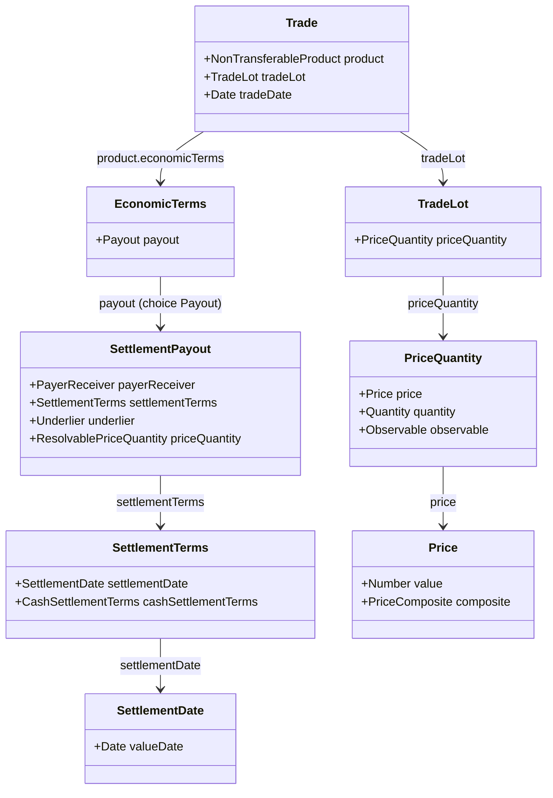

---

### 1.2 スポットとプレーンフォワードの構造比較

| 構成要素 | 為替スポット (FX Spot) | プレーン為替先渡 (FX Forward) | 補足・CDM構造 |
|---|---|---|---|
| **Payout 型** | `SettlementPayout` (1..1) | `SettlementPayout` (1..1) | 同一の型（`choice Payout` 内）を使用 |
| **ISDA 分類** | `ForeignExchange_Spot_Forward` | `ForeignExchange_Spot_Forward` | `Qualify_ForeignExchange_Spot_Forward` で共通判定（※1） |
| **受渡日 (`valueDate`)** | 約定日 $T$ から標準スポット日（例: $T+2$） | スポット日より先の特定将来期日 | `settlementTerms.settlementDate.valueDate` に設定 |
| **為替レート構造** | 単一の直物レート（Spot Rate） | 先渡レート（Outright Forward Rate）または **直物＋スワップポイント合成** | [`Price`](../../common-domain-model/rosetta-source/src/main/rosetta/observable-asset-type.rosetta) の `composite` 属性 |
| **受渡形態** | 現物受渡（`Physical`） | 現物受渡（`Physical`） | 差金決済（NDF）の場合は `cashSettlementTerms` を指定（※2） |

> **※1: ISDA タクソノミ名の統一性**:
> CDM の自動商品分類関数 [`Qualify_ForeignExchange_Spot_Forward`](../../common-domain-model/rosetta-source/src/main/rosetta/product-qualification-func.rosetta) はスポットとフォワードを区別せず共通判定するため、実サンプル（`fx-ex01`, `fx-ex03`）で出力される ISDA タクソノミ名は一律 `ForeignExchange_Spot_Forward` となります。
>
> **※2: 実サンプルにおける `settlementType` の未出力実態**:
> Rosetta DSL 型定義（[`SettlementBase`](../../common-domain-model/rosetta-source/src/main/rosetta/product-common-settlement-type.rosetta)）上は `settlementType SettlementTypeEnum (1..1)` と必須定義されていますが、FpML Ingest 変換関数（[`MapFxCashSettlementToSettlementTerms`](../../common-domain-model/rosetta-source/src/main/rosetta/ingest-fpml-confirmation-settlement-func.rosetta)）では `if fpmlFxCashSettlement exists then SettlementTypeEnum -> Cash` と実装されているため、現物受渡（Deliverable）の場合は値がセットされず、実サンプル JSON（`fx-ex01-fx-spot.json`, `fx-ex03-fx-fwd.json`）では `settlementType` キー自体が出力されません（省略されます）。

---

### 1.3 為替レートの合成表現（`Price.composite` によるフォワードポイント）

プレーンフォワードでは、為替レートを単一の数値（例: 0.9175）として保持するだけでなく、直物レート（Spot Rate）とフォワードポイント（Forward Points / スワップポイント）の計算関係を [`composite`](../../common-domain-model/rosetta-source/src/main/rosetta/observable-asset-type.rosetta) 属性により構造化して保持することが可能です。

- `baseValue`: 直物スポットレート（例: 0.9130）
- `operand`: フォワードポイント（例: 0.0045）
- `arithmeticOperator`: 演算子（`Add` または `Subtract`）
- `operandType`: `ForwardPoint`

---

### 1.4 実サンプル JSON の対比（Evidence）

#### (1) FX Spot 実例: [`fx-ex01-fx-spot.json`](../../common-domain-model/rosetta-source/src/main/resources/ingest/output/fpml-confirmation-to-trade-state/fpml-5-13-products-fx-derivatives/fx-ex01-fx-spot.json)
- `tradeDate`: `"2001-10-23"`
- `settlementTerms.settlementDate.valueDate`: `"2001-10-25"`（ちょうど2営業日後のスポット日）
- `price[0].value`: `1.48`（USD per GBP）

#### (2) FX Forward 実例: [`fx-ex03-fx-fwd.json`](../../common-domain-model/rosetta-source/src/main/resources/ingest/output/fpml-confirmation-to-trade-state/fpml-5-13-products-fx-derivatives/fx-ex03-fx-fwd.json)
- `tradeDate`: `"2001-11-19"`
- `settlementTerms.settlementDate.valueDate`: `"2001-12-21"`（約1ヶ月先のアウトライト先渡期日）
- `price[0]`:
  ```json
  {
    "@key:scoped": "price-1",
    "value": 0.9175,
    "unit": { "currency": { "@data": "USD" } },
    "perUnitOf": { "currency": { "@data": "EUR" } },
    "priceType": "ExchangeRate",
    "composite": {
      "baseValue": 0.9130,
      "operand": 0.0045,
      "arithmeticOperator": "Add",
      "operandType": "ForwardPoint"
    },
    "derivedQuantity": { "value": 9175000, "unit": { "currency": { "@data": "USD" } } }
  }
  ```

---

## 2. 直物差金決済為替先渡（NDF: Non-Deliverable Forward）の CDM モデリング

### 2.1 NDF の経済的背景と市場慣習（規制通貨と米ドル差金決済）

**直物差金決済為替先渡（NDF: Non-Deliverable Forward）** は、資本規制や外国為替管理令により自国通貨の国外持ち出し・非居住者間での現物受渡（Physical Delivery）が制限されている新興国通貨（規制通貨 / Non-Deliverable Currency / Reference Currency: 例 INR, KRW, BRL, TWD, CNY, IDR など）を対象としたデリバティブ取引です。

現物交換（2通貨の元本交換）を行わず、約定時に合意した先渡レート（Forward Rate: $K$）と、満期前の評価日（Fixing Date）に観測された公表直物レート（Fixing Spot Rate: $S$）との差額を、**国際決済通貨（Settlement Currency: 通常は米ドル USD）** で片道ネット差金決済（Net Cash Settlement）します。

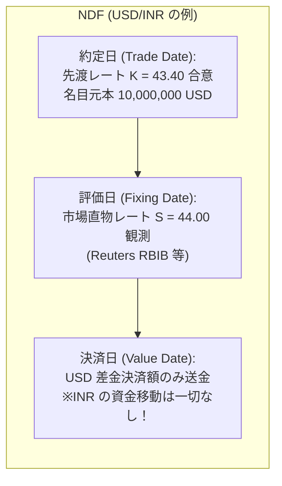

#### 差金決済額（Cash Settlement Amount）の計算式（USD 決済の場合）
ドル買い・規制通貨売りの場合、直物レート $S > K$ でクライアントの利益となり、以下の算式によって算出された米ドル金額が売り手から買い手へ送金されます：

$$\text{Cash Settlement Amount (USD)} = N_{USD} \times \frac{S - K}{S}$$

ここで $N_{USD}$ は米ドル名目元本、$K$ は約定先渡レート、$S$ は評価日の公表フィキシングレートです。

---

### 2.2 CDM における統一データ構造（`SettlementPayout` ＋ `cashSettlementTerms`）

CDM において、NDF は特別な独立した Payout 型を新設するのではなく、為替スポットやプレーンフォワードと**全く同一の基底型である [`SettlementPayout`](../../common-domain-model/rosetta-source/src/main/rosetta/product-template-type.rosetta)** を用いて統一的に表現されます。

両者を決定論的に分かつのは、[`SettlementTerms`](../../common-domain-model/rosetta-source/src/main/rosetta/product-common-settlement-type.rosetta) の内部に **[`cashSettlementTerms`](../../common-domain-model/rosetta-source/src/main/rosetta/product-common-settlement-type.rosetta)** が付与されているか否かです。

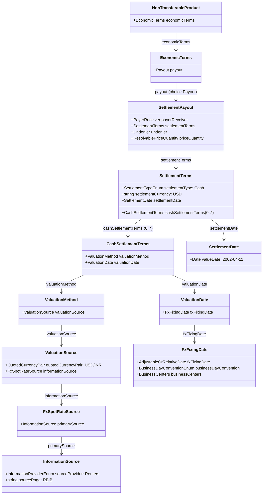

---

### 2.3 自動商品分類（Qualification）における決定的差異

[`product-qualification-func.rosetta`](../../common-domain-model/rosetta-source/src/main/rosetta/product-qualification-func.rosetta) において、現物受渡先渡（Deliverable Forward）と NDF は、**`cashSettlementTerms` の有無（absent vs exists）** という 1 つの条件制約によって明確に峻別されます。

```rosetta
// 1. プレーン為替先渡 / スポット (Deliverable) の判定
func Qualify_ForeignExchange_Spot_Forward:
    set is_product:
        Qualify_AssetClass_ForeignExchange(economicTerms) = True
            and economicTerms -> payout only-element as SettlementPayout exists
            and economicTerms -> payout as SettlementPayout -> settlementTerms -> cashSettlementTerms is absent

// 2. 直物差金決済先渡 (NDF) の判定
func Qualify_ForeignExchange_NDF:
    set is_product:
        Qualify_AssetClass_ForeignExchange(economicTerms) = True
            and economicTerms -> payout only-element as SettlementPayout exists
            and economicTerms -> payout as SettlementPayout -> settlementTerms -> cashSettlementTerms exists
```

| 構成要素 | プレーン為替先渡 (Outright Forward) | 直物差金決済先渡 (NDF) |
|---|---|---|
| **Payout 型** | `SettlementPayout` (1..1) | `SettlementPayout` (1..1) |
| **ISDA タクソノミ** | `ForeignExchange_Spot_Forward`（※1） | `ForeignExchange_NDF` |
| **決済種別 (`settlementType`)** | 通常未出力（実サンプルでは省略/null） | **`Cash`（差金決済）** |
| **決済通貨 (`settlementCurrency`)** | 2通貨双方 | **単一の決済通貨（USD 等、`string` 型）** |
| **差金決済条件 (`cashSettlementTerms`)** | **存在しない（`is absent`）** | **必須（`exists`、多重度 `0..*`）** |
| **評価日 (`valuationDate`)** | なし | **`fxFixingDate`（通常決済日の2営業日前）** |
| **為替参照レート源** | なし（約定レートで現物決済） | **中央銀行・公表レート源（Reuters, BFIX 等）** |

> **※1: タクソノミ判定関数名との整合性**:
> 先述の通り、プレーン為替先渡は [`Qualify_ForeignExchange_Spot_Forward`](../../common-domain-model/rosetta-source/src/main/rosetta/product-qualification-func.rosetta) によって認定されるため、実サンプル JSON（`fx-ex03-fx-fwd.json`）における推論値は `ForeignExchange_Spot_Forward` となります（独立した `Qualify_ForeignExchange_Forward` 関数は存在しません）。

---

### 2.4 フィキシング日（評価日）と受渡日（決済日）の日付構造

FpML では伝統的に `nonDeliverableSettlement` という為替固有の型が使われていましたが、CDM では汎用的な **[`CashSettlementTerms`](../../common-domain-model/rosetta-source/src/main/rosetta/product-common-settlement-type.rosetta)** へと完全に調和（Harmonise）されています。

1. **満期決済期日 (`settlementTerms.settlementDate.valueDate`)**:
   - 差金額が送金される最終決済日（例: `2002-04-11`）。
2. **フィキシング期日（二重ネスト構造: `cashSettlementTerms.valuationDate.fxFixingDate.fxFixingDate`）**:
   - 市場実勢直物レートを観測・確定させる評価日（例: `2002-04-09`）。
   - **Rosetta DSL 型定義の二重構造**: [`ValuationDate`](../../common-domain-model/rosetta-source/src/main/rosetta/product-common-settlement-type.rosetta) の属性 `fxFixingDate`（型: [`FxFixingDate`](../../common-domain-model/rosetta-source/src/main/rosetta/product-common-settlement-type.rosetta)）内に、さらに同名の属性 `fxFixingDate`（型: `AdjustableOrRelativeDate`）が定義されています。そのため、実サンプルの JSON パス上は `valuationDate.fxFixingDate.fxFixingDate.adjustableDate.adjustedDate` のように二重ネストとなります。
   - 固定日付として指定する（`adjustableDate`）ほか、満期決済日から一定の営業日オフセット（例: $-2$ Business Days in Mumbai & New York）として相対指定（`Offset`）することも可能です。
3. **情報源 (`valuationMethod.valuationSource`)**:
   - 参照する通貨ペア（`quotedCurrencyPair`）および公表ベンダー（`sourceProvider: "Reuters"`, `sourcePage: "RBIB"` 等）を厳密に構造化します。

---

### 2.5 NDF のライフサイクルイベント遷移と計算責務の境界

> **CDM の計算境界（一次ソース上の重要事実）**:
> 金融工学的には差金決済額 $(S - K)/S \times N_{USD}$ が算出されますが、**CDM（Rosetta DSL）内部には NDF（`SettlementPayout`）の差金決済額を自動計算する関数は存在しません**（[`CalculateReset`](../../common-domain-model/rosetta-source/src/main/rosetta/event-common-func.rosetta) は `PerformancePayout` と `InterestRatePayout` のみ対応）。
> レートの観測および差金額の計算は**外部の基幹／決済システム**が実行し、CDM はその確定結果を [`ResetInstruction`](../../common-domain-model/rosetta-source/src/main/rosetta/event-common-type.rosetta) / [`TransferInstruction`](../../common-domain-model/rosetta-source/src/main/rosetta/event-common-type.rosetta) として受け取り、決定論的に監査履歴（`resetHistory`, `transferHistory`, `closedState`）へ記録・確定するプロトコルとして機能します。

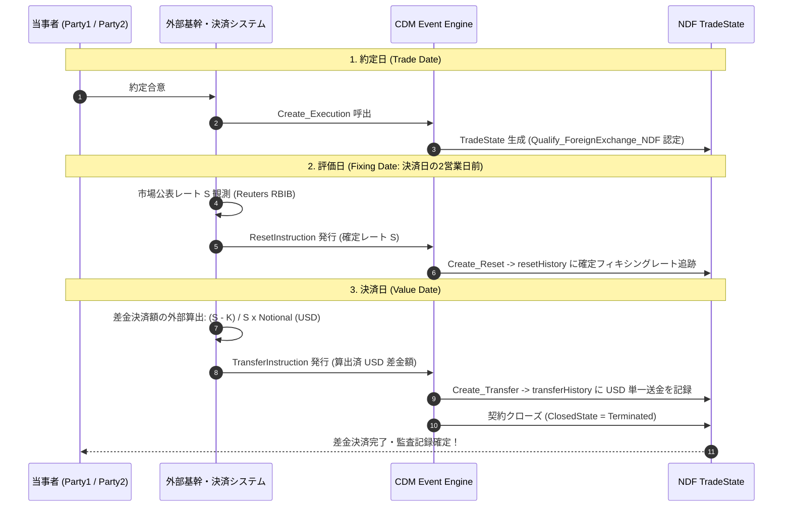

1. **約定形成（Execution）**:
   - `SettlementPayout` ＋ `cashSettlementTerms` を持つ `TradeState` が組成され、`Qualify_ForeignExchange_NDF` として認定。
2. **フィキシング観測・確定（Observation & Reset）**:
   - フィキシング日に公表レート（$S$）が外部で観測され、[`ResetInstruction`](../../common-domain-model/rosetta-source/src/main/rosetta/event-common-type.rosetta) / [`Create_Reset`](../../common-domain-model/rosetta-source/src/main/rosetta/event-common-func.rosetta) により確定レートが `TradeState.resetHistory` に記録される。
3. **資金移動（Transfer）**:
   - 外部で算出された米ドル差額に基づき、[`TransferInstruction`](../../common-domain-model/rosetta-source/src/main/rosetta/event-common-type.rosetta) / [`Create_Transfer`](../../common-domain-model/rosetta-source/src/main/rosetta/event-common-func.rosetta) によって `TradeState.transferHistory` に単一通貨の送金（`CashTransfer`）として記録される。
4. **契約終了（Termination）**:
   - 資金決済に伴い契約残高がクリアされ、[`State.closedState = Terminated`](../../common-domain-model/rosetta-source/src/main/rosetta/event-common-enum.rosetta) となり契約が完了する。

---

### 2.6 NDS（Non-Deliverable Swap）および NDO（Non-Deliverable Option）との対比

| プロダクト | CDM Payout 型 | 構成と特徴 | Qualification 判定関数 |
|---|---|---|---|
| **NDF**<br>(先渡) | `SettlementPayout` (1..1) | 単一先渡レグ、差金決済条件（`cashSettlementTerms`）を内包 | `Qualify_ForeignExchange_NDF` |
| **NDS**<br>(スワップ) | `SettlementPayout` (2..2) | スワップの 2 レグ（ニアレグ＋ファーレグ）双方が `cashSettlementTerms` を保持 | `Qualify_ForeignExchange_NDS` |
| **NDO**<br>(オプション) | `OptionPayout` (1..1) | 通貨オプションの権利行使に伴い差金決済が行われる（ヨーロピアン型） | `Qualify_ForeignExchange_NDO` |

---

## 3. 通貨オプション単体（FX Option）の CDM 表現

通貨オプションは、CDM の汎用オプション構造である [`OptionPayout`](../../common-domain-model/rosetta-source/src/main/rosetta/product-template-type.rosetta) をベースに、通貨資産（[`Cash`](../../common-domain-model/rosetta-source/src/main/rosetta/base-staticdata-asset-common-type.rosetta)）をアンダーライングとして定義されます。

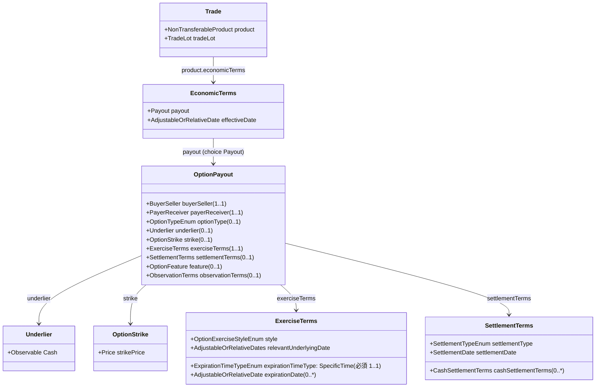

### 主要構成フィールド一覧

| フィールド | 型（多重度） | 役割とFXオプションにおける具体値 |
|---|---|---|
| `underlier` | `Underlier` -> `Observable` (`0..1`) | 対象通貨資産（[`Cash`](../../common-domain-model/rosetta-source/src/main/rosetta/base-staticdata-asset-common-type.rosetta)）。例えば USD/AUD オプションの場合、被交換通貨（AUD）。DSL 上の多重度は `0..1` ですが、ISDA アセットクラス判定（`Qualify_AssetClass_ForeignExchange`）および現物受渡派生処理で参照されます。 |
| `optionType` | `OptionTypeEnum` (`0..1`) | `Call` または `Put`（ストラドルの場合は `Straddle`）。 |
| `buyerSeller` | `BuyerSeller` (`1..1`) | オプションの買い手（Buyer）と売り手（Seller）。 |
| `payerReceiver` | `PayerReceiver` (`1..1`) | 権利行使時の資金受渡における支払側と受取側（`PayoutBase` から継承）。 |
| `strike` | `OptionStrike` (`0..1`) | 行使価格。内部の **`strikePrice`（型: `Price`）にインラインで直接構造化**（`priceType = ExchangeRate`、`value`、単位通貨と基準通貨を指定）。外部への `@ref:scoped` アドレス参照属性は持ちません。 |
| `exerciseTerms` | `ExerciseTerms` (`1..1`) | 権利行使条件。<br>- `style`: ヨーロピアン (`European`) または アメリカン (`American`)<br>- **`expirationTimeType`**: 行使時刻タイプ（**必須 `1..1`**、例: `SpecificTime`）<br>- `expirationDate`: オプション満期日・行使期限（多重度 `0..*`）<br>- `relevantUnderlyingDate`: 行使に伴う受渡日（Value Date） |
| `settlementTerms` | `SettlementTerms` (`0..1`) | 決済方法および期日。<br>- `settlementType`: 現物受渡（FpML Ingest 実サンプルでは未出力/省略）または 差金決済 (`Cash`)<br>- `settlementDate`: 受渡日（`valueDate`）<br>- `cashSettlementTerms`: NDO（Non-Deliverable Option）の場合のフィキシングソース・評価日（多重度 `0..*`） |
| `feature` | `OptionFeature` (`0..1`) | バリア（`barrier`）、平均レート型（`averagingFeature`）などのエキゾチック条項。条件制約 `AsianOptionChoice_averagingStrikeFeature` / `AsianOptionChoice_averagingFeature` により `strike.averagingStrikeFeature` とは排他関係にあります。 |
| `observationTerms` | `ObservationTerms` (`0..1`) | 価格・指標の単一または複数回の観測条件。FpML Ingest 関数 [`MapFxOptionFeaturesToObservationTerms`](../../common-domain-model/rosetta-source/src/main/rosetta/ingest-fpml-confirmation-product-fxoption-func.rosetta)（L137-157）では、FpML の `<fxOption><features><asian>` が `feature.averagingFeature` ではなくこの `observationTerms` にマッピングされます。 |

### 自動商品分類（Product Qualification）
[`product-qualification-func.rosetta`](../../common-domain-model/rosetta-source/src/main/rosetta/product-qualification-func.rosetta)（L266-287）の `Qualify_ForeignExchange_VanillaOption` では、以下の条件がすべて満たされた場合にバニラ通貨オプションとして認定されます：
1. アセットクラスが `ForeignExchange` であること
2. `payout` が単一の `OptionPayout` であること（`economicTerms -> payout only-element as OptionPayout exists`）
3. 行使スタイルが `Bermuda` ではないこと（`style <> Bermuda`、すなわち European または American）
4. エキゾチック機能がないこと、または平均レートのみであること（`optionPayout -> feature is absent or optionPayout -> feature -> averagingFeature only exists`）
   > **※注記（アジアンオプションの判定挙動）**:
   > 1. `Qualify_ForeignExchange_VanillaOption` の DSL 条件式自体が `optionPayout -> feature -> averagingFeature only exists` を許容しているため、独立した `Qualify_ForeignExchange_AsianOption` は存在せず、ISDA タクソノミ上は `ForeignExchange_VanillaOption` に包含されます。
   > 2. さらに FpML Ingest（[`MapFxOptionPayout`](../../common-domain-model/rosetta-source/src/main/rosetta/ingest-fpml-confirmation-product-fxoption-func.rosetta) L78-115）においては、FpML の `<features><asian>` は `OptionPayout.observationTerms` へマッピングされ、`OptionPayout.feature` は未設定（`is absent`）のまま出力されます。そのため、実サンプル（[`fx-ex21-avg-rate-option-parametric-plus-rate-observation.json`](../../common-domain-model/rosetta-source/src/main/resources/ingest/output/fpml-confirmation-to-trade-state/fpml-5-13-products-fx-derivatives/fx-ex21-avg-rate-option-parametric-plus-rate-observation.json) 等）では第1条件（`feature is absent`）によって `ForeignExchange_VanillaOption` と判定されます。
5. `cashSettlementTerms` が非存在（差金決済の場合はヨーロピアン型に限り `Qualify_ForeignExchange_NDO` と判定）

---

## 4. ストリップ型シンセティックフォワードと FX TARF のモデリング

### 4.1 ストリップ型シンセティックフォワードの2つの表現アプローチ

複数受渡日（$T_1, T_2, \dots, T_n$）を持つシンセティックフォワード（Strip of Synthetic Forwards）について、CDM で正統とされる **2つの表現アプローチ** を比較・解説します。

#### アプローチ 1: 単一 Trade 内の複数 Payout 構造（Single Trade, Multi-Payout）

1つの [`Trade`](../../common-domain-model/rosetta-source/src/main/rosetta/event-common-type.rosetta) 内の `EconomicTerms.payout`（多重度 `1..*`）に、各受渡期日 $T_i$ に対応する Call と Put の [`OptionPayout`](../../common-domain-model/rosetta-source/src/main/rosetta/product-template-type.rosetta) を合計 $2 \times n$ 個並べる構造です。

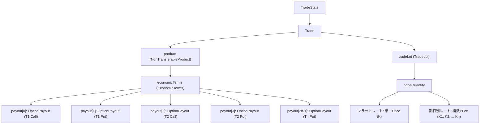

##### ストライク表現の2つのバリエーション
> **一次ソース上の重要仕様（インライン直接指定）**:
> [`OptionStrike.strikePrice`](../../common-domain-model/rosetta-source/src/main/rosetta/product-template-type.rosetta) はインラインの直接 `Price` 型であり、外部への `@ref:scoped` 参照属性を持ちません（実機サンプル `fx-ex09-euro-opt.json` 等でも行使レートは Payout 内部に直接埋め込まれ、`tradeLot.priceQuantity.price` には計算後名目額 `derivedQuantity` のみが入ります）。

1. **フラットレート型（単一行使価格 $K$）**:
   - すべての期日 $T_i$ で同一の為替レート（例: 150.00 JPY/USD）が適用される。
   - すべての `OptionPayout` の `strike.strikePrice.value` に同一の行使価格 $K$ を直接定義します。
2. **期日別レート型（マルチフォワード: スワップポイント加味 $K_i$）**:
   - 各受渡日 $T_i$ までの金利差（フォワードスプレッド）を反映し、期日ごとに異なる行使価格 $K_1, K_2, \dots, K_n$ を設定する。
   - 各期日 $T_i$ の Call/Put ペアの `strike.strikePrice.value` に対応する $K_i$ を直接定義します。
   - ※現物為替スワップ（`fx-ex08-fx-swap.json`）では `SettlementPayout.priceQuantity.priceSchedule` が `TradeLot` の `price` を `@ref:scoped` で参照する構造が取られますが、オプション（`OptionPayout`）ではストライク自体がインライン保持されるという構造的相違があります。

##### 純粋先渡（Non-synthetic Strip of Forwards）との対比
シンセティックではなく通常の先渡ストリップの場合、CDM では [`SettlementPayout`](../../common-domain-model/rosetta-source/src/main/rosetta/product-template-type.rosetta) を期日分（$n$ 個）並べる構造となります（FX Swap の `nearLeg` / `farLeg` 構造の多期間拡張）。

---

#### アプローチ 2: マルチ Trade パッケージ構造（`IdentifiedList` / Multi-Trade）

各受渡期日 $T_i$ の Call / Put（または期日ごとの合成先渡ペア）をそれぞれ独立した [`TradeState`](../../common-domain-model/rosetta-source/src/main/rosetta/event-common-type.rosetta) として生成し、[`executionDetails.packageReference`](../../common-domain-model/rosetta-source/src/main/rosetta/event-common-type.rosetta)（型: [`IdentifiedList`](../../common-domain-model/rosetta-source/src/main/rosetta/base-staticdata-identifier-type.rosetta)）およびイベントレベルの [`packageInformation`](../../common-domain-model/rosetta-source/src/main/rosetta/event-common-type.rosetta)（`EventInstruction` から `BusinessEvent` に継承される属性、型: `IdentifiedList`）で共通のパッケージ識別子を付与して束ねる構造です。

> **Rosetta DSL における正規仕様注釈 (`base-staticdata-identifier-type.rosetta` L28)**:
> *"Attaches an identifier to a collection of objects, when those objects themselves can each be represented by an identifier. One use case is the representation of package transactions, where each component is a separate trade with its own identifier, and those trades are linked together as a package with its own identifier. **The data type has been named generically rather than referring to 'packages' as it may have a number of other uses.**"*
> （※CDM には `TradePackage` という型は存在せず、汎用型 `IdentifiedList` を用いてパッケージ化を表現します。）

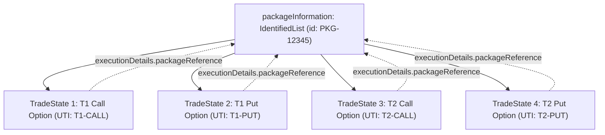

#### 2つのアプローチの比較評価と一次ソースの制約

| 評価軸                                   | アプローチ 1: 単一 Trade（Multi-Payout）                                                               | アプローチ 2: マルチ Trade（`IdentifiedList`）                   |
| ------------------------------------- | --------------------------------------------------------------------------------------------- | ------------------------------------------------------ |
| **契約のアトミック性**                         | 高（1つの TradeState で全期日・全レグを包括）                                                                 | 低（各レグが独立した TradeState）                                 |
| **ISDA 商品判定 (Qualification)**         | **脱落（ISDA タクソノミが付与されない）**<br>`Qualify_ForeignExchange_VanillaOption` は `only-element` を要求するため | **完全対応**<br>各 TradeState が単一 Payout であるため個別にバニラオプション認定 |
| **CDM ライフサイクル関数 (`Create_Exercise`)** | **実行不可（破綻）**<br>一次ソース `Create_Exercise`（L533）で `tradeLot only-element` がハードコードされているため         | **正常実行可能**<br>各期日・各レグの TradeState に対し独立して権利行使関数を適用可能   |
| **規制報告（EMIR / CFTC）**                 | 複合取引としての単一 UTI 付番またはカスタム報告                                                                    | 各レグ個別に店頭オプションとしての UTI 付番・報告が容易                         |
| **清算機関（CCP）登録**                       | 単一プロダクトとして取り扱いにくい場合がある                                                                        | オプションレグ単位でそのまま登録可能                                     |

> [!IMPORTANT]
> **CDM 実装における結論**:
> 単一 Trade 複数 Payout 構造（アプローチ 1）は、静的なデータ構造としては定義可能ですが、CDM の自動商品分類（Qualification）から脱落し、かつ標準の権利行使関数（`Create_Exercise`）で `tradeLot only-element` 制約によりライフサイクル処理が破綻します。
> したがって、CDM において期日ごとの権利行使や消滅を自律処理・監査追跡する実務設計としては、**アプローチ 2（独立した TradeState 群を `IdentifiedList` でパッケージ化）が事実上唯一の整合解**となります。
> なお、一次ソースリポジトリにはオプション複合戦略（FpML `<strategy>`）の完全なサンプル JSON は存在せず（変換未実装のため `incomplete-products` に隔離）、実在する複数レグサンプルは `SettlementPayout` による現物為替スワップ（`fx-ex08-fx-swap.json` 等）のみです。

##### 4.1.1 アプローチ2におけるパッケージ構成データルール（`PackageTrade` 等）

アプローチ 2 に基づき、複数期間（例: $T_1, T_2$ の計 4 レグのバニラオプション）のストリップ型シンセティックフォワードを [`WorkflowStep`](../../common-domain-model/rosetta-source/src/main/rosetta/event-workflow-type.rosetta)（および [`BusinessEvent`](../../common-domain-model/rosetta-source/src/main/rosetta/event-common-type.rosetta)）として構成する際、一次ソースの Rosetta DSL 上で以下のデータルールおよび構造仕様が適用されます：

- **パッケージ識別子の二層定義**:
  - **イベント階層**: `WorkflowStep.businessEvent.packageInformation`（[`event-common-type.rosetta` L21](../../common-domain-model/rosetta-source/src/main/rosetta/event-common-type.rosetta)）に [`IdentifiedList`](../../common-domain-model/rosetta-source/src/main/rosetta/base-staticdata-identifier-type.rosetta)（`listId`: パッケージ全体の識別子、`componentId (2..*)`: 構成する全レグの取引識別子リスト）を定義します。
  - **トレード階層**: 各 `TradeState.trade.executionDetails.packageReference`（[`event-common-type.rosetta` L497](../../common-domain-model/rosetta-source/src/main/rosetta/event-common-type.rosetta)）に同一の `IdentifiedList` を設定します。
- **`PackageTrade` データルール（[`event-common-type.rosetta` L316-318](../../common-domain-model/rosetta-source/src/main/rosetta/event-common-type.rosetta)）**:
  ```rosetta
  condition PackageTrade:
      if executionDetails -> packageReference exists
      then executionDetails -> packageReference -> componentId -> assignedIdentifier contains tradeIdentifier -> assignedIdentifier
  ```
  `Trade` 型の条件制約 `PackageTrade`（Java 生成バリデータ名 `TradePackageTrade`）により、`executionDetails.packageReference.componentId` の `assignedIdentifier` リスト内に、当該 `Trade` 自身の `tradeIdentifier.assignedIdentifier` が必ず含まれていなければなりません。
- **その他必須条件の充足**:
  - [`ExecutionDetails`](../../common-domain-model/rosetta-source/src/main/rosetta/event-common-type.rosetta)（L492-502）では `executionType ExecutionTypeEnum (1..1)` が必須であり、`Electronic` の場合は `ExecutionVenue` ルールにより `executionVenue` が必須となるため、店頭相対取引では `OffFacility` を指定します。
  - 各 `TradeState` は単一の `OptionPayout` を持つため、個別に [`Qualify_ForeignExchange_VanillaOption`](../../common-domain-model/rosetta-source/src/main/rosetta/product-qualification-func.rosetta) の認定条件を満たします。

---

### 4.2 FX TARF (Target Accrual Redemption Forward) の構造とモデリング

#### 4.2.1 TARF の金融工学的構造（レバレッジド・フォワードと累積利益上限）

**FX TARF（Target Accrual Redemption Forward: 目標累積型為替先渡）** は、企業が通常の実勢フォワードレートよりも有利な「ボーナス行使レート」で為替ヘッジを行える一方、不利局面での引き取り義務が倍増（レバレッジ）し、かつ**累積利益が一定の目標値（Target Cap）に達した瞬間に将来の全取引が消滅（Redemption / Knock-out）**する代表的な仕組為替デリバティブです。

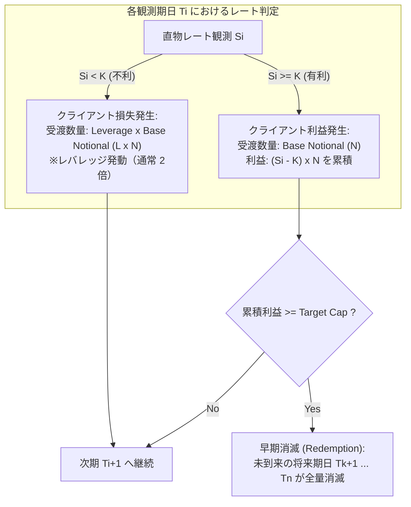

#### TARF の主要パラメータ
1. **行使価格（Strike / Target Rate: $K$）**: 実勢フォワードレートよりも有利なレート（例: ドル売り円買いで実勢 150 円に対し 155 円）。
2. **レバレッジ比率（Leverage Ratio: $L$）**: 不利局面（$S_i < K$）において強制引き取りとなる数量倍率（通常 2.0 倍）。
3. **目標累積利益（Target Cap / Target Profit: $TP$）**: 契約が早期終了する累積利益の閾値（例: 累計 3.00 円、または 100,000 USD）。
4. **超過利益処理（Target Gain Treatment）**:
   - **Full Accrual**: 目標に到達した期も、定められた全額の利益を受け取る。
   - **Exact / Partial Accrual**: 目標上限 $TP$ を超えないよう、最後の期の受渡数量を按分縮小（Cap 調整）する。
   - **Zero**: 累積利益が Target Cap を超える期は、その期の利益がゼロになる。

---

#### 4.2.2 CDM におけるデータ構造設計と一次ソースの限界

> [!CAUTION]
> **一次ソースにおける TARF サポートの実態**:
> - **キーワードの完全皆無**: CDM 一次ソース（Rosetta DSL コードベースおよびサンプル JSON）において、`tarf` や `TargetAccrual` といった文字列・型定義は **0 件（完全未定義）** です。
> - **専用 Qualification の非存在**: バニラや NDF と異なり、TARF を自動認定する関数（例: `Qualify_ForeignExchange_TARF`）は CDM に存在しません。
> - **型定義の誤用**:
>   - 「[`EconomicTerms.terminationProvision.earlyTerminationProvision`](../../common-domain-model/rosetta-source/src/main/rosetta/product-template-type.rosetta) の `mandatoryEarlyTermination` や各レグの `feature.barrier.knockOut` で消滅条件を定義できる」とされることがありますが、これは**明らかな既存型の過剰解釈・誤用**です。
>   - [`MandatoryEarlyTermination`](../../common-domain-model/rosetta-source/src/main/rosetta/product-template-type.rosetta) は金利スワップ等であらかじめ合意された期日（`mandatoryEarlyTerminationDate`）に公正価値（Fair Value）で解約する規定（ISDA ird-44）であり、**累積利益（Target Cap）の監視や超過利益の按分処理（Full / Exact Accrual）を表現する属性は一切持ちません**。
>   - [`Barrier.knockOut`](../../common-domain-model/rosetta-source/src/main/rosetta/product-template-type.rosetta) も単一の為替レート水準（`Trigger.level`）を評価するものであり、期を跨いだ「累積利益（Accrued Profit）」という集計値を評価するデータ構造は存在しません。

##### 現実的な CDM モデリング（非対称ストリップ構造 ＋ 外部ライフサイクル駆動）
一次ソースの制約を踏まえると、CDM において TARF を表現する正統なアプローチは、**「非対称な数量比を持つ期日別オプションのストリップ」としてプロダクトを組成し、非標準的な累積消滅条項は外部管理する** という設計になります。

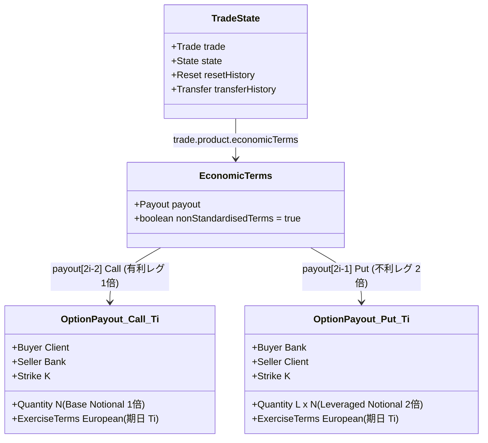

1. **レバレッジの表現（非対称 TradeLot / PriceQuantity）**:
   - 各期日 $T_i$ に対し、クライアント買 Call（数量 $N$）と、クライアント売 Put（数量 $L \times N$）の2つの [`OptionPayout`](../../common-domain-model/rosetta-source/src/main/rosetta/product-template-type.rosetta) をペアで定義します。
   - `TradeLot.priceQuantity` において、Call レグの `quantity` を $N$、Put レグの `quantity` を $L \times N$（例: 2倍）に割り当てます。
2. **累積消滅（Redemption）条件の取り扱い**:
   - CDM スキーマ単体では累積利益上限（Target Cap）を構造化して保持できないため、[`EconomicTerms.nonStandardisedTerms`](../../common-domain-model/rosetta-source/src/main/rosetta/product-template-type.rosetta) を `true` に設定して非標準契約条項が存在することを示し、マスター契約や取引確認書の電子文書に委ねます。
   - したがって、契約期間中の消滅発火（Redemption）は、**完全に外部のリスク管理エンジンが累積計算・判定を行い、イベント発生時に CDM のイベントプリミティブを駆動する** 運用となります。

---

#### 4.2.3 ライフサイクル管理と早期消滅（Redemption）のイベントメカニズム

> **CDM の設計思想と自律計算の境界**:
> CDM は「金融商品の契約データモデル」および「状態遷移の監査ログモデル」を定義するプロトコルであり、**「期をまたいで累積利益を自律計算し、Target Cap と比較して自動発火するビルトイン計算エンジン」は CDM（Rosetta DSL）内部には含まれません**。
> 累積損益の計算や Target 到達の判定は外部の基幹システム（ポジション／リスク管理エンジン）が実行し、その結果として発生した状態遷移を **CDM の標準イベントプリミティブとして決定論的に記録・確定** します。

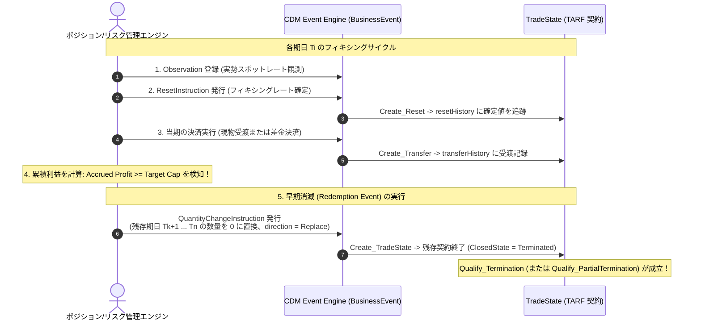

#### Redemption（早期消滅）時の CDM 状態遷移詳細
- **イベントプリミティブ**: [`QuantityChangeInstruction`](../../common-domain-model/rosetta-source/src/main/rosetta/event-common-type.rosetta)
  - `change = QuantityChangeDirectionEnum -> Replace`
  - 対象期日（$T_{k+1} \dots T_n$）の数量を 0 に設定。
- **契約状態（State）の遷移**:
  - 対象レグまたは TradeState 全体の [`State.closedState`](../../common-domain-model/rosetta-source/src/main/rosetta/event-common-type.rosetta) に [`ClosedStateEnum -> Terminated`](../../common-domain-model/rosetta-source/src/main/rosetta/event-common-enum.rosetta) を記録。
- **イベント認定（Qualification）**:
  - 単一 TradeState 全体が終了した場合は `Qualify_Termination`、期日ごとの TradePackage 構造で残存 TradeState を個別に終了させた場合は各 TradeState で `Qualify_Termination` が成立。

---

#### 4.2.4 ターゲット到達時の最終期数量調整（Exact Accrual）の CDM 表現

Exact Accrual（按分調整）ルールが適用される場合、ターゲットに達した最後の期において、累積利益がちょうど Target Cap に一致するよう**当期の受渡数量を縮小（Downsize）**する必要があります。

CDM ではこの調整を、決済前の [`QuantityChangeInstruction`](../../common-domain-model/rosetta-source/src/main/rosetta/event-common-type.rosetta) により当期レグの数量を縮小（例: $1,000,000 \to 450,000$）させた上で、調整後の数量に基づき当期の受渡（`Transfer`）を実行し、同時に残余将来期日を全量消滅（`Terminated`）させる複合イベントとして厳密にモデル化できます。

---

## 5. デジタル系通貨オプション（Digital / Binary Options）の CDM モデリングと表現限界

### 5.1 デジタルオプションの類型とバニラオプションとのペイオフ差異

**デジタルオプション（Digital Option / Binary Option）** は、判定条件（トリガー／タッチ条件）が満たされた場合に、バニラオプションのような原資産価格と行使価格の差額（本源的価値: $\max(S_T - K, 0) \times N$）や2通貨の双方向元本交換ではなく、**あらかじめ定められた固定金額（または原資産通貨そのものの片道受渡）** を行う不連続ペイオフ型のエキゾチックオプションです。為替市場（FX）においては、以下のバリエーションが標準的に取引されます。

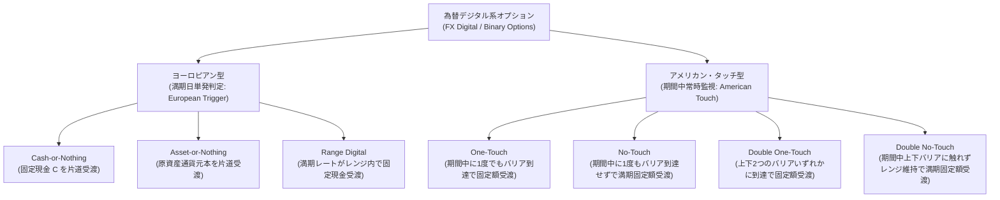

| オプション種別 | 判定条件（Condition） | ペイオフ（受渡内容） | 支払タイミング |
|---|---|---|---|
| **プレーンバニラ（比較基準）** | 満期日（または期間中）に $S_T > K$（Call）または $S_T < K$（Put） | **現物**: 通貨ペア双方向の元本交換（$N$ と $K \times N$）<br>**差金 (NDO)**: 本源的価値 $\max(S_T - K, 0) \times N$ | 満期決済日（または行使から $T+2$） |
| **European Cash-or-Nothing** | 満期日のフィキシングレート $S_T \ge B$（または $\le B$） | **あらかじめ合意した固定金額 $C$（単一通貨の片道現金支払）** | 満期決済日 |
| **European Asset-or-Nothing** | 満期日のフィキシングレート $S_T \ge B$（または $\le B$） | **原資産通貨そのものの額面 $N$（対価通貨の支払なし）** | 満期受渡日 |
| **European Range Digital** | 満期日のレートがレンジ内（$B_L \le S_T \le B_U$） | 固定金額 $C$ | 満期決済日 |
| **American One-Touch** | 観測期間中に一度でもバリア $B$ に到達（$S_t \ge B$ または $\le B$） | 固定金額 $C$ | タッチ即時（Immediate / $T+2$）または満期決済日 |
| **American No-Touch** | 観測期間中、一度もバリア $B$ に到達しない | 固定金額 $C$ | 満期決済日 |
| **Double One-Touch (DOT)** | 上限バリア $B_U$ または下限バリア $B_L$ のいずれかに到達 | 固定金額 $C$ | タッチ即時または満期決済日 |
| **Double No-Touch (DNT)** | 期間中、為替レートが常にレンジ内（$B_L < S_t < B_U$）に留まる | 固定金額 $C$ | 満期決済日 |

---

### 5.2 CDM 一次ソースにおけるサポート実態：バニラとデジタルを区別する標準手段の不在

> [!CAUTION]
> **一次ソースにおけるデジタル系オプション表現の結論**:
> **現行の FINOS CDM（[`OptionPayout`](../../common-domain-model/rosetta-source/src/main/rosetta/product-template-type.rosetta) および関連スキーマ）には、バニラオプションの「行使価格と実勢レートの差額に基づくペイアウト（Intrinsic Value Payout）」と、デジタル／バイナリ・オプションの「トリガー条件成立による固定額／単一通貨ペイアウト（Digital / Binary Payout）」をデータモデル上で明確に区別して表現する専用の型・列挙値・属性は存在しません。**

一次ソース（Rosetta DSL 型定義・列挙型・FpML Ingest 関数・Qualification 関数）を精査すると、以下の 4 つの観点から「デジタル系ペイアウトをバニラと区別する標準機構が未整備である」ことが裏付けられます。

#### 1. `Payout` および `OptionPayout` スキーマにおけるデジタル専用属性の不在
- **専用 Payout 型の不在**:
  [`product-template-type.rosetta`](../../common-domain-model/rosetta-source/src/main/rosetta/product-template-type.rosetta)（L53-65）の `choice Payout` に定義されているオプション系型は [`OptionPayout`](../../common-domain-model/rosetta-source/src/main/rosetta/product-template-type.rosetta)（L126-194）のみであり、`DigitalOptionPayout` のような独立した型は存在しません。
- **`OptionTypeEnum` の定義範囲**:
  `OptionPayout.optionType` の型である [`OptionTypeEnum`](../../common-domain-model/rosetta-source/src/main/rosetta/product-template-enum.rosetta)（L253-271）は、`PutCallEnum`（`Put`, `Call`）を継承して `Payer`, `Receiver`, `Straddle` を追加した計 5 値のみで構成されており、`Digital`、`Binary`、`CashOrNothing`、`AssetOrNothing`、`OneTouch`、`NoTouch` といった列挙値は一切存在しません。
- **`OptionFeature` の定義範囲**:
  [`OptionFeature`](../../common-domain-model/rosetta-source/src/main/rosetta/product-template-type.rosetta)（L661-666）が保持する属性は `fxFeature`（コンポジット／クANTO）、`strategyFeature`（スプレッド／カレンダー）、`averagingFeature`（アジアン平均）、`barrier`（ノックイン／ノックアウト）、`passThrough` の 5 つのみであり、「満期またはタッチ時に固定金額を支払う（Digital Payout）」ことを指定する属性は存在しません。

#### 2. `SettlementTypeEnum -> Cash` および `CashSettlementTerms` の定義との乖離
- **差金決済（`Cash`）の公式定義**:
  [`SettlementTypeEnum`](../../common-domain-model/rosetta-source/src/main/rosetta/product-common-settlement-enum.rosetta)（L39-44）において、`Cash` は以下の通り定義されています：
  > *"The intrinsic value of the option will be delivered by way of a cash settlement amount determined, (i) by reference to the differential between the strike price and the settlement price..."*
  
  すなわち、CDM のオプションにおける `settlementType = Cash` は「ストライク価格と決済価格の差額に基づく本源的価値（$\max(S_T - K, 0)$）の差金決済（NDO 等）」を意味しており、デジタルオプションの固定額支払（Cash-or-Nothing）を意味しません。
- **`CashSettlementTerms.cashSettlementAmount` の公式 Ingest 未マッピング**:
  [`CashSettlementTerms`](../../common-domain-model/rosetta-source/src/main/rosetta/product-common-settlement-type.rosetta)（L77-130）内の `cashSettlementAmount`（L115）は *"The amount paid by the seller to the buyer for cash settlement on the cash settlement date. If not otherwise specified, would typically be calculated as..."*（指定されなければ通常は計算式で算出される差金決済額）と定義され、回収率 `recoveryFactor` との排他選択制約（`optional choice cashSettlementAmount, recoveryFactor`）を持ちます。しかし、現行の FpML Ingest 変換関数では `<fxDigitalOption><payout>` をこの `cashSettlementAmount` へマッピングする実装は未整備（空）となっています（※ [product-model.md](../../common-domain-model/docs/product-model.md) の第一原理に基づき、この `cashSettlementAmount` をデジタルオプションの確定決済額として活用する構成については **§5.5** で詳述します）。

#### 3. FpML `<fxDigitalOption>` Ingest 変換関数の未完（スケルトン）実態と必須制約違反
- FpML 5.13 には為替デジタルオプション専用の `<fxDigitalOption>` スキーマが存在し、ヨーロピアン判定用の `<trigger>`、アメリカン・タッチ判定用の `<touch>`、および固定受取額を表す `<payout>`（`currency`, `amount`, `payoutStyle`）が明確に定義されています。
- しかし、CDM 側の Ingest 変換関数 [`MapFxDigitalOptionPayout`](../../common-domain-model/rosetta-source/src/main/rosetta/ingest-fpml-confirmation-product-fxdigitaloption-func.rosetta)（L72-108）は開発途上の初期スケルトン実装にとどまっており、以下の状態となっています：
  ```rosetta
  func MapFxDigitalOptionPayout:
      inputs:
          fpmlFxDigitalOption fpml.FxDigitalOption (0..1)
      output:
          optionPayout OptionPayout (0..1)

      set optionPayout:
          OptionPayout {
              payerReceiver: MapSellerAsPayerAndBuyerAsReceiver(fpmlFxDigitalOption -> buyerSellerModel),
              settlementTerms: MapFxDigitalOptionToSettlementTerms(fpmlFxDigitalOption),
              buyerSeller: MapBuyerSeller(fpmlFxDigitalOption -> buyerSellerModel),
              underlier: empty,
              exerciseTerms: MapExerciseTerms(...),
              ...
          }
  ```
  - **デジタル固有要素の完全欠落**: FpML の `<trigger>`、`<touch>`、`<payout>` を読み取るロジックが一切書かれておらず、`strike` も `feature` も未設定のまま捨てられます。
  - **必須属性・データルール違反の発生**: `underlier: empty` とハードコードされ、`optionType` もマッピングされず、さらに [`MapPriceQuantityList`](../../common-domain-model/rosetta-source/src/main/rosetta/ingest-fpml-confirmation-tradestate-func.rosetta)（L416-450）に `fpml.FxDigitalOption` の分岐が存在しないため `trade.tradeLot` 自体が欠落します。
  - このため、一次ソースのデジタルオプション出力サンプル（[`fx-ex14-euro-digital-option.json`](../../common-domain-model/rosetta-source/src/main/resources/ingest/output/fpml-confirmation-to-trade-state/fpml-5-13-incomplete-products-fx-derivatives/fx-ex14-euro-digital-option.json) 〜 [`fx-ex19-double-no-touch-option.json`](../../common-domain-model/rosetta-source/src/main/resources/ingest/output/fpml-confirmation-to-trade-state/fpml-5-13-incomplete-products-fx-derivatives/fx-ex19-double-no-touch-option.json)）はすべて `incomplete-products`（不完全プロダクト）フォルダに隔離されており、CDM 自身の必須バリデーションルール（`OptionPayout.underlier (1..1)`、`condition OptionTypePresent`、`EconomicTerms` の `condition Quantity`、`SettlementBase.settlementType (1..1)`）に違反する不完全データとなっています（詳細は §8.8 参照）。

#### 4. 商品適格性判定（Product Qualification）関数の不在
- [`product-qualification-func.rosetta`](../../common-domain-model/rosetta-source/src/main/rosetta/product-qualification-func.rosetta) には、バニラオプション認定用の `Qualify_ForeignExchange_VanillaOption`（L675-685）や NDO 認定用の `Qualify_ForeignExchange_NDO`（L640-650）は定義されていますが、**デジタル／バイナリ／タッチオプションを認定する Qualification 関数は一切存在しません**。

---

### 5.3 既存型（`OptionPayout` ＋ `Barrier` ＋ `FeaturePayment`）を流用する対応案の検証と構造的限界

CDM 標準スキーマの範囲内でデジタル系オプションを表現する代替案として、「`OptionPayout.strike` を省略（`empty`）した上で、`OptionPayout.feature.barrier`（[`Barrier`](../../common-domain-model/rosetta-source/src/main/rosetta/product-template-type.rosetta)）の [`TriggerEvent`](../../common-domain-model/rosetta-source/src/main/rosetta/observable-event-type.rosetta) に判定レート（[`Trigger.level`](../../common-domain-model/rosetta-source/src/main/rosetta/observable-event-type.rosetta)）を設定し、固定受取額を [`FeaturePayment.amount`](../../common-domain-model/rosetta-source/src/main/rosetta/observable-event-type.rosetta) に格納する」という対応案が検討されることがあります。

しかし、一次ソースの型定義とデータルール（`condition`）に照らして厳密に検証すると、この流用案には**以下の重大な意味的矛盾およびバリデーション上の破綻**が存在し、CDM の正規表現として位置づけることはできません。

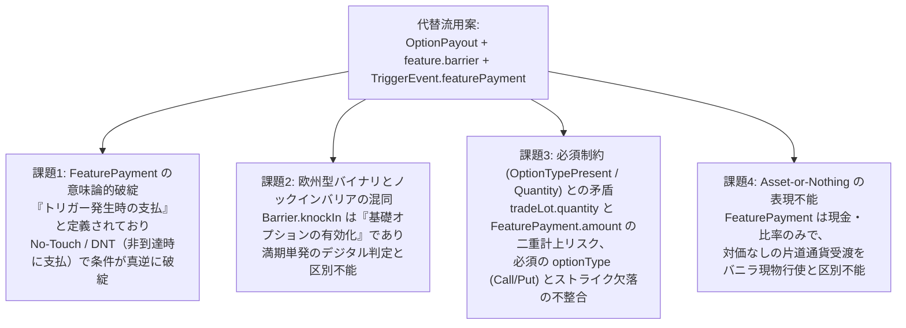

#### 1. `Barrier` / `FeaturePayment` の本来の意味と No-Touch（ノータッチ）での論理破綻
- **一次ソースにおける本来の定義**:
  - [`Barrier`](../../common-domain-model/rosetta-source/src/main/rosetta/product-template-type.rosetta)（L820-828）は *"As per ISDA 2002 Definitions."* と注記されており、`knockIn` は「所定トリガー到達時に基礎オプションが有効化（active）される条件」、`knockOut` は「所定トリガー到達時に基礎オプションが消滅する条件」です。
  - [`FeaturePayment`](../../common-domain-model/rosetta-source/src/main/rosetta/observable-event-type.rosetta)（L84-99）の公式定義は ***"Payment made following trigger occurrence."***（**トリガー事象の発生に伴って行われる支払**＝主にバリア・オプションがノックアウトされた際のリベート支払等）です。なお、CDM 一次ソース全体（全 `*-func.rosetta` および全サンプル JSON）において、FX プロダクトで `FeaturePayment` を使用している箇所は **0 件** です。
- **No-Touch / Double No-Touch における致命的矛盾**:
  - ワンタッチ（One-Touch）であれば「バリア到達（トリガー発生）に伴って固定額が支払われる」ため、`knockIn` + `FeaturePayment` で現象面を近似できたとしても、**ノータッチ（No-Touch / Double No-Touch）は「期間中に一度もトリガーが発生しなかった場合にのみ、満期に固定額が支払われる」商品**です。
  - これを `Barrier.knockOut` + `FeaturePayment` に格納すると、CDM の定義上は「バリアにタッチしてノックアウト（トリガー発生）した時に支払われるリベート」という意味になり、**支払条件が経済的実態と完全に逆転（破綻）**します。

#### 2. ヨーロピアン・デジタル（満期単発判定）とバリア（期間監視によるオプション有効化）の概念混同
- ヨーロピアン・デジタル（例: `fx-ex14-euro-digital-option`）は、満期日（Expiration Date）の単一時点において為替レートがトリガー水準以上（または以下）であれば固定額を支払う契約であり、期間中のノックイン／ノックアウト条項ではありません。
- これを `OptionPayout.feature.barrier.knockIn` で表現すると、「バリア突破によって基礎となるオプションが有効化されるノックイン・オプション」と構文上区別がつかなくなります。

#### 3. `OptionPayout` および `EconomicTerms` の必須制約（`condition`）との矛盾と二重計上リスク
CDM の標準バリデーションを通過する有効な `TradeState` / `OptionPayout` を構築するには、以下の必須制約を満たす必要があります：
1. **`OptionPayout.underlier (1..1)`**: アンダーライング（通貨 `Cash` 等）の設定が必須。
2. **`condition OptionTypePresent` ([`product-template-type.rosetta`](../../common-domain-model/rosetta-source/src/main/rosetta/product-template-type.rosetta) L184-187)**:
   ```rosetta
   condition OptionTypePresent:
       if underlier -> Observable exists or underlier -> Product -> TransferableProduct exists
       then optionType exists
   ```
   アンダーライングが `Observable`（通貨 `Cash` 等）である場合、デジタルオプションであっても必ず `optionType`（`Call` または `Put` 等）を設定しなければバリデーションエラーとなります。
3. **`EconomicTerms` の `condition Quantity` ([`product-template-type.rosetta`](../../common-domain-model/rosetta-source/src/main/rosetta/product-template-type.rosetta) L46-49)**:
   ```rosetta
   condition Quantity:
       if payout -> OptionPayout exists ...
       then priceQuantity -> quantitySchedule exists
   ```
   `OptionPayout` が存在する場合、必ず `priceQuantity.quantitySchedule`（すなわち `Trade.tradeLot.priceQuantity.quantity`）に数量を設定しなければなりません。

この必須制約により、以下のジレンマが発生します：
- **数量の二重計上（Double Counting）**: 必須制約を満たすために `tradeLot.priceQuantity.quantity` に固定ペイアウト額（例: 750,000 GBP）を設定し、同時に `feature.barrier.knockIn.featurePayment.amount` にも `750,000 GBP` を設定すると、「基礎となる Call/Put オプションの名目元本」と「バリアの `FeaturePayment`（リベート／一時金）」の双方がデータ上に存在し、外部の評価・決済エンジンが二重計上するリスクが生じます。
- **ストライク未設定の解釈曖昧性**: `OptionPayout.strike` は多重度 `(0..1)` のため省略自体は可能ですが、`underlier`（通貨）、`optionType`（`Call`/`Put`）、`tradeLot.quantity`（750,000 GBP）が揃った状態で `strike` だけが空の `OptionPayout` は、システム側から見ると「ストライク価格が未入力（またはゼロ）のバニラオプション」と区別できません。

#### 4. Asset-or-Nothing（原資産通貨の片道受渡）の表現不能性
- European Asset-or-Nothing は「満期に条件を満たせば、対価通貨の支払なしに基準通貨の元本 $N$ のみを引き渡す」契約です。
- しかし、`FeaturePayment` は現金支払額（`amount` / `currency`）または比率（`levelPercentage`）しか保持できず、また `OptionPayout` を現物行使（`Create_Exercise`）して `SettlementPayout` を派生生成しても、バニラオプションの現物受渡（2通貨の双方向交換）と「対価通貨ゼロの片道受渡」をスキーマ上で区別する手段が存在しません。

---

### 5.4 実務システムにおける推奨アプローチ（非標準条項フラグ vs Rune DSL 拡張）

以上の一次ソース分析から、実務において FINOS CDM で為替デジタル系オプションを取り扱う場合は、既存の `Barrier` + `FeaturePayment` を無理に「正規表現」として流用するのではなく、システムの要件に応じて以下の **2つのアプローチのいずれか** を採用することが推奨されます。

| アプローチ | 設計方針 | メリット | デメリット・制約 | 適したユースケース |
|---|---|---|---|---|
| **アプローチ 1:<br>標準スキーマ維持 ＋ `nonStandardisedTerms = True` による外部管理** | 標準 CDM 型を変更せず、`OptionPayout` の必須属性（`underlier`, `optionType`, `tradeLot`）を満たした上で、**`economicTerms.nonStandardisedTerms = True`** と **`product.taxonomy`**（`EuroBinary`, `OneTouch`, `NoTouch` 等）によりデジタル商品であることを明示し、ペイオフ判定は外部エンジンで行う。 | ・CDM 標準の Java / Python ライブラリを無改造で利用可能<br>・モデルバリデーションエラー（5件の必須違反）を回避可能<br>・権利行使・決済後のイベント（`BusinessEvent`）は標準プリミティブでそのまま記録可能 | ・標準スキーマ単体では「バニラ」と「デジタル」のペイオフ式の違いやタッチ条件の詳細を機械可読に保持できない（社内規約または外部タームシート参照が必要） | 取引ライフサイクル管理（約定・プレミアム決済・行使／消滅・資金決済の監査記録）を標準 CDM で統一したい場合（§4.2.2 の TARF と同様の割り切り） |
| **アプローチ 2:<br>Rune DSL（旧 Rosetta DSL）による独自スキーマ拡張** | [Rune DSLを用いたCDMモデルの独自拡張ワークフロー](extending_cdm_with_rune_dsl.md) に従い、独自名前空間（例: `com.example.cdm.fx`）で `OptionPayout` または `OptionFeature` を拡張し、デジタル専用属性（`DigitalPayoutFeature`）を追加定義する。 | ・Cash-or-Nothing / Asset-or-Nothing / One-Touch / No-Touch の条件と固定ペイアウト額を型安全かつ誤解なく表現可能<br>・プライシングエンジンへの直接入力モデルとして利用可能 | ・独自拡張した `.rosetta` ファイルのビルドとパッケージ配布管理が必要 | プライシングエンジン連携や契約条件の完全な機械可読化（STP）を CDM オブジェクト単体で完結させたい場合 |

#### アプローチ 2（Rune DSL 独自拡張）におけるスキーマ設計イメージ
バニラとデジタルのペイアウトを厳密に区別する必要がある場合、無理に `Barrier.featurePayment` を転用するのではなく、[Rune DSLを用いたCDMモデルの独自拡張ワークフロー](extending_cdm_with_rune_dsl.md) の手順に従って以下のような拡張型を定義するのが CDM の設計思想（型安全性・単一表現の原則）に最も忠実です：

```rosetta
// 独自名前空間におけるデジタルオプション拡張概念例
enum DigitalPayoutStyleEnum:
    CashOrNothing      <"条件成立時に固定金額（現金）を支払う">
    AssetOrNothing     <"条件成立時に原資産（基準通貨元本）を引き渡す">

enum TouchConditionEnum:
    AtExpiry           <"満期日単発判定（European Binary / Range Digital）">
    OneTouch           <"期間中に一度でもトリガー水準に到達すれば成立">
    NoTouch            <"期間中に一度もトリガー水準に到達しなければ満期成立">

type DigitalOptionFeature:
    payoutStyle DigitalPayoutStyleEnum (1..1)
    touchCondition TouchConditionEnum (1..1)
    trigger Trigger (1..2)              <"単一トリガーまたはレンジ上下限（Double Touch / Range）">
    fixedPayout Money (0..1)            <"CashOrNothing 時の固定支払額・通貨">
    settlementTiming TimeTypeEnum (0..1) <"タッチ即時決済（Immediate）か満期決済（Close/Expiry）か">
```

---

### 5.5 第一原理からの再構成：「行使条件」と「決済額」の分離による標準スキーマ表現（確定差金決済額アプローチ）

§5.3 の流用案は「既存の `Fx-European-Option`（2通貨交換オプション）をテンプレートにしてデジタル要素を *付け足す*」発想でした。ここでは [product-model.md](../../common-domain-model/docs/product-model.md) の定義に立ち返り、デジタルオプションの経済効果から CDM 構成要素を第一原理で組み立て直します。

#### 1. product-model.md の分解原則
- **Payout**（L16-19）は「将来の 1 つ以上の資産移転に関する当事者間コミットメントのパラメトリック記述であり、その移転はある資産等の将来の価値・パフォーマンスに条件付けられうる（オプションの場合）」と定義されています。
- **OptionPayout の underlier**（L539-589）は「行使（exercise）を定義するもの」であり（Underlier 使用表）、行使の決済が現金か現物かは payout の定義（`settlementTerms`）で指定されます。
- **TradeLot.PriceQuantity**（L804-852）では `price`・`quantity`・`observable` は商品特性に応じて取捨選択され、バニラ FX オプションと異なりデジタルオプションには対価通貨の交換額（`price.derivedQuantity`）が存在しません。
- **SettlementTerms**（L1044-1103）は決済特性を定義し、差金決済固有のパラメータは `cashSettlementTerms` が担います。

#### 2. 経済効果の分解（`fx-ex14-euro-digital-option` を例に）
FpML 入力 [`fx-ex14-euro-digital-option.xml`](../../common-domain-model/rosetta-source/src/main/resources/ingest/input/fpml-5-13-incomplete-products-fx-derivatives/fx-ex14-euro-digital-option.xml) の経済効果は「買手が 53,000 GBP のプレミアムを払い、2001-11-26 14:00 London に GBP/USD（Reuters `GBP=`）が 1.4800 *以上* なら、売手が 2001-11-28 に 750,000 GBP を支払う」です。これを 3 つの問いに分解します：

| 問い | 経済的な答え | CDM の担い手（一次ソース） |
|---|---|---|
| **① 何が条件で発生するか（行使条件）** | GBP/USD の満期フィキシングが 1.48 以上 | `OptionPayout.underlier`（`Cash` GBP または `ForeignExchangeRateIndex` GBP/USD）＋ `optionType = Call` ＋ `strike.strikePrice`（1.48 USD/GBP）＋ `exerciseTerms`（European, `automaticExercise`）— すなわち **ITM なら自動行使** |
| **② 発生したら何が移転するか（決済額）** | 固定 750,000 GBP（計算式なし） | `settlementTerms.settlementType = Cash` ＋ **`cashSettlementTerms.cashSettlementAmount`**（`Money`：750,000 GBP） |
| **③ 対価は何か** | 約定時の 53,000 GBP プレミアム | `TradeState.transferHistory`（`transferType = Premium`。一次ソース NDO サンプル [`fx-ex11-non-deliverable-option.json`](../../common-domain-model/rosetta-source/src/main/resources/ingest/output/fpml-confirmation-to-trade-state/fpml-5-13-products-fx-derivatives/fx-ex11-non-deliverable-option.json) と同形） |

**核心**: バニラとデジタルの違いは ① ではなく **② のみ**にあります。バニラ（差金決済）は決済額が「数量 ×（フィキシング − ストライク）」で *計算* され、デジタルは決済額が契約時に *確定* しています。[`CashSettlementTerms`](../../common-domain-model/rosetta-source/src/main/rosetta/product-common-settlement-type.rosetta)（L108-121）の `cashSettlementAmount` は *"The amount paid by the seller to the buyer for cash settlement on the cash settlement date. **If not otherwise specified**, would typically be calculated as ..."* と定義されており、「指定されれば計算に代わる確定額」という意味論を最初から持っています。

> [!NOTE]
> **CDM 内の先例（クレジット）**: 同じ `CashSettlementTerms` 内で `cashSettlementAmount` と排他選択（`condition CashSettlementTermsChoice: optional choice cashSettlementAmount, recoveryFactor`）される `recoveryFactor` は *"Used for fixed recovery, ... determined at contract formation"* であり、FpML `<cashSettlementTerms><recoveryFactor>` から取り込まれます（[`ingest-fpml-confirmation-settlement-func.rosetta`](../../common-domain-model/rosetta-source/src/main/rosetta/ingest-fpml-confirmation-settlement-func.rosetta) L756-766）。固定回収率 CDS は市場で「デジタル（バイナリ）CDS」と呼ばれる商品であり、CDM は **デジタル性を新しい payout 型ではなく「事前確定された差金決済条件」として表現する** 設計を既に採っています。

#### 3. 組み立て結果（CDM 7.5.0 公式エンジンで全データルール合格）

```json
"payout": [ {
  "@type": "cdm.product.template.OptionPayout",
  "payerReceiver": { "payer": "Party1", "receiver": "Party2" },
  "priceQuantity": { "quantitySchedule": { "@ref:scoped": "quantity-1" } },
  "settlementTerms": {
    "settlementType": "Cash",
    "settlementCurrency": { "@data": "GBP" },
    "settlementDate": { "valueDate": "2001-11-28" },
    "cashSettlementTerms": [ {
      "valuationMethod": { "valuationSource": {
        "quotedCurrencyPair": { "currency1": { "@data": "GBP" }, "currency2": { "@data": "USD" },
                                "quoteBasis": "Currency2PerCurrency1" },
        "informationSource": { "primarySource": { "sourceProvider": { "@data": "Reuters" },
                                                  "sourcePage": { "@data": "GBP=" } } } } },
      "valuationTime": { "hourMinuteTime": "14:00:00", "businessCenter": { "@data": "GBLO" } },
      "cashSettlementAmount": { "value": 750000, "unit": { "currency": { "@data": "GBP" } } }
    } ]
  },
  "buyerSeller": { "buyer": "Party2", "seller": "Party1" },
  "underlier": { "@type": "cdm.observable.asset.Observable", "@ref:scoped": "observable-1" },
  "optionType": "Call",
  "exerciseTerms": {
    "style": "European",
    "expirationDate": [ { "adjustableDate": { "adjustedDate": { "@data": "2001-11-26" } } } ],
    "expirationTime": { "hourMinuteTime": "14:00:00", "businessCenter": { "@data": "GBLO" } },
    "expirationTimeType": "SpecificTime",
    "exerciseProcedure": { "automaticExercise": { "isApplicable": true }, "followUpConfirmation": false }
  },
  "strike": { "strikePrice": { "value": 1.48, "unit": { "currency": { "@data": "USD" } },
                               "perUnitOf": { "currency": { "@data": "GBP" } }, "priceType": "ExchangeRate" } }
} ]
// tradeLot.priceQuantity: quantity-1 = 750,000 GBP, observable-1 = Cash(GBP)
// transferHistory: Premium 53,000 GBP (party2 -> party1, 2001-11-14)
```

- `TradeState` を `WorkflowStep.businessEvent.after` に格納し、`cdm-workflowstep-validator`（CDM 7.5.0, `RosettaTypeValidator`）で検証した結果は **`STATUS: PASS`**（構文・多重度・参照解決・全 `condition`）。§8.8 の 5 件の必須違反（`Quantity`, `underlier`, `OptionTypePresent`, `settlementType` 等）はすべて解消されます。
- 補足: NDO サンプルと同形の `valuationDate.fxFixingDate` を付与すると、`FxFixingDate` の必須属性（`period`, `periodMultiplier`）と `FxFixingDateDateChoice` 違反が出るため、フィキシング＝満期時刻である本商品では省略しています（フィキシング時刻は `valuationTime` と `exerciseTerms.expirationTime` で表現）。
- **`underlier`（`Observable`）の 2 つの選択肢とトレードオフ**:
  - **選択肢 A（`Asset -> Cash (GBP)`）**: バニラ FX オプション／NDO と同じ構造。`Qualify_AssetClass_ForeignExchange`（[`product-qualification-func.rosetta`](../../common-domain-model/rosetta-source/src/main/rosetta/product-qualification-func.rosetta) L171）が `True` となる一方、`Qualify_ForeignExchange_NDO` も `True` と判定されます。
  - **選択肢 B（`Index -> ForeignExchangeRateIndex`）**: [`observable-asset-type.rosetta`](../../common-domain-model/rosetta-source/src/main/rosetta/observable-asset-type.rosetta)（L43-50, L439-440）および [`MapQuotedCurrencyPairToObservableWithLocation`](../../common-domain-model/rosetta-source/src/main/rosetta/ingest-fpml-confirmation-pricequantity-func.rosetta)（L2406-2439）に定義された「為替レートインデックス（`quotedCurrencyPair` ＋ `primaryFxSpotRateSource`）」を `Observable` に置く方法です。「通貨の交換ではなく為替レート水準そのものを観測対象とする」という経済的実態により忠実であり、`ValuationSource.quotedCurrencyPair` の `[metadata address "pointsTo"=Observable->Index->ForeignExchangeRateIndex->quotedCurrencyPair]` により、`cashSettlementTerms.valuationMethod.valuationSource.quotedCurrencyPair` から `@ref:scoped: "quotedCurrencyPair-1"` で直接ポインタ参照することも可能です（なお、`ForeignExchangeRateIndex` は [`AssetBase`](../../common-domain-model/rosetta-source/src/main/rosetta/base-staticdata-asset-common-type.rosetta) L16-17 を継承するため、`RosettaTypeValidator` の多重度検証を通過するには `identifier AssetIdentifier (1..*)` の設定が必須です）。

#### 4. §5.3 の 4 課題の再評価

| §5.3 の課題 | 本アプローチでの扱い |
|---|---|
| 課題1: `FeaturePayment` の意味論破綻（No-Touch で逆転） | **解消**。`FeaturePayment` を使わない。支払は「行使された場合の差金決済」という CDM 本来の意味のまま。 |
| 課題2: ヨーロピアン・バイナリとノックインの混同 | **解消**。満期単発判定は `strike` ＋ `optionType` ＋ 自動行使で表し、`Barrier` を使わない。 |
| 課題3: `quantity` と `FeaturePayment.amount` の二重計上 | **性質が変わる**。`quantity`（750,000 GBP）と `cashSettlementAmount`（750,000 GBP）は同額だが、後者は追加の支払ではなく「行使時決済額の確定値」であり、加算されない。運用上は「`cashSettlementAmount` が存在すれば決済額は計算せずその値を使う」「`quantity` は報告上の想定元本＝ペイアウト額」と規約化する。 |
| 課題4: Asset-or-Nothing の表現不能 | **FX では消滅**。FX の「資産」は通貨そのものなので、Asset-or-Nothing（基準通貨元本 N を受領）は「基準通貨建て Cash-or-Nothing」と経済的に同一。`settlementCurrency` / `cashSettlementAmount` の通貨を基準通貨（本例 GBP）にするか決済通貨（USD）にするかで両者を区別できる。 |

#### 5. デジタル系ファミリーへの展開（概念設計・エンジン未検証）

| 商品 | 構成 | 評価 |
|---|---|---|
| European Digital Put（`AtOrBelow`） | 上記の `optionType = Put` | ◎ そのまま |
| Range Digital（`fx-ex15`） | Digital Call(下限) − Digital Call(上限) の合成。`OptionFeature.strategyFeature.strikeSpread.upperStrike` に上限を置く案、または 2 トレードのパッケージ | ○ 合成として表現可（`StrikeSpread` の固定額適用は解釈規約が必要） |
| One-Touch（満期払い） | `feature.barrier.knockIn`（期間監視）＋ `strike` なし ＋ 自動行使 ＋ `cashSettlementAmount` | ○ 「ノックインで権利が発生し、満期に確定額を受領」で意味論一致 |
| No-Touch / Double No-Touch | `feature.barrier.knockOut`（`TriggerEvent` を 1〜2 件、または `Trigger.level (0..2)`）＋ `cashSettlementAmount` | ○ 「タッチで権利消滅、残存すれば満期に確定額」で [`Barrier`](../../common-domain-model/rosetta-source/src/main/rosetta/product-template-type.rosetta)（L635-637）本来の定義と一致 |
| One-Touch（即時払い `Immediate`） | タッチ時点での決済日を相対日付で表す標準手段がない | △ `nonStandardisedTerms = True` 併用 |

#### 6. 残る限界（正直な評価）
1. **商品自動判定の誤認**: [`Qualify_ForeignExchange_VanillaOption`](../../common-domain-model/rosetta-source/src/main/rosetta/product-qualification-func.rosetta)（L1754-1768: Bermuda 以外・feature なし）と `Qualify_ForeignExchange_NDO`（L1771-1784: European・`cashSettlementTerms` あり）は、DSL を読む限り `underlier = Cash` の場合に条件を満たす。対策は `product.taxonomy` に非計算値（例: FpML `productType = EuroBinary`、ISDA 分類値）を明示するか、`underlier` に `ForeignExchangeRateIndex` を用いつつ、拡張側で「`cashSettlementAmount` が存在する `OptionPayout` = Digital」と判定する `Qualify_` 関数を追加すること（上流へのコントリビューション候補）。
2. **境界値の扱い**: FpML `AtOrAbove` は等号を含むが、バニラ `Call` の ITM 判定（フィキシング > ストライク）と等号時の扱いが一致する保証はない。厳密性が必要なら規約化が必要。
3. **Ingestion 未実装**: 現行 [`ingest-fpml-confirmation-product-fxdigitaloption-func.rosetta`](../../common-domain-model/rosetta-source/src/main/rosetta/ingest-fpml-confirmation-product-fxdigitaloption-func.rosetta) はスケルトンのため、本表現は手動構築またはマッピング拡張が必要。
4. **ライフサイクル**: ITM 時は §6.3 の差金決済パス（`QuantityChange` ＋ `Transfer`：金額＝`cashSettlementAmount`）、OTM 時は行使なしで満期消滅となり、標準イベント体系に自然に乗る。

> [!TIP]
> §5.4 のアプローチ 1（標準スキーマ＋`nonStandardisedTerms`）と 2（Rune DSL 拡張）の **中間解** として、本アプローチは「標準型のみ・拡張なし・ペイオフは機械可読」を同時に満たします。European Cash-or-Nothing（Call/Put、基準通貨／決済通貨建て）については、本アプローチを第一候補とするのが妥当です。

---

## 6. 権利行使後のペイアウト（Payout after Exercise）の決定論的メカニズム


通貨オプションの満期到来または権利行使時において、CDM は**「現物受渡（Physical Exercise）」と「差金決済（Cash Settlement / NDO）」の2つの決済形態を決定論的に区別し、異なるライフサイクルパスで処理**します。

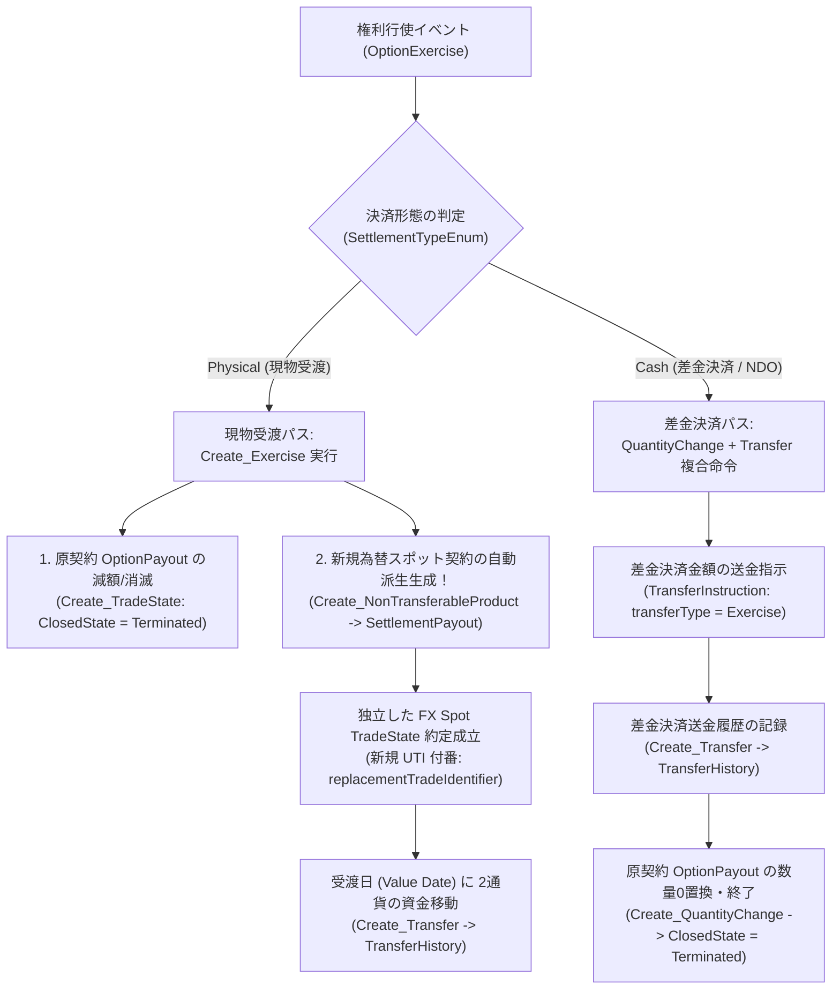

---

### 6.1 オプション権利行使の全体アーキテクチャ（`Create_Exercise` 関数仕様）

CDM のコア関数 [`Create_Exercise`](../../common-domain-model/rosetta-source/src/main/rosetta/event-common-func.rosetta)（`event-common-func.rosetta` L498-553）は、現物受渡型オプションの権利行使に伴う原契約の減額および行使結果プロダクト（新規契約）の生成をアトミックに実行します。

```rosetta
func Create_Exercise:
    inputs:
        exerciseInstruction ExerciseInstruction (1..1)
        originalTrade TradeState (1..1)
    output:
        exercise TradeState (1..*)
```

- **入力パラメータ**:
  - `exerciseInstruction`: 行使対象の Payout（`exerciseOption`）、行使に伴う残存数量変更（`exerciseQuantity`）、および現物行使時の新規取引識別子（`replacementTradeIdentifier`）。
  - `originalTrade`: 行使前の原オプション契約（`TradeState`）。
- **出力パラメータ (`exercise: TradeState (1..*)`)**:
  - 戻り値として**2つの `TradeState`** が返却されます：
    1. **原取引の残高更新**: `Create_TradeState( PrimitiveInstruction { quantityChange: exerciseInstruction -> exerciseQuantity, ... }, originalTrade )`（行使数量分が減額され、全量行使で数量が `0` になると `Create_TradeState` L2244-2250 により `state.closedState.state = ClosedStateEnum -> Terminated` および `state.positionState = PositionStatusEnum -> Closed` が設定される）。
    2. **行使結果の派生取引**: `execution`（行使によって新たに成立した新規契約）。
  - > [!IMPORTANT]
    > **`ClosedStateEnum` における `Terminated` と `Exercised` の一次ソース仕様**:
    > [`event-common-enum.rosetta`](../../common-domain-model/rosetta-source/src/main/rosetta/event-common-enum.rosetta)（L178）には `ClosedStateEnum -> Exercised` という列挙値が存在しますが、一次ソースの [`Create_TradeState`](../../common-domain-model/rosetta-source/src/main/rosetta/event-common-func.rosetta)（L2244-2250）は数量が `0` になった際に一律で **`ClosedStateEnum -> Terminated`** をセットします。さらに、イベント適格性判定関数 [`Qualify_Exercise`](../../common-domain-model/rosetta-source/src/main/rosetta/event-qualification-func.rosetta)（L198, L213）も `businessEvent -> instruction -> after -> state -> closedState -> state all = ClosedStateEnum -> Terminated` を必須条件として要求しており、`Exercised` を設定すると `Qualify_Exercise` が `False`（不適合）となります。

---

### 6.2 現物受渡（Physical Exercise）: 為替スポット（`SettlementPayout`）の自動派生生成

現物受渡の通貨オプションが行使された場合、CDM は**行使後に2通貨の交換を行う為替スポット契約（FX Spot）を自動生成**します。この一連のメカニズムは、以下の 3 つの Rosetta DSL 関数連携によって実現されています。

#### 1. スポットプロダクトの生成 ([`Create_NonTransferableProduct`](../../common-domain-model/rosetta-source/src/main/rosetta/event-common-func.rosetta) L568-578)
通貨オプションのアンダーライングは通貨資産（`Cash`）です。アンダーライングが完成されたプロダクト（`Product`）ではない場合、`Create_Exercise`（L502-505）から以下の関数が呼び出されます：

```rosetta
func Create_NonTransferableProduct:
    inputs:
        underlier Underlier (1..1)
        payerReceiver PayerReceiver (1..1)
    output:
        newProduct NonTransferableProduct (1..1)

    set newProduct -> economicTerms -> payout -> SettlementPayout -> underlier: underlier
    set newProduct -> economicTerms -> payout -> SettlementPayout -> payerReceiver:
        payerReceiver
```

> **決定的ポイント**:
> `Create_NonTransferableProduct` は、アンダーライング（通貨資産）と権利行使時の支払受取方向を取り込み、**第1章で詳述した為替スポットの標準データ構造である [`SettlementPayout`](../../common-domain-model/rosetta-source/src/main/rosetta/product-template-type.rosetta) を持つ新規プロダクトを動的に合成**します。
>
> > [!NOTE]
> > **一次ソースコードにおける実装制約（受渡期日の欠落）**:
> > Rosetta DSL の実装コード（`event-common-func.rosetta` L568-578）を確認すると、`Create_NonTransferableProduct` は `underlier` と `payerReceiver` のみを設定し、**`settlementTerms`（受渡期日 `settlementDate.valueDate` 等）は設定しません**。
> > さらに、呼出元の `Create_Exercise`（L538）でも `executionDetails: empty` とされており、DSL 関数が自律生成する派生スポット契約は期日情報を持たないスケルトンにとどまります。実務運用では、行使指示や外部オーケストレーションにより受渡期日を補完設定する必要があります。

#### 2. Put オプションにおける受渡方向の反転と一次ソース実装上のバグ ([`Update_ProductDirection`](../../common-domain-model/rosetta-source/src/main/rosetta/event-common-func.rosetta) L554-567)
Call オプションと Put オプションでは、原資産の受渡方向（買い／売り）が逆転します。`Create_Exercise`（L507-511）では、オプション種別が `Put` の場合に 1 引数関数 `Update_ProductDirection` を呼び出して `NonTransferableProduct` の支払・受取方向（Payer / Receiver）を反転させる設計となっています：

```rosetta
// Create_Exercise 内 (event-common-func.rosetta L507-511)
alias resultProduct:
    if optionPayout -> optionType = OptionTypeEnum -> Put
    then Update_ProductDirection(afterProduct -> NonTransferableProduct)
    else afterProduct -> NonTransferableProduct
```

```rosetta
// Update_ProductDirection の一次ソース実装 (event-common-func.rosetta L554-567)
func Update_ProductDirection:
    inputs:
        before NonTransferableProduct (1..1)
    output:
        after NonTransferableProduct (1..1)

    alias originalPayer:
        before -> economicTerms -> payout -> SettlementPayout only-element -> payerReceiver -> payer
    alias originalReceiver:
        before -> economicTerms -> payout -> SettlementPayout only-element -> payerReceiver -> receiver
    set after: before
    set after -> economicTerms -> payout -> OptionPayout -> payerReceiver -> payer:
        originalReceiver
    set after -> economicTerms -> payout -> OptionPayout -> payerReceiver -> receiver:
        originalPayer
```

> [!WARNING]
> **一次ソース `Update_ProductDirection` における代入先パスの実装バグ**:
> 上記の通り、`Update_ProductDirection`（`event-common-func.rosetta` L554-567）は、`originalPayer` / `originalReceiver` を `before -> economicTerms -> payout -> SettlementPayout only-element -> payerReceiver` から正しく取得しているにもかかわらず、後半の `set` 文（L563-566）の代入先パスが `SettlementPayout` ではなく誤って **`after -> economicTerms -> payout -> OptionPayout -> payerReceiver`** となっています。
> この結果、`Put` オプションに対して `Create_Exercise` をそのまま実行すると、派生生成された `SettlementPayout.payerReceiver` の向きが反転しないばかりか、必須属性を欠いた不完全な `OptionPayout` 要素が余分に付加されてしまう（一次ソース実装上のバグ）点に注意が必要です。

#### 3. 新規約定（Execution）の組成と受渡決済（Transfer）
- 合成された `SettlementPayout` に対し、`Create_Execution` が実行されます。
- 行使指示書に指定された `replacementTradeIdentifier` が付番され、独立した新たな **FX Spot 取引（`TradeState`）** として台帳に登録されます。
- この FX Spot 取引は、約定日を行使日として組成され、受渡期日到来時に通常のスポット取引と同様に [`Create_Transfer`](../../common-domain-model/rosetta-source/src/main/rosetta/event-common-func.rosetta) によって 2 通貨の現物送金（`Transfer`）が実行されます。

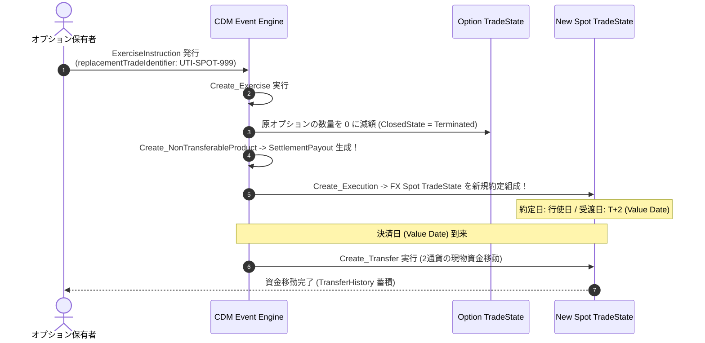

---

### 6.3 差金決済（Cash Settlement / NDO）: キャッシュフロー直結と契約終了

差金決済オプション（Non-Deliverable Option: NDO 等）の場合、現物通貨の交換（FX Spot 約定の派生生成）は行われません。一次ソースの [`Qualify_Exercise`](../../common-domain-model/rosetta-source/src/main/rosetta/event-qualification-func.rosetta)（L200-217）および公式テスト出力 [`exercise-cash-settled-func-output.json`](../../common-domain-model/rosetta-source/src/main/resources/functions/business-event/exercise/exercise-cash-settled-func-output.json) に示される通り、単一の `Instruction` 内で **`QuantityChangeInstruction` と `TransferInstruction` を組み合わせる構成**で処理されます。

1. **フィキシングレートの確定と差金決済額（Cash Settlement Amount）の算出**:
   - 満期日の評価時刻において、参照ソース（Reuters、Bloomberg等）から為替レートを観測し、イン・ザ・マネー（ITM）の場合に決済通貨建てでの差額受渡金額が算出される：
     $$\text{Cash Amount} = \max(S_{fixing} - K, 0) \times \frac{\text{Notional}}{S_{fixing}} \quad (\text{例: USD 決済 NDO})$$
2. **複合プリミティブ命令（`QuantityChange` + `Transfer`）による資金移動と契約終了**:
   - [`PrimitiveInstruction`](../../common-domain-model/rosetta-source/src/main/rosetta/event-common-type.rosetta) に以下の2つのプリミティブを同時指定して [`Create_TradeState`](../../common-domain-model/rosetta-source/src/main/rosetta/event-common-func.rosetta) を実行します（※`ExerciseInstruction.exerciseQuantity` の型は `QuantityChangeInstruction` であり、そこに `TransferInstruction` が内包されるわけではありません）：
     - **`quantityChange`（[`QuantityChangeInstruction`](../../common-domain-model/rosetta-source/src/main/rosetta/event-common-type.rosetta)）**: `direction: Replace` により原オプション契約の数量を `0` に減額（[`Create_QuantityChange`](../../common-domain-model/rosetta-source/src/main/rosetta/event-common-func.rosetta)）。
     - **`transfer`（[`TransferInstruction`](../../common-domain-model/rosetta-source/src/main/rosetta/event-common-type.rosetta)）**: `transferType: Exercise` を持つ `TransferState` により、差金受渡額の送金履歴を追加（[`Create_Transfer`](../../common-domain-model/rosetta-source/src/main/rosetta/event-common-func.rosetta)）。
   - 原契約の `TradeState.state.closedState.state` に [`ClosedStateEnum -> Terminated`](../../common-domain-model/rosetta-source/src/main/rosetta/event-common-enum.rosetta)、`positionState` に `PositionStatusEnum -> Closed` が設定され、派生取引を生成することなく単一の `after` `TradeState` で取引が完結します（`Qualify_Exercise` の第2分岐 L200-217 に適合）。

---

### 6.4 現物受渡 vs 差金決済の決定論的比較表

| 項目 | 現物受渡（Physical Exercise） | 差金決済（Cash Settlement / NDO） |
|---|---|---|
| **行使結果の生成物** | **原契約の更新 TradeState ＋ 新規の FX Spot 取引（`SettlementPayout`）** の計2件 | 新規契約は生成されず、**原契約の終了＋差金資金移動（`Transfer`）を記録した単一 TradeState** のみ |
| **派生契約の UTI** | `replacementTradeIdentifier` により新規付番 | 不要（原契約のライフサイクル内で完結） |
| **資金決済のタイミング** | スポット日（通常行使から $T+2$ 営業日後） | 決済期日（通常フィキシングから $T+2$ 等） |
| **資金移動（Transfer）の内容** | 2通貨の双方向送金（Gross Principal Exchange） | 決済通貨での片道ネット差額送金（`transferType: Exercise`） |
| **原契約の最終状態** | `ClosedStateEnum -> Terminated` / `PositionStatusEnum -> Closed` | `ClosedStateEnum -> Terminated` / `PositionStatusEnum -> Closed` |
| **CDM プリミティブ・呼出関数** | `PrimitiveInstruction.exercise`（`Create_Exercise` $\to$ `Create_TradeState` + `Create_NonTransferableProduct` + `Create_Execution`） | `PrimitiveInstruction { quantityChange, transfer }`（`Create_TradeState` $\to$ `Create_QuantityChange` + `Create_Transfer`） |

---

### 6.5 デジタルオプション行使・条件成立後のイベント表現（Cash Settled vs Physical）

第 5 章（§5.2〜§5.3）で詳述した通り、現行 CDM のプロダクト定義（[`OptionPayout`](../../common-domain-model/rosetta-source/src/main/rosetta/product-template-type.rosetta)）にはバニラとデジタルのペイオフ計算式を区別する標準属性は存在しません。しかし、**外部の判定・評価エンジンによってトリガー／タッチ条件の成立が判定された後に発生するライフサイクルイベント（権利行使・契約終了・資金移動）については、CDM の統一イベントモデル（[`BusinessEvent`](../../common-domain-model/rosetta-source/src/main/rosetta/event-common-type.rosetta)）の標準プリミティブを用いて決定論的に記録・監査することが可能**です。

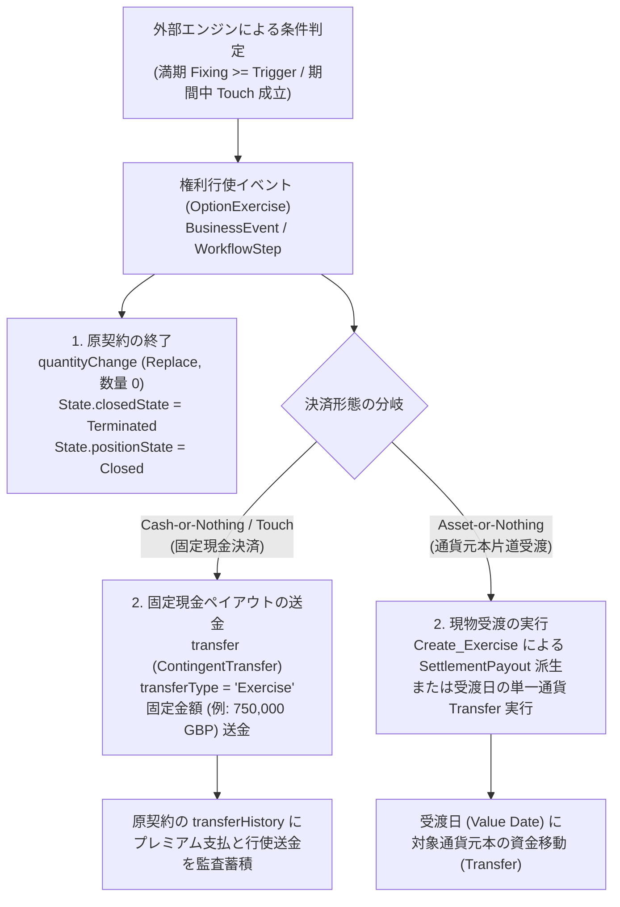

#### 1. 差金決済型（Cash-or-Nothing / Touch Payout: 固定金額送金）
為替デジタルオプションの大部分を占める「条件成立時に合意済みの固定金額を支払う契約（European Cash-or-Nothing, One-Touch, No-Touch 等）」では、条件成立による支払確定をバニラ差金決済（NDO 行使）と同一のイベントプリミティブ構成で表現します。
- **イベントの意図（`intent`）**: `EventIntentEnum -> OptionExercise`
- **イベントプリミティブの構成**:
  1. **契約終了（[`QuantityChangeInstruction`](../../common-domain-model/rosetta-source/src/main/rosetta/event-common-type.rosetta)）**:
     - `direction`: `QuantityChangeDirectionEnum -> Replace`
     - `change`: 名目数量を `0` に置換。
     - 原契約の `state.closedState.state` は [`ClosedStateEnum -> Terminated`](../../common-domain-model/rosetta-source/src/main/rosetta/event-common-enum.rosetta)、`positionState` は `PositionStatusEnum -> Closed` に遷移。
  2. **行使ペイアウト送金（[`TransferInstruction`](../../common-domain-model/rosetta-source/src/main/rosetta/event-common-type.rosetta)）**:
     - [`ContingentTransfer`](../../common-domain-model/rosetta-source/src/main/rosetta/event-common-type.rosetta)（または `Transfer`）により、条件成立に伴う固定キャッシュフロー（例: 750,000 GBP）を生成。
     - `transferType`: `TransferTypeEnum -> Exercise`
     - `payerReceiver`: オプション売り手が `payerPartyReference`、オプション買い手が `receiverPartyReference`。
     - `settlementDate`: 決済期日（Value Date）。
- **状態反映（`TradeState.transferHistory`）とイベント認定（Qualification）**:
  - 行使後の `after` に格納される `TradeState` の `transferHistory` には、約定時のプレミアム支払レコード（`transferType: "Premium"`）に加えて、今回の権利行使ペイアウト（`transferType: "Exercise"`）が時系列で監査蓄積されます。
  - [`Qualify_Exercise`](../../common-domain-model/rosetta-source/src/main/rosetta/event-qualification-func.rosetta)（L195-217: `OptionPayout exists` かつ `intent = OptionExercise` かつ `quantityChange exists` かつ `transfer exists` かつ `closedState.state = Terminated`）が決定論的に成立します。
  - ※なお、ノータッチ（No-Touch）オプションが期間中にバリアにタッチして権利消滅（リベートなし）した場合は、`intent` を空として数量を `0` に置換する `QuantityChangeInstruction` 単体イベント（`Qualify_Termination`）または満期無価値失効（`ClosedStateEnum -> Expired`）として処理します。

#### 2. 原資産受渡型（Asset-or-Nothing: 通貨受渡）
条件成立時に原資産通貨そのものの受渡を行う場合、CDM のコア関数 [`Create_Exercise`](../../common-domain-model/rosetta-source/src/main/rosetta/event-common-func.rosetta) $\to$ [`Create_NonTransferableProduct`](../../common-domain-model/rosetta-source/src/main/rosetta/event-common-func.rosetta) を駆動して原契約をクローズ（`ClosedStateEnum -> Terminated`）し、新規の [`SettlementPayout`](../../common-domain-model/rosetta-source/src/main/rosetta/product-template-type.rosetta)（新規 UTI: `replacementTradeIdentifier`）を派生生成します。
- ※**実装上の注意点**: §6.2.2 および §8.9 で詳述する通り、`Create_NonTransferableProduct` が自動生成する `SettlementPayout` は `underlier` と `payerReceiver` のみを持つスケルトンであり、また Asset-or-Nothing では対価通貨の反対送金が発生しない（片道受渡である）ため、受渡日（Value Date）における実際の資金移動は外部エンジンが生成する単一通貨の `TransferInstruction` によって確定させます。

---

## 7. CDM が取り扱う動的ライフサイクルイベント（Lifecycle Events）

CDM のイベントモデルでは、状態（[`TradeState`](../../common-domain-model/rosetta-source/src/main/rosetta/event-common-type.rosetta)）と不可分な操作（[`PrimitiveInstruction`](../../common-domain-model/rosetta-source/src/main/rosetta/event-common-type.rosetta)）を組み合わせた [`BusinessEvent`](../../common-domain-model/rosetta-source/src/main/rosetta/event-common-type.rosetta) により、取引のライフサイクル遷移を決定論的かつ監査可能（Audit-proof）に処理します。

プレーンバニラやシンセティックフォワードでは「権利行使（Exercise）」「資金決済（Transfer）」「元本・契約残高管理（QuantityChange）」が基本ですが、**バリアオプション（Barrier Option: Knock-in / Knock-out）やアベレージオプション（Asian Option: Average Rate / Average Strike）といった経路依存型（Path-dependent）エキゾチックオプションを網羅する場合、CDM では全 8 大ライフサイクルイベントとして体系化**されています。

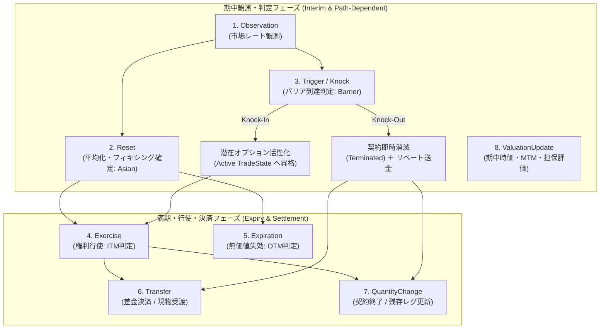

---

### 全 8 大ライフサイクルイベント一覧と CDM マッピング

| # | ライフサイクルイベント | CDM プリミティブ / 関数 / 型 | 対象商品・発生契機 | CDM における処理と状態遷移 |
|---|---|---|---|---|
| **1** | **市場観測<br>(Observation)** | `TradeState.resetHistory`<br>[`Reset.observations`](../../common-domain-model/rosetta-source/src/main/rosetta/event-common-type.rosetta)<br>[`Observation`](../../common-domain-model/rosetta-source/src/main/rosetta/observable-event-type.rosetta) | **バリア / アベレージ共通**<br>期中の観測スケジュール（日次、引け値、特定時刻等） | 市場データ（為替レート）を観測・記録。市場レート観測値（`Observation`）は `Reset` の `observations` 属性として紐づけられ、確定値とともに `resetHistory` に監査蓄積される（※`TradeState.observationHistory` はクレジット・コーポレートアクション専用型）。 |
| **2** | **フィキシング / 平均化確定<br>(Reset)** | `PrimitiveInstruction.reset`<br>[`ResetInstruction`](../../common-domain-model/rosetta-source/src/main/rosetta/event-common-type.rosetta)<br>[`Create_Reset`](../../common-domain-model/rosetta-source/src/main/rosetta/event-common-func.rosetta)<br>`Qualify_Reset` | **アベレージオプション（Asian）の核**<br>観測終了時または期間確定時 | 複数観測値（`observations (1..*)`）から平均化規則（[`AveragingCalculation`](../../common-domain-model/rosetta-source/src/main/rosetta/product-template-type.rosetta)）に基づき確定レート（`resetValue: Price`）を計算。`TradeState.resetHistory` に蓄積。 |
| **3** | **バリア到達判定<br>(Trigger / Knock)** | 条件定義: [`Barrier`](../../common-domain-model/rosetta-source/src/main/rosetta/product-template-type.rosetta), [`TriggerEvent`](../../common-domain-model/rosetta-source/src/main/rosetta/observable-event-type.rosetta)<br>イベント実行: `PrimitiveInstruction.quantityChange` / `transfer`<br>認定: `Qualify_Termination` | **バリアオプションの核**<br>観測レートがバリア水準（`Trigger.level`）にヒットした瞬間 | **Knock-out**: 独立した Trigger プリミティブは存在せず、残存数量を 0 とする `QuantityChange`（契約状態: [`ClosedStateEnum -> Terminated`](../../common-domain-model/rosetta-source/src/main/rosetta/event-common-enum.rosetta)）として実行。リベートがある場合は `TriggerEvent.featurePayment` に基づき `Transfer` を同時発行。<br>**Knock-in**: 潜在状態から権利行使可能な有効契約へ状態遷移。 |
| **4** | **権利行使<br>(Exercise)** | `PrimitiveInstruction.exercise`（現物）または `quantityChange` + `transfer`（差金）<br>[`ExerciseInstruction`](../../common-domain-model/rosetta-source/src/main/rosetta/event-common-type.rosetta)<br>[`Create_Exercise`](../../common-domain-model/rosetta-source/src/main/rosetta/event-common-func.rosetta)<br>`Qualify_Exercise` | **全オプション共通**<br>満期日または行使期間において ITM と判定された場合 | 現物行使では `exerciseOption` で特定 Payout を指定し、原契約を終了（`Terminated`）して現物受渡取引（FX Spot 約定）を派生生成。差金行使では数量 0 置換（`Terminated`）と行使差金送金（`transferType: Exercise`）を同時実行。 |
| **5** | **満期失効・無価値終了<br>(Expiration)** | `TradeState.state.closedState`<br>[`ClosedStateEnum -> Expired`](../../common-domain-model/rosetta-source/src/main/rosetta/event-common-enum.rosetta) | **全オプション共通**<br>満期到来時に OTM で行使されなかった場合、またはノックイン未到達のまま満期終了 | 権利行使されずに契約が終了。契約状態を明示的に `Expired`（失効）としてクローズし、ポジションを閉鎖。 |
| **6** | **資金移動・決済<br>(Transfer / Settlement)** | `PrimitiveInstruction.transfer`<br>[`TransferInstruction`](../../common-domain-model/rosetta-source/src/main/rosetta/event-common-type.rosetta)<br>[`Create_Transfer`](../../common-domain-model/rosetta-source/src/main/rosetta/event-common-func.rosetta)<br>`Qualify_CashTransfer` | **全商品共通**<br>契約締結時、行使決済時、ノックアウト時 | プレミアム支払（`UnscheduledTransfer`）、ノックアウト時のリベート支払、差金決済（Cash Settlement）、現物受渡資金移動を `transferHistory` に記録。 |
| **7** | **契約残高・条件変更<br>(QuantityChange / TermsChange)** | `PrimitiveInstruction.quantityChange`<br>[`QuantityChangeInstruction`](../../common-domain-model/rosetta-source/src/main/rosetta/event-common-type.rosetta)<br>`Qualify_PartialTermination` / `Termination` | **ストリップ型 / バリア共通**<br>期日ごとの順次決済、一部解約、ノックアウト消滅 | 期日 $T_i$ の行使後に残存期日 $T_{i+1} \dots T_n$ を残す（単一 Trade の場合）、またはノックアウト時に残存数量を 0 にして契約終了（`Terminated`）させる。 |
| **8** | **時価評価・担保評価更新<br>(ValuationUpdate)** | `PrimitiveInstruction.valuation`<br>[`ValuationInstruction`](../../common-domain-model/rosetta-source/src/main/rosetta/event-common-type.rosetta)<br>[`Valuation`](../../common-domain-model/rosetta-source/src/main/rosetta/event-position-type.rosetta)<br>`Qualify_ValuationUpdate` | **全デリバティブ共通**<br>日次 MTM（時価評価）および感応度・マージン計算 | 期中のバリア接近度や平均化進捗を反映した時価評価額（PV / MTM）を `TradeState.valuationHistory` に追跡・記録。 |

---

### エキゾチック特有イベントの深層解説

#### A. アベレージオプション（Asian）における `Reset` イベントのメカニズム
アベレージオプションでは、満期時のペイオフ計算に用いるレートが単一のスポットレートではなく、**観測期間中のレートの平均値（算術平均等）**となります。
- **データ構造の排他ルール**:
  [`OptionPayout`](../../common-domain-model/rosetta-source/src/main/rosetta/product-template-type.rosetta)（L137-143）の2つの条件制約により、以下が厳密に区別されます：
  - **Average Rate Option (平均レート型)**: `feature -> averagingFeature` を使用（ペイオフ: $\max(\bar{S} - K, 0)$）。
    - 条件制約 `AsianOptionChoice_averagingFeature`: `if feature -> averagingFeature exists then strike -> strikePrice exists`
  - **Average Strike Option (平均行使価格型)**: `strike -> averagingStrikeFeature` を使用（ペイオフ: $\max(S_T - \bar{S}, 0)$）。
    - 条件制約 `AsianOptionChoice_averagingStrikeFeature`: `if strike -> averagingStrikeFeature exists then feature -> averagingFeature is absent`
- **`Reset` の計算構造と観測値の紐づけ**:
  [`Reset`](../../common-domain-model/rosetta-source/src/main/rosetta/event-common-type.rosetta) は複数の市場観測値（`observations: Observation (1..*)`）と平均化方法（`averagingMethodology: AveragingCalculation`）を結びつけ、算出された平均為替レート（`resetValue: Price`）を確定します。
  Rosetta 条件制約 `condition AveragingMethodologyExists`:
  ```rosetta
  if observations count > 1 then averagingMethodology exists
  ```
  複数観測値が存在する場合、平均化計算ロジック（`averagingMethod` や `precision`（端数処理規則））の指定が必須と定義されています。
  > **注記（観測値の格納設計）**: CDM の `TradeState.observationHistory`（型: `ObservationEvent`）はクレジットイベント（`CreditEvent`）やコーポレートアクション（`CorporateAction`）専用として設計されており、為替レート等の市場クォート観測値は `Reset.observations`（型: `Observation`）内に監査参照として保持され、`TradeState.resetHistory` に蓄積されます。

#### B. バリアオプション（Barrier）における `Trigger` と状態遷移メカニズム
バリアオプションでは、為替レートがバリア水準に達したかどうかに応じて契約の存続状態が劇的に変化します。
- **データ構造（プロダクト側の静的条件）**:
  [`OptionPayout.feature.barrier`](../../common-domain-model/rosetta-source/src/main/rosetta/product-template-type.rosetta)（型: [`Barrier`](../../common-domain-model/rosetta-source/src/main/rosetta/product-template-type.rosetta)）：
  - `knockIn`: [`TriggerEvent`](../../common-domain-model/rosetta-source/src/main/rosetta/observable-event-type.rosetta)（バリア到達により権利が有効化）
  - `knockOut`: [`TriggerEvent`](../../common-domain-model/rosetta-source/src/main/rosetta/observable-event-type.rosetta)（バリア到達により権利が無効・消滅）
- **判定条件（Trigger）**:
  - `level`: バリアレート水準（[`PriceSchedule`](../../common-domain-model/rosetta-source/src/main/rosetta/observable-asset-type.rosetta)）
  - `triggerType`: 突破方向（[`TriggerTypeEnum`](../../common-domain-model/rosetta-source/src/main/rosetta/observable-event-enum.rosetta) -> `EqualOrGreater`, `EqualOrLess` 等）
  - `triggerTimeType`: 監視時刻（[`TriggerTimeTypeEnum`](../../common-domain-model/rosetta-source/src/main/rosetta/observable-event-enum.rosetta) -> `Anytime`（取引日中の常時監視：continuous barrier）または `Closing`（引け値のみ））
  - `featurePayment`: ノックアウト時に買い手に支払われるリベート金額（[`FeaturePayment`](../../common-domain-model/rosetta-source/src/main/rosetta/observable-event-type.rosetta)）
- **イベント発生時の状態遷移（イベントプリミティブ）**:
  CDM のイベントモデルにおいて `Trigger` は独立したプリミティブ操作ではなく、以下の既存プリミティブの組み合わせによって表現されます：
  - **Knock-Out 発生時**:
    1. [`QuantityChangeInstruction`](../../common-domain-model/rosetta-source/src/main/rosetta/event-common-type.rosetta) により残存数量が 0 となり、`State.closedState` に [`ClosedStateEnum -> Terminated`](../../common-domain-model/rosetta-source/src/main/rosetta/event-common-enum.rosetta) が設定され契約終了。イベント認定は `Qualify_Termination` となる。
    2. リベート（`featurePayment`）が存在する場合、[`TransferInstruction`](../../common-domain-model/rosetta-source/src/main/rosetta/event-common-type.rosetta) によりリベート受渡（`ContingentTransfer`）が実行される。
  - **Knock-In 発生時**:
    - バリアヒットにより休眠状態から有効契約へ状態遷移し、満期日に向けた通常の `Exercise` / `Expiration` 待機状態へと移行する。

---

## 8. 実サンプル JSON / XML による要素レベルの裏どり検証 (Evidence & Mapping)

CDM 一次リポジトリ（`rosetta-source/src/main/resources/ingest/`）配下に実在する XML 入力および JSON 出力成果物、ならびに Rosetta DSL 関数実装と照合し、上記仕様の妥当性を確認したエビデンス一覧です。

### 8.1 スポットおよびプレーンフォワードの要素対応
- **検証ファイル**:
  - スポット: [`fx-ex01-fx-spot.json`](../../common-domain-model/rosetta-source/src/main/resources/ingest/output/fpml-confirmation-to-trade-state/fpml-5-13-products-fx-derivatives/fx-ex01-fx-spot.json)
  - プレーンフォワード: [`fx-ex03-fx-fwd.json`](../../common-domain-model/rosetta-source/src/main/resources/ingest/output/fpml-confirmation-to-trade-state/fpml-5-13-products-fx-derivatives/fx-ex03-fx-fwd.json)

| CDM モデル要素 | 実サンプル JSON パス / キー名 | スポット (`fx-ex01`) | プレーンフォワード (`fx-ex03`) |
|---|---|---|---|
| 商品タクソノミ | `trade.product.taxonomy[0]` | `ForeignExchange_Spot_Forward` | `ForeignExchange_Spot_Forward` |
| ペイアウト型 | `trade.product.economicTerms.payout[0]` | `@type: "cdm.product.template.SettlementPayout"` | `@type: "cdm.product.template.SettlementPayout"` |
| 約定日 | `trade.tradeDate` | `2001-10-23` | `2001-11-19` |
| 受渡期日 | `payout[0].settlementTerms.settlementDate` | `valueDate: "2001-10-25"` ($T+2$) | `valueDate: "2001-12-21"` (約1ヶ月先) |
| 為替レート | `tradeLot[0].priceQuantity[0].price[0]` | `value: 1.48` | `value: 0.9175` |
| レート合成 | `price[0].composite` | なし（直物単一値） | `baseValue: 0.9130`, `operand: 0.0045`, `operandType: ForwardPoint` |

---

### 8.2 NDF（Non-Deliverable Forward）実サンプルの要素対応と裏どり検証

一次リポジトリ配下に実在する NDF の FpML 5-13 入力 XML および CDM Ingest 変換後 JSON を対比検証した結果です。

- **検証ファイル**:
  - FpML 入力 XML: [`fx-ex07-non-deliverable-forward.xml`](../../common-domain-model/rosetta-source/src/main/resources/ingest/input/fpml-5-13-products-fx-derivatives/fx-ex07-non-deliverable-forward.xml)
  - CDM 出力 JSON: [`fx-ex07-non-deliverable-forward.json`](../../common-domain-model/rosetta-source/src/main/resources/ingest/output/fpml-confirmation-to-trade-state/fpml-5-13-products-fx-derivatives/fx-ex07-non-deliverable-forward.json)

#### FpML 入力 XML と CDM 出力 JSON の要素対比表

| CDM モデル要素 | FpML 入力 XML パス (`fx-ex07.xml`) | 実サンプル CDM JSON パス (`fx-ex07.json`) | 具体値・解釈 |
|---|---|---|---|
| **商品タクソノミ** | なし（XML 要素 `<fxSingleLeg>` 内に内包） | `trade.product.taxonomy[0]` | `source: "ISDA"`, `name: "ForeignExchange_NDF"`, `calculated: true` |
| **ペイアウト型** | `<fxSingleLeg>` | `trade.product.economicTerms.payout[0]` | `@type: "cdm.product.template.SettlementPayout"` |
| **決済方式** | `<nonDeliverableSettlement>` | `payout[0].settlementTerms.settlementType` | `SettlementTypeEnum -> "Cash"` |
| **決済通貨** | `<nonDeliverableSettlement><settlementCurrency>USD</settlementCurrency>` | `payout[0].settlementTerms.settlementCurrency` | `"USD"`（※INR は決済通貨とならない） |
| **決済期日** | `<valueDate>2002-04-11</valueDate>` | `payout[0].settlementTerms.settlementDate.valueDate` | `"2002-04-11"` |
| **フィキシング期日** | `<fixing><fixingDate>2002-04-09</fixingDate>` | `payout[0].settlementTerms.cashSettlementTerms[0].valuationDate.fxFixingDate.fxFixingDate.adjustableDate.adjustedDate` | `"2002-04-09"`（受渡日の2営業日前） |
| **市場レート配信元** | `<primaryRateSource><rateSource>Reuters</rateSource><rateSourcePage>RBIB</rateSourcePage></primaryRateSource>` | `cashSettlementTerms[0].valuationMethod.valuationSource.informationSource` | `sourceProvider: "Reuters"`, `sourcePage: "RBIB"` |
| **フィキシング通貨ペア** | `<fixing><quotedCurrencyPair><currency1>USD</currency1><currency2>INR</currency2></quotedCurrencyPair>` | `cashSettlementTerms[0].valuationMethod.valuationSource.quotedCurrencyPair` | `currency1: "USD"`, `currency2: "INR"`, `quoteBasis: "Currency2PerCurrency1"` |
| **約定レート** | `<exchangeRate><rate>43.40</rate></exchangeRate>` | `tradeLot[0].priceQuantity[0].price[0]` | `value: 43.40`, `unit: INR`, `perUnitOf: USD`, `priceType: "ExchangeRate"` |
| **直物・スワップポイント** | `<spotRate>43.35</spotRate><forwardPoints>0.05</forwardPoints>` | `price[0].composite` | `baseValue: 43.35`, `operand: 0.05`, `operandType: "ForwardPoint"` |
| **契約元本（USD）** | `<exchangedCurrency1><currency>USD</currency><amount>10000000</amount></exchangedCurrency1>` | `tradeLot[0].priceQuantity[0].quantity` | `value: 10000000`, `unit.currency: "USD"` |
| **参照元本（INR）** | `<exchangedCurrency2><currency>INR</currency><amount>434000000</amount></exchangedCurrency2>` | `tradeLot[0].priceQuantity[0].price[0].derivedQuantity` | `value: 434000000`, `unit.currency: "INR"` |

> **設計検証の成果**:
> 1. **スキーマ統合（Harmonization）**: FpML 5-13 では `<nonDeliverableSettlement>` という FX 固有のタグが用いられていましたが、CDM ではこれが他プロダクト（金利・エクイティ）と共通化された [`CashSettlementTerms`](../../common-domain-model/rosetta-source/src/main/rosetta/product-common-settlement-type.rosetta) の配下に吸収され、為替フィキシング日は `valuationDate.fxFixingDate.fxFixingDate` として完全に正規化されています。
> 2. **決定論的タクソノミ推論**: 入力 XML にタクソノミが記載されていなくても、`cashSettlementTerms` が存在することを判定エンジンが検知し、`ForeignExchange_NDF` を `calculated: true` で正確に自動付与することが実機確認されました。

---

### 8.3 通貨オプション単体（FX Option）の要素対応
- **検証ファイル**:
  - ヨーロピアン: [`fx-ex09-euro-opt.json`](../../common-domain-model/rosetta-source/src/main/resources/ingest/output/fpml-confirmation-to-trade-state/fpml-5-13-products-fx-derivatives/fx-ex09-euro-opt.json)
  - アメリカン: [`fx-ex10-amer-opt.json`](../../common-domain-model/rosetta-source/src/main/resources/ingest/output/fpml-confirmation-to-trade-state/fpml-5-13-products-fx-derivatives/fx-ex10-amer-opt.json)
  - 差金決済（NDO）: [`fx-ex11-non-deliverable-option.json`](../../common-domain-model/rosetta-source/src/main/resources/ingest/output/fpml-confirmation-to-trade-state/fpml-5-13-products-fx-derivatives/fx-ex11-non-deliverable-option.json)

| CDM モデル要素 | 実サンプル JSON パス / キー名 | `fx-ex09-euro-opt.json` での具体値 |
|---|---|---|
| 商品タクソノミ | `trade.product.taxonomy[1]` | `source: "ISDA"`, `name: "ForeignExchange_VanillaOption"`, `calculated: true` |
| ペイアウト型 | `trade.product.economicTerms.payout[0]` | `@type: "cdm.product.template.OptionPayout"` |
| 買手・売手 | `payout[0].buyerSeller` | `buyer: "Party1"`, `seller: "Party2"` |
| オプション種別 | `payout[0].optionType` | `"Put"`（または `"Call"`） |
| 行使価格 | `payout[0].strike.strikePrice` | `value: 0.4920`, `unit.currency: "USD"`, `perUnitOf.currency: "AUD"`, `priceType: "ExchangeRate"`<br>※**Payout 内にインラインで直接格納**（外部参照なし） |
| 権利行使条件 | `payout[0].exerciseTerms` | `style: "European"`, `expirationDate[0].adjustableDate.adjustedDate: "2002-06-04"`, `expirationTimeType: "SpecificTime"` |
| 受渡期日 | `payout[0].settlementTerms.settlementDate` | `valueDate: "2002-06-06"`（※`settlementType` は未出力/省略） |
| アンダーライング | `payout[0].underlier` | `@type: "cdm.observable.asset.Observable"`, `@ref:scoped: "observable-1"`（`Cash: AUD`） |
| 元本・数量 | `trade.tradeLot[0].priceQuantity[0]` | `quantity.value: 75000000 AUD`, `price[0].derivedQuantity.value: 36900000 USD`<br>※`price` 側にはレート値は入らず、計算済名目金額のみ格納 |

> **検証の知見**:
> 1. **ストライクのインライン保持**: オプションでは為替レート（行使価格）は `OptionPayout.strike.strikePrice` 内に直接インラインで構造化され、`tradeLot` の `price` からのスコープ参照（`@ref:scoped`）は行われません。`tradeLot` 側には行使レートに基づく計算結果数量（`derivedQuantity`）のみが保持されます。
> 2. **`settlementType` の出力挙動**: 現物受渡のオプション（`fx-ex09`, `fx-ex10`）では `settlementType` は出力されず、差金決済（NDO: `fx-ex11`）においてのみ `"settlementType": "Cash"` が出力されます。

---

### 8.4 複数受渡日・期日別ストライク（マルチフォワード）の要素対応
- **検証ファイル**: [`fx-ex08-fx-swap.json`](../../common-domain-model/rosetta-source/src/main/resources/ingest/output/fpml-confirmation-to-trade-state/fpml-5-13-products-fx-derivatives/fx-ex08-fx-swap.json)
  - `payout` 配列内に複数要素（ニアレグ＋ファーレグ）が並び、各要素が独立した `settlementDate.valueDate`（`2002-01-25`, `2002-02-25`）を持つ。
  - `tradeLot.priceQuantity` 配列内に期日別の `price-1`（1.48）、`price-2`（1.50）が定義され、各 Payout からスコープ参照（`@ref:scoped`）される。
  - > **注記**: 本サンプルは **2つの `SettlementPayout` を持つ現物為替スワップ（FX Swap）** の実機エビデンスです。`OptionPayout` を複数並べるシンセティックフォワード（オプションストリップ）の完全サンプルはリポジトリ内に未収録（後述 8.8 の通り Incomplete 隔離）であり、構造参照元としての引用となります。

---

### 8.5 レグ独立識別子（複数 UTI / USI）の要素対応
- **検証ファイル**: [`fx-ex26-fxswap-multiple-USIs.json`](../../common-domain-model/rosetta-source/src/main/resources/ingest/output/fpml-confirmation-to-trade-state/fpml-5-13-products-fx-derivatives/fx-ex26-fxswap-multiple-USIs.json)
  - `tradeIdentifier` 配列内にレグごとの独立した UTI（末尾 `...012` と `...013`）を保持できる実機仕様を裏どり。

---

### 8.6 ライフサイクルイベント（動的状態遷移）の要素対応
- **検証ファイル**: [`msg-ex54-execution-advice-trade-partial-termination-C11-00.json`](../../common-domain-model/rosetta-source/src/main/resources/ingest/output/fpml-confirmation-to-workflow-step/fpml-5-13-processes-execution-advice/msg-ex54-execution-advice-trade-partial-termination-C11-00.json)
  - `primitiveInstruction.quantityChange`（`direction = "Replace"`）による元本減額、および `primitiveInstruction.transfer` による資金移動の連動を実証。

---

### 8.7 エキゾチックオプション（アベレージ・バリア）の要素対応とサンプル JSON 実態調査

CDM 一次リポジトリにおけるエキゾチックオプション（アベレージ型およびバリア型）のサンプル JSON 提供状況および要素レベルの整合性を調査した結果、以下の実態が明らかになっています。

#### A. アベレージオプション（Asian Option）
- **検証ファイル（契約成立 TradeState）**: [`fx-ex21-avg-rate-option-parametric-plus-rate-observation.json`](../../common-domain-model/rosetta-source/src/main/resources/ingest/output/fpml-confirmation-to-trade-state/fpml-5-13-products-fx-derivatives/fx-ex21-avg-rate-option-parametric-plus-rate-observation.json)
- **実証された契約要素**:
  - `OptionPayout.observationTerms`: 観測スケジュール（`observationDates.periodicSchedule.startDate: 2010-11-01`, `endDate: 2010-11-30`, `periodFrequency: 1D`）。
  - `observationTerms.informationSource`: フィキシング配信元（`sourceProvider: "Reuters"`, `sourcePage: "BNBX"`）。
  - `observationTerms.observationTime`: 観測時刻（`hourMinuteTime: 18:00:00`, `businessCenter: MXMC`）。
  - `OptionPayout.strike.strikePrice`: 行使価格 12.40 MXN per USD。
  - **商品タクソノミ判定の挙動**: FpML の `<fxOption><features><asian>` は [`MapFxOptionFeaturesToObservationTerms`](../../common-domain-model/rosetta-source/src/main/rosetta/ingest-fpml-confirmation-product-fxoption-func.rosetta)（L102-119）により `OptionPayout.observationTerms` にマッピングされ、`OptionPayout.feature` は `absent` のままとなります。そのため、[`Qualify_ForeignExchange_VanillaOption`](../../common-domain-model/rosetta-source/src/main/rosetta/product-qualification-func.rosetta)（L684: `optionPayout -> feature is absent`）の条件を満たし、`trade.product.taxonomy` には `ForeignExchange_VanillaOption`（`calculated: true`）が出力されています。
- **ライフサイクルイベント（Reset）のサンプル JSON 有無**:
  - **為替（FX）における `Reset` イベントのサンプル JSON は CDM リポジトリ内に存在しません（0件）**。
  - 上記ファイルは契約約定時点の `TradeState`（初期プレミアム支払の `transferHistory` のみ）であり、期中観測値（`Observation`）の蓄積や確定レートを計算・適用した `BusinessEvent` / `resetHistory` は含まれません。
  - ※なお CDM 全体でも、`Reset` イベントの出力サンプルは証券貸借の請求書計算（`sec-lending`）に限定されています。

#### B. バリアオプション（Barrier Option）
- **検証ファイル（契約成立 TradeState）**: [`fx-ex13-fx-dbl-barrier-option.json`](../../common-domain-model/rosetta-source/src/main/resources/ingest/output/fpml-confirmation-to-trade-state/fpml-5-13-incomplete-products-fx-derivatives/fx-ex13-fx-dbl-barrier-option.json)（および [`fx-ex12-fx-barrier-option.json`](../../common-domain-model/rosetta-source/src/main/resources/ingest/output/fpml-confirmation-to-trade-state/fpml-5-13-incomplete-products-fx-derivatives/fx-ex12-fx-barrier-option.json)）
- **Ingest 変換における現状の制約と要素欠落**:
  - 上記ファイルは FpML からの Ingest 変換結果ですが、`incomplete-products`（不完全変換）ディレクトリに分類されています。
  - 為替オプションの Ingest マッピング関数（[`ingest-fpml-confirmation-product-fxoption-func.rosetta`](../../common-domain-model/rosetta-source/src/main/rosetta/ingest-fpml-confirmation-product-fxoption-func.rosetta)）においてバリア機能（`barrier`）の変換ロジックが未実装であるため、**出力された CDM JSON 内には `OptionPayout.feature.barrier`（`TriggerEvent` やトリガー水準等）が出力されず欠落**しています。
  - **未マッピングに伴う商品分類の誤適合（False Positive）**: `OptionPayout.feature` が空（`absent`）のまま出力される結果、`Qualify_ForeignExchange_VanillaOption`（`optionPayout -> feature is absent`）が `True` と評価され、`fx-ex13-fx-dbl-barrier-option.json` の `trade.product.taxonomy` には入力 XML 由来の `source: "Other", value.name: "DOUBLEBARRIER"` に加えて、**`source: "ISDA", value.name: "ForeignExchange_VanillaOption", calculated: true` が誤って自動付与**されています。
  - ※CDM の一次ソース JSON サンプルで `feature.barrier` が出力されるのは、クレジットイベントをトリガーとするクレジット・スワップション（`cd-swaption-1.json` 等）に限られます。
- **ライフサイクルイベント（バリアタッチ）のサンプル JSON 有無**:
  - **バリア到達（Knock-In / Knock-Out）を表現したイベント（`BusinessEvent` / `WorkflowStep`）のサンプル JSON は存在しません（0件）**。
  - CDM のイベントモデル上、ノックアウト消滅は `QuantityChangeInstruction`（数量0・`State.closedState.state = Terminated`）およびリベート送金（`Transfer`）の複合イベントとしてモデル化（認定: `Qualify_Termination`）されますが、これを実機実行したテストデータセットは未収録です。

---

### 8.8 デジタル系オプションの実サンプル XML / JSON 実態調査

一次リポジトリ配下の FpML 入力 XML および CDM 出力 JSON を対比調査した結果、デジタル系オプションにおける CDM のマッピング状況および未完（Incomplete）隔離の具体的な要因が実証されました。

- **検証対象サンプル一覧（全6件・すべて `incomplete-products` 配下）**:
  - ヨーロピアン・デジタル: [`fx-ex14-euro-digital-option.xml`](../../common-domain-model/rosetta-source/src/main/resources/ingest/input/fpml-5-13-incomplete-products-fx-derivatives/fx-ex14-euro-digital-option.xml) $\to$ [`fx-ex14-euro-digital-option.json`](../../common-domain-model/rosetta-source/src/main/resources/ingest/output/fpml-confirmation-to-trade-state/fpml-5-13-incomplete-products-fx-derivatives/fx-ex14-euro-digital-option.json)
  - ヨーロピアン・レンジ・デジタル: [`fx-ex15-euro-range-digital-option.xml`](../../common-domain-model/rosetta-source/src/main/resources/ingest/input/fpml-5-13-incomplete-products-fx-derivatives/fx-ex15-euro-range-digital-option.xml) $\to$ [`fx-ex15-euro-range-digital-option.json`](../../common-domain-model/rosetta-source/src/main/resources/ingest/output/fpml-confirmation-to-trade-state/fpml-5-13-incomplete-products-fx-derivatives/fx-ex15-euro-range-digital-option.json)
  - ワンタッチ: [`fx-ex16-one-touch-option.xml`](../../common-domain-model/rosetta-source/src/main/resources/ingest/input/fpml-5-13-incomplete-products-fx-derivatives/fx-ex16-one-touch-option.xml) $\to$ [`fx-ex16-one-touch-option.json`](../../common-domain-model/rosetta-source/src/main/resources/ingest/output/fpml-confirmation-to-trade-state/fpml-5-13-incomplete-products-fx-derivatives/fx-ex16-one-touch-option.json)
  - ノータッチ: [`fx-ex17-no-touch-option.xml`](../../common-domain-model/rosetta-source/src/main/resources/ingest/input/fpml-5-13-incomplete-products-fx-derivatives/fx-ex17-no-touch-option.xml) $\to$ [`fx-ex17-no-touch-option.json`](../../common-domain-model/rosetta-source/src/main/resources/ingest/output/fpml-confirmation-to-trade-state/fpml-5-13-incomplete-products-fx-derivatives/fx-ex17-no-touch-option.json)
  - ダブル・ワンタッチ: [`fx-ex18-double-one-touch-option.xml`](../../common-domain-model/rosetta-source/src/main/resources/ingest/input/fpml-5-13-incomplete-products-fx-derivatives/fx-ex18-double-one-touch-option.xml) $\to$ [`fx-ex18-double-one-touch-option.json`](../../common-domain-model/rosetta-source/src/main/resources/ingest/output/fpml-confirmation-to-trade-state/fpml-5-13-incomplete-products-fx-derivatives/fx-ex18-double-one-touch-option.json)
  - ダブル・ノータッチ: [`fx-ex19-double-no-touch-option.xml`](../../common-domain-model/rosetta-source/src/main/resources/ingest/input/fpml-5-13-incomplete-products-fx-derivatives/fx-ex19-double-no-touch-option.xml) $\to$ [`fx-ex19-double-no-touch-option.json`](../../common-domain-model/rosetta-source/src/main/resources/ingest/output/fpml-confirmation-to-trade-state/fpml-5-13-incomplete-products-fx-derivatives/fx-ex19-double-no-touch-option.json)

#### 1. 要素対比と実態分析（`fx-ex14-euro-digital-option` の場合）

| 要素名 | FpML 入力 XML (`fx-ex14.xml`) | CDM 出力 JSON (`fx-ex14.json`) | 監査結果と要因分析 |
|---|---|---|---|
| **商品タクソノミ** | `<productType>EuroBinary</productType>` | `taxonomy[0].value.name: "EuroBinary"` | 保持（独自スキーマ URL 紐づけ、ISDA 自動分類は未定義） |
| **買手・売手** | `<buyerPartyReference href="party2"/>` (UBS)<br>`<sellerPartyReference href="party1"/>` (Citi) | `buyerSeller.buyer: "Party1"`, `seller: "Party2"` | 正常変換（`trade.counterparty` にて `Party1 -> party2 (UBS)`, `Party2 -> party1 (Citi)` にバインド） |
| **行使条件** | `<europeanExercise>` (満期: 2001-11-26) | `exerciseTerms.style: "European"` | 正常変換 |
| **受渡日・決済種別** | `<valueDate>2001-11-28</valueDate>` | `settlementTerms.settlementDate.valueDate: "2001-11-28"`<br>（`settlementType` は**欠落**） | [`MapFxDigitalOptionToSettlementTerms`](../../common-domain-model/rosetta-source/src/main/rosetta/ingest-fpml-confirmation-settlement-func.rosetta)（L171-190）が `settlementDate` しかセットせず、`settlementType` を未設定とするため |
| **トリガー条件** | `<trigger><triggerRate>1.4800</triggerRate><triggerCondition>Above</triggerCondition></trigger>` | **欠落（出力なし）** | [`MapFxDigitalOptionPayout`](../../common-domain-model/rosetta-source/src/main/rosetta/ingest-fpml-confirmation-product-fxdigitaloption-func.rosetta)（L72-108）で `<trigger>` / `<touch>` が未マッピングのため欠落 |
| **固定ペイアウト** | `<payout><currency>GBP</currency><amount>750000</amount><payoutStyle>Immediate</payoutStyle></payout>` | **欠落（出力なし）** | `MapFxDigitalOptionPayout` で `<payout>` が未マッピングのため欠落 |
| **アンダーライング** | `<quotedCurrencyPair>GBP/USD</quotedCurrencyPair>` | **欠落（`underlier: empty`）** | `MapFxDigitalOptionPayout`（L82）上で `underlier: empty` とハードコード |
| **オプション種別** | なし（`<triggerCondition>Above</triggerCondition>` で表現） | **欠落（`optionType` 出力なし）** | `MapFxDigitalOptionPayout` で `optionType` 未設定 |
| **ロット・数量・価格** | `<payout>` / `<trigger>` 内の数量・レート | **欠落（`trade.tradeLot` 出力なし）** | [`MapPriceQuantityList`](../../common-domain-model/rosetta-source/src/main/rosetta/ingest-fpml-confirmation-tradestate-func.rosetta)（L416-450）に `fpml.FxDigitalOption` 分岐が存在しないため欠落 |
| **プレミアム** | `<premium><amount>53000 GBP</amount></premium>` | `transferHistory[0].transfer` (`53000 GBP`) | 正常変換（初期資金移動として記録） |

#### 2. `fx-ex14`〜`fx-ex19` で発生する CDM 標準バリデーションエラー（5件）の内訳

一次ソースの `fx-ex14`〜`fx-ex19` の出力 JSON を CDM 自身のモデルバリデータにかけると、上記のスケルトン実装に起因して以下の **5 つの必須データルール違反（Model Validation Failures）** が発生します：

| # | 違反が発生する CDM 型 | 違反ルール・属性名 | 一次ソース定義箇所 | エラー発生の直接原因 |
|---|---|---|---|---|
| **1** | `EconomicTerms` | `condition Quantity` | [`product-template-type.rosetta`](../../common-domain-model/rosetta-source/src/main/rosetta/product-template-type.rosetta) (L46-49) | `OptionPayout` が存在するにもかかわらず、`MapPriceQuantityList` に `FxDigitalOption` 分岐がなく `priceQuantity.quantitySchedule`（`tradeLot`）が空のため |
| **2** | `OptionPayout` | `underlier (1..1)` | [`product-template-type.rosetta`](../../common-domain-model/rosetta-source/src/main/rosetta/product-template-type.rosetta) (L131) | `MapFxDigitalOptionPayout`（L82）で `underlier: empty` とハードコードされているため |
| **3** | `OptionPayout` | `condition OptionTypePresent` | [`product-template-type.rosetta`](../../common-domain-model/rosetta-source/src/main/rosetta/product-template-type.rosetta) (L184-187) | `underlier` が `NonTransferableProduct` でない場合に必須となる `optionType`（`Call`/`Put` 等）が未設定のため |
| **4** | `SettlementBase` | `settlementType (1..1)` | [`product-common-settlement-type.rosetta`](../../common-domain-model/rosetta-source/src/main/rosetta/product-common-settlement-type.rosetta) (L29) | `MapFxDigitalOptionToSettlementTerms` が `settlementDate` のみをセットし、必須の `settlementType`（`Cash` / `Physical`）をセットしないため |
| **5** | `SettlementTerms` | `condition OptionSettlementChoice` | [`product-common-settlement-type.rosetta`](../../common-domain-model/rosetta-source/src/main/rosetta/product-common-settlement-type.rosetta) (L59-64) | `settlementType` が存在する場合に連動して要求される決済詳細条件が未設定のため |

> **知見のまとめ**:
> 一次ソースの検証から明らかな通り、CDM における `<fxDigitalOption>` の Ingest 変換は未完のスケルトンであり、また標準の `OptionPayout` にはバニラとデジタルのペイアウトを区別する型構造が存在しません。既存型（`Barrier` + `FeaturePayment`）を流用する代替案の構造的破綻や、実務システムにおける推奨アプローチ（`nonStandardisedTerms = True` または Rune DSL 独自拡張）については **第 5 章（§5.2〜§5.4）** を参照してください。

#### 複数オプション戦略（ストラドル・スプレッド等）の Ingest 実態
- **検証ファイル**:
  - FpML 入力 XML: [`fx-ex23-straddle.xml`](../../common-domain-model/rosetta-source/src/main/resources/ingest/input/fpml-5-13-incomplete-products-fx-derivatives/fx-ex23-straddle.xml)
  - CDM 出力 JSON: [`fx-ex23-straddle.json`](../../common-domain-model/rosetta-source/src/main/resources/ingest/output/fpml-confirmation-to-trade-state/fpml-5-13-incomplete-products-fx-derivatives/fx-ex23-straddle.json)
  - 戦略識別子サンプル: [`fx-ex25-option-strategyComponentIdentifier.json`](../../common-domain-model/rosetta-source/src/main/resources/ingest/output/fpml-confirmation-to-trade-state/fpml-5-13-incomplete-products-fx-derivatives/fx-ex25-option-strategyComponentIdentifier.json)
- **実態と要因分析**:
  - FpML における `<strategy>` 構造（複数の `<fxOption>` を束ねる構造）は、CDM 側の Ingest マッピング（[`MapNonTransferableProduct`](../../common-domain-model/rosetta-source/src/main/rosetta/ingest-fpml-confirmation-tradestate-func.rosetta) L256-372）が未実装です。
  - 出力された JSON（`fx-ex23`）では、`trade.product.economicTerms` には `nonStandardisedTerms: false` のみが出力されて `payout` や `tradeLot` が欠落し、`incomplete-products` 配下に隔離されています。
  - したがって、複数レグを持つオプション戦略やシンセティックフォワードを単一 Trade として Ingest 変換した完全サンプルは、CDM のテストデータセットには存在しません（第4章で論じた通り、単一 Trade 内に複数の `OptionPayout` を並べるか、各レグを独立した TradeState として `IdentifiedList` でパッケージ化する構造を用います）。

---

### 8.9 権利行使後の派生生成（Physical vs Cash）のコード裏どり

CDM Rosetta DSL における権利行使後のペイアウト生成メカニズムについて、以下の関数群の実装コードによりその動作が完全に裏どりされています。

1. **`Create_Exercise` ([`event-common-func.rosetta`](../../common-domain-model/rosetta-source/src/main/rosetta/event-common-func.rosetta) L498-553)**:
   - オプション行使時に `originalTrade` の数量を減額（全量行使時は `ClosedStateEnum -> Terminated`）し、同時に派生取引 `execution` を組成して返却する。
2. **`Create_NonTransferableProduct` ([`event-common-func.rosetta`](../../common-domain-model/rosetta-source/src/main/rosetta/event-common-func.rosetta) L568-578)**:
   - アンダーライングが通貨資産（`Cash`）の場合、**為替スポット取引のデータ型である [`SettlementPayout`](../../common-domain-model/rosetta-source/src/main/rosetta/product-template-type.rosetta) を持つプロダクトを直接インスタンス化**する：
     ```rosetta
     set newProduct -> economicTerms -> payout -> SettlementPayout -> underlier: underlier
     set newProduct -> economicTerms -> payout -> SettlementPayout -> payerReceiver: payerReceiver
     ```
   - ※**実装上の制約注記**: 上記の通り、一次ソースの DSL コードは `underlier` と `payerReceiver` のみをセットし、受渡期日（`settlementTerms.settlementDate`）を設定しません。そのため、DSL レベルで自律生成される派生スポット契約は期日未設定のスケルトンにとどまる点に注意が必要です。
3. **`Update_ProductDirection` ([`event-common-func.rosetta`](../../common-domain-model/rosetta-source/src/main/rosetta/event-common-func.rosetta) L554-567)**:
   - `optionType = OptionTypeEnum -> Put` の場合、`SettlementPayout` の Payer と Receiver のロールを反転させるために呼び出される 1 引数関数（`Update_ProductDirection(afterProduct -> NonTransferableProduct)`）。
   - ※**一次ソースの実装バグ注記**: §6.2.2 で詳述した通り、`Update_ProductDirection` の `set` 文（L563-566）は代入先が誤って `OptionPayout -> payerReceiver` となっており、`SettlementPayout -> payerReceiver` が更新されない一次ソース上のバグが存在します。
4. **`replacementTradeIdentifier` ([`event-common-type.rosetta`](../../common-domain-model/rosetta-source/src/main/rosetta/event-common-type.rosetta) L136)**:
   - 行使によって誕生した新規 FX Spot 取引に対して、独立した新しい取引識別子（UTI）を付与する。

---

### 8.10 期間渡し為替予約（Flexible Forward / Delivery Option）の実サンプル XML / JSON 実態調査

- **検証ファイル**:
  - FpML 入力 XML: [`fx-ex27-flexible-term-forward.xml`](../../common-domain-model/rosetta-source/src/main/resources/ingest/input/fpml-5-13-incomplete-products-fx-derivatives/fx-ex27-flexible-term-forward.xml)
  - CDM 出力 JSON: [`fx-ex27-flexible-term-forward.json`](../../common-domain-model/rosetta-source/src/main/resources/ingest/output/fpml-confirmation-to-trade-state/fpml-5-13-incomplete-products-fx-derivatives/fx-ex27-flexible-term-forward.json)

#### 1. 金融商品性（為替フォワードの期間渡し / 期日受渡オプション付為替予約）
- **商品定義**: 本サンプル（`fx-ex27`）は、金融実務において**「為替フォワードの期間渡し」**、**「期日受渡オプション付為替予約（Forward with Delivery Option / Delivery Option Forward）」**、または **「Window Forward / Time-Option Forward / Flexible Forward」** と呼ばれる取引です。
- **通常の先渡（Fixed Date Forward）との差異**:
  - 通常の確定日渡し為替予約が特定の日付（Value Date）でのみ受渡を行うのに対し、貿易実務等で受渡期日が確定しない顧客向けに、**あらかじめ定められた期間（Window）内であれば、確定した先渡レートでいつでも（かつ分割して）受渡を実行できる柔軟性（Delivery Option）** を提供します。
  - ※**注意**: 通貨オプション（Currency Option）と異なり、為替交換自体の履行義務は 100% 確定しており、「受渡期日を選択できる権利」のみが付帯しています。
- **FpML XML (`<fxFlexibleForward>`) の契約要素**:
  - 総枠名目元本: `<notionalAmount> 10,000,000 EUR`
  - 最低実行額: `<minimumExecutionAmount> 500,000 EUR`（分割実行の許容）
  - 受渡可能期間: `<executionPeriodDates>`（2011-09-30 〜 2012-12-30）
  - 決済ラグ: `<settlementDateOffset> 2 Business Days`（指図から T+2 営業日決済）
  - 確定先渡レート: `<forwardRate> 1.375 USD per EUR`
  - 組成手数料: `<additionalPayment> 123,000 EUR`（期日受渡の柔軟性に対するプレミアム）

#### 2. CDM における Ingest 変換実態と Incomplete 隔離要因
- **CDM 出力 JSON の現状**:
  - 出力された JSON（[`fx-ex27-flexible-term-forward.json`](../../common-domain-model/rosetta-source/src/main/resources/ingest/output/fpml-confirmation-to-trade-state/fpml-5-13-incomplete-products-fx-derivatives/fx-ex27-flexible-term-forward.json)）には、`tradeIdentifier`、`tradeDate`、`party`、`contractDetails.governingLaw` に加え、`trade.product.economicTerms` 配下に共通フォールバック処理による `calculationAgent`（`CalculationAgentIndependent`）と `nonStandardisedTerms: false` のみが出力され、**`product.taxonomy`、`product.economicTerms.payout`、および `trade.tradeLot` は完全欠落**しています。
- **要因分析**:
  - [`ingest-fpml-confirmation-tradestate-func.rosetta`](../../common-domain-model/rosetta-source/src/main/rosetta/ingest-fpml-confirmation-tradestate-func.rosetta) の `MapNonTransferableProduct`（L256-372）および `MapPriceQuantityList`（L416-450）には、FpML の `<fxFlexibleForward>` 要素をパースして `SettlementPayout` や期間制約条件等へ変換するマッピング分岐が未実装であり、`default` 分岐へフォールバックするためです。
  - そのため、`fpml-5-13-incomplete-products-fx-derivatives` 配下に隔離されています。

---

### 8.11 FpML 為替プロダクト Ingest ディスパッチ構造とエキゾチック商品の対応範囲

一次ソースの [`ingest-fpml-confirmation-tradestate-func.rosetta`](../../common-domain-model/rosetta-source/src/main/rosetta/ingest-fpml-confirmation-tradestate-func.rosetta) における FpML プロダクトの変換ディスパッチ実装（`MapNonTransferableProduct` L256-372 および `MapPriceQuantityList` L416-450）を精査すると、為替（FX）関連スキーマのサポート境界は以下の通り明確に定義されています。

#### 1. `MapNonTransferableProduct` / `MapPriceQuantityList` における FX 対応状況一覧

| FpML プロダクト要素 (`fpml.Product` choice) | `MapNonTransferableProduct` (L256-372) | `MapPriceQuantityList` (`tradeLot`, L416-450) | 一次ソース Ingest 出力状況 |
|---|---|---|---|
| `<fxSingleLeg>` (`fpml.FxSingleLeg`) | `MapFxSingleLegNonTransferableProduct` | `MapFxSingleLegPriceQuantityList` | **完全対応**（FX Spot / Forward / NDF: `fx-ex01`〜`fx-ex07`） |
| `<fxSwap>` (`fpml.FxSwap`) | `MapFxSwapNonTransferableProduct` | `MapFxSwapPriceQuantityList` | **完全対応**（FX Swap: `fx-ex08`, `fx-ex26`） |
| `<fxOption>` (`fpml.FxOption`) | `MapFxOptionNonTransferableProduct` | `MapFxOptionPriceQuantityList` | **バニラ・NDO・アベレージ観測に対応**（`fx-ex09`〜`fx-ex11`, `fx-ex21`）。※`<features><barrier>` は未マッピング（`fx-ex12`, `fx-ex13`） |
| `<fxDigitalOption>` (`fpml.FxDigitalOption`) | `MapFxDigitalOptionNonTransferableProduct`（スケルトン） | **分岐なし（`default: empty`）** | **不完全対応**（`underlier`・`strike`・`feature`・`tradeLot` が欠落：`fx-ex14`〜`fx-ex19`） |
| `<fxVarianceSwap>` / `<fxVolatilitySwap>` | `MapFxPerformanceSwapNonTransferableProduct` | `MapFxPerformanceSwapPriceQuantityList` | パフォーマンススワップ（`PerformancePayout`）へ変換 |
| **上記以外の FX エキゾチック・戦略要素**<br>（`<fxFlexibleForward>`, `<strategy>`, `<fxAccrualOption>`, `<fxAccrualForward>`, `<fxTargetKnockoutForward>` 等） | **`default` 分岐へフォールバック**<br>（`calculationAgent` と `nonStandardisedTerms` のみ設定、`payout` なし） | **`default: empty`**<br>（`tradeLot` 出力なし） | **未実装**（`fx-ex23-straddle.json`, `fx-ex27-flexible-term-forward.json` 等） |

#### 2. `default` フォールバック時の一次ソース DSL 挙動
[`ingest-fpml-confirmation-tradestate-func.rosetta`](../../common-domain-model/rosetta-source/src/main/rosetta/ingest-fpml-confirmation-tradestate-func.rosetta)（L354-372）において、`MapNonTransferableProduct` の `switch` 分岐に一致しない FpML プロダクト要素はすべて以下の `default` ブロックで処理されます：

```rosetta
default:
    NonTransferableProduct {
        identifier: MapProductIdentifierList(fpmlProduct -> productModel),
        taxonomy: MapProductTaxonomyList(fpmlProduct -> productModel),
        economicTerms: EconomicTerms {
            calculationAgent: MapCalculationAgent(
                    fpmlTrade -> calculationAgentModel,
                    fpmlTrade -> calculationAgentBusinessCenter
                ),
            nonStandardisedTerms: if fpmlTrade -> tradeHeader -> partyTradeInformation -> nonStandardTerms exists
                then fpmlTrade -> tradeHeader -> partyTradeInformation -> nonStandardTerms -> value = True
                else False,
            ...
        }
    }
```

このため、未実装の FpML FX エキゾチック商品（期間渡し `<fxFlexibleForward>`、オプション戦略 `<strategy>`、アクルーアル型 `<fxAccrualOption>` 等）を Ingest パイプラインに入力すると、共通ヘッダ（`tradeDate`, `tradeIdentifier`, `party`, `contractDetails`）と `economicTerms.calculationAgent` / `nonStandardisedTerms` のみが出力され、`payout` および `tradeLot` は空となることが一次ソースのコードから決定論的に裏付けられます。

---

### 8.12 オプション権利行使（`OptionExercise`）イベントの一次ソース JSON・DSL 裏どり検証

オプションの権利行使（現物受渡および差金決済）における `BusinessEvent` の構造について、一次リポジトリ（`rosetta-source/src/main/resources/functions/business-event/exercise/`）配下の公式関数テスト出力 JSON および [`Qualify_Exercise`](../../common-domain-model/rosetta-source/src/main/rosetta/event-qualification-func.rosetta)（L195-217）の実装と照合した裏どり結果です。

#### 1. 一次ソースにおける権利行使（Exercise）サンプルと適格性判定ルール

| 決済形態 | 一次ソース検証ファイル | `PrimitiveInstruction` の構成 | `after` (`TradeState`) の結果構造 |
|---|---|---|---|
| **差金決済型権利行使<br>(Cash-Settled Exercise)** | [`exercise-cash-settled-func-output.json`](../../common-domain-model/rosetta-source/src/main/resources/functions/business-event/exercise/exercise-cash-settled-func-output.json) | 単一 `instruction` 内に **`quantityChange`**（`direction: "Replace"`, 数量 `0`）と **`transfer`**（`ContingentTransfer`, `transferType: "Exercise"`）を同時指定 | **単一の `TradeState`**：<br>- `state.closedState.state: "Terminated"`<br>- `state.positionState: "Closed"`<br>- `transferHistory` に行使決済送金（`transferType: "Exercise"`）を追加 |
| **現物受渡型権利行使<br>(Physical Exercise)** | [`exercise-swaption-full-physical-func-output.json`](../../common-domain-model/rosetta-source/src/main/resources/functions/business-event/exercise/exercise-swaption-full-physical-func-output.json) | 1. 原オプションに対する `quantityChange`（数量 `0`, `direction: "Replace"`）<br>2. 派生取引に対する `execution`（`Create_Exercise` が内部生成） | **2つの `TradeState`**：<br>1. 原オプション取引：`state.closedState.state: "Terminated"`, `positionState: "Closed"`<br>2. 派生生成された原資産取引（新規 `tradeIdentifier` 付番、`positionState: "Executed"`） |

#### 2. 一次ソース [`exercise-cash-settled-func-output.json`](../../common-domain-model/rosetta-source/src/main/resources/functions/business-event/exercise/exercise-cash-settled-func-output.json) のコア構造抜粋

```json
{
  "intent": "OptionExercise",
  "eventDate": "2019-04-01",
  "effectiveDate": "2019-04-03",
  "instruction": [
    {
      "primitiveInstruction": {
        "quantityChange": {
          "change": [
            {
              "quantity": [
                { "value": 0.00, "unit": { "currency": { "value": "EUR" } } }
              ]
            }
          ],
          "direction": "Replace"
        },
        "transfer": {
          "transferState": [
            {
              "transfer": {
                "quantity": { "value": 10000, "unit": { "currency": { "value": "EUR" } } },
                "payerReceiver": {
                  "payerPartyReference": { "globalReference": "33f59567", "externalReference": "party1" },
                  "receiverPartyReference": { "globalReference": "33f59568", "externalReference": "party2" }
                },
                "settlementDate": { "adjustedDate": { "value": "2019-04-01" } },
                "transferType": "Exercise"
              }
            }
          ]
        }
      },
      "before": { "...": "原オプション TradeState" }
    }
  ],
  "after": [
    {
      "trade": { "...": "数量 0 に更新された原オプション Trade" },
      "state": {
        "closedState": {
          "state": "Terminated",
          "activityDate": "2019-04-01",
          "effectiveDate": "2019-04-03"
        },
        "positionState": "Closed"
      },
      "transferHistory": [
        {
          "transfer": {
            "quantity": { "value": 10000, "unit": { "currency": { "value": "EUR" } } },
            "transferType": "Exercise"
          }
        }
      ]
    }
  ]
}
```

> **裏どり検証の要点**:
> [`Qualify_Exercise`](../../common-domain-model/rosetta-source/src/main/rosetta/event-qualification-func.rosetta)（L195-217）は、差金決済行使について「`before` に `OptionPayout` が存在し、`intent = EventIntentEnum -> OptionExercise` であり、`primitiveInstruction` に `quantityChange` と `transfer` の 2 つのみが存在し、かつ `after -> state -> closedState -> state` がすべて `ClosedStateEnum -> Terminated` であること」を厳密に要求しています。

---

### 8.13 マルチ Trade パッケージ型シンセティックフォワード（`IdentifiedList`）の一次ソース制約ルール検証

第 4 章 §4.1 アプローチ 2 で論じた「独立した `TradeState` 群を `IdentifiedList` でパッケージ化するストリップ型シンセティックフォワード」について、一次ソースの Rosetta DSL データルール（`condition`）および適格性判定関数との対応関係をまとめます。

| 対象ドメイン / 型名 | 一次ソース定義ファイル | データルール（`condition`）/ 判定関数 | 要求される構造仕様 |
|---|---|---|---|
| **パッケージ包含制約<br>(`Trade`)** | [`event-common-type.rosetta`](../../common-domain-model/rosetta-source/src/main/rosetta/event-common-type.rosetta) (L316-318) | `condition PackageTrade`:<br>`if executionDetails -> packageReference exists then executionDetails -> packageReference -> componentId contains tradeIdentifier -> assignedIdentifier` | 各 `TradeState.trade.executionDetails.packageReference.componentId`（型: `AssignedIdentifier (2..*)`）のリスト内に、当該 `Trade` 自身の `tradeIdentifier.assignedIdentifier` が必ず含まれている（`contains`）必要がある。 |
| **イベントレベルのパッケージ情報<br>(`EventInstruction`)** | [`event-common-type.rosetta`](../../common-domain-model/rosetta-source/src/main/rosetta/event-common-type.rosetta) (L51-55) | `EventInstruction.packageInformation`<br>（型: [`IdentifiedList`](../../common-domain-model/rosetta-source/src/main/rosetta/base-staticdata-identifier-type.rosetta) `0..1`） | [`Create_BusinessEvent`](../../common-domain-model/rosetta-source/src/main/rosetta/event-common-func.rosetta)（L162）または [`Create_PackageExecutionDetails`](../../common-domain-model/rosetta-source/src/main/rosetta/event-common-func.rosetta)（L1275-1285）により、複数 `Instruction` に跨る共通の `IdentifiedList`（`listId` + 全構成取引の `componentId`）を各取引の `executionDetails.packageReference` に付与する。 |
| **価格・為替レート制約<br>(`PriceSchedule`)** | [`observable-asset-type.rosetta`](../../common-domain-model/rosetta-source/src/main/rosetta/observable-asset-type.rosetta) (L135-203) | `UnitOfAmountExists`, `PositiveAssetPrice`, `PositiveSpotRate` | `priceType = PriceTypeEnum -> ExchangeRate` の場合、`unit.currency` と `perUnitOf.currency` が必須であり、為替レート `value`（および `composite.baseValue`）は正数（`> 0`）でなければならない。 |
| **決済条件制約<br>(`SettlementTerms`)** | [`product-common-settlement-type.rosetta`](../../common-domain-model/rosetta-source/src/main/rosetta/product-common-settlement-type.rosetta) (L26-39) | `SettlementBase.settlementType`<br>（型: `SettlementTypeEnum (1..1)`） | `settlementTerms` を定義する場合、`settlementType`（`Physical` または `Cash` 等）は必須属性 `(1..1)` であり、受渡日 `settlementDate` を各期日ごとに保持する。 |
| **商品適格性判定<br>(Product Qualification)** | [`product-qualification-func.rosetta`](../../common-domain-model/rosetta-source/src/main/rosetta/product-qualification-func.rosetta) (L675-685) | `Qualify_ForeignExchange_VanillaOption` | パッケージを構成する各 `TradeState` はそれぞれ単一の `OptionPayout`（Call または Put）のみを持ち、`settlementTerms.cashSettlementTerms is absent` かつ `feature is absent` であるため、全レグが個別に `ForeignExchange_VanillaOption` として決定論的に認定される。 |

---

## 9. 関連ドキュメント
- [金融商品モデリング & 経済条件](product_modeling.md)
- [取引ライフサイクルイベント](event_lifecycle.md)
- [TradableProduct と TradeLot の分離設計](tradable_product_and_tradelot.md)
- [契約日付モデリング](contract_dates_modeling.md)
- [WorkflowStep とライフサイクルサンプル解析](workflow_step_and_lifecycle_samples.md)
- [Rune DSLを用いたCDMモデルの独自拡張ワークフロー](extending_cdm_with_rune_dsl.md)
- [Rosetta DSL 定義インベントリ](../overview/rosetta_dsl_inventory.md)


