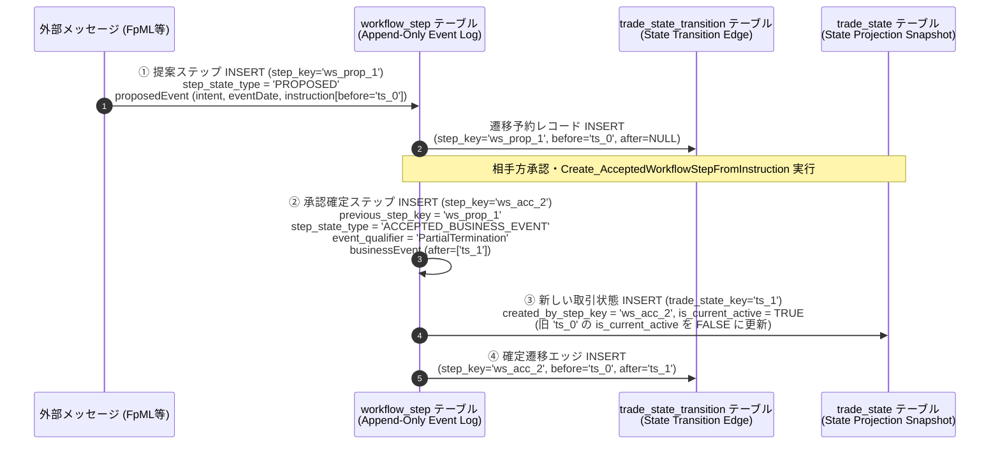
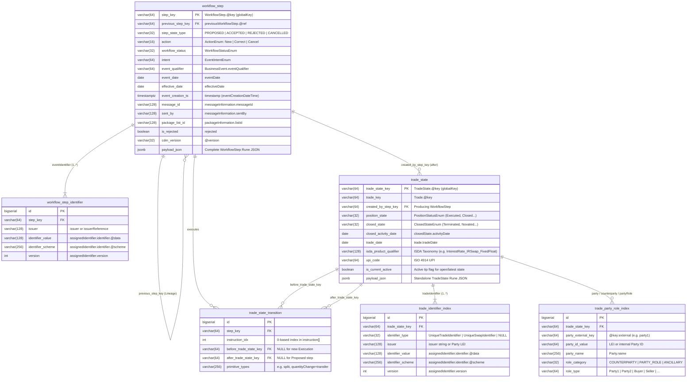
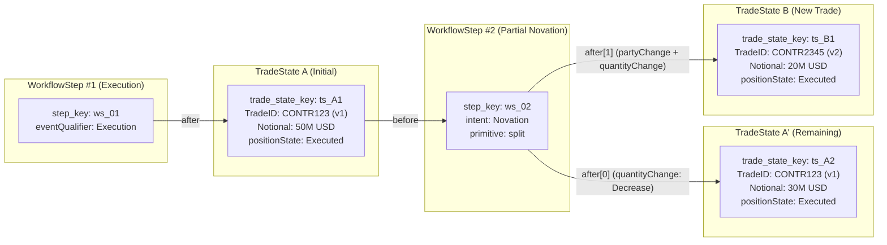

# WorkflowStep & TradeState の RDB 永続化アーキテクチャ設計（ハイブリッド JSONB ＋ イベントソーシングモデル）

本ページでは、FINOS Common Domain Model (CDM) における多様な **`WorkflowStep`**（および内包される **`BusinessEvent`** / **`TradeState`**）の JSON ドキュメントをリレーショナルデータベース（RDB）に永続化する際のテーブル設計指針・正規化境界・ER モデルについて、Rosetta (Rune) DSL の一次仕様に基づき解説します。

---

## 1. なぜ `WorkflowStep` の完全リレーショナル正規化（第3正規形）はアンチパターンなのか？

「データ構造が深く複雑なのでリレーション構造に正規化するのは厳しそう」という直感は、CDM の型システムとシリアライゼーション仕様の観点から**完全に正しい技術的判断**です。`WorkflowStep` 以下のツリーを従来の第3正規形（3NF）で数十〜数百のテーブルに分解（Shredding）しようとすると、以下の 4 つの構造的障壁に直面します。

### 1.1 780 種の型階層・深いネスト・再帰構造
- CDM 全体では **780 件の `type`** と **280 件の `enum`** が定義されており（[rosetta_dsl_inventory.md](../overview/rosetta_dsl_inventory.md) 参照）、`WorkflowStep` から最下層のスケジュール・観測条件まで **10〜15 階層以上のネスト**が存在します。
- `PrimitiveInstruction`（[`event-common-type.rosetta`](../../common-domain-model/rosetta-source/src/main/rosetta/event-common-type.rosetta) L45-L58）は 13 種類のプリミティブ操作を持ち、そのうちの `SplitInstruction`（L188-L190）は `breakdown PrimitiveInstruction (1..*)` として **`PrimitiveInstruction` 自体を再帰的に内包**します。

### 1.2 多重ポリモーフィズムと排他選択（Choice ルール）
- **ワークフローステップの多態性**: `WorkflowStep`（[`event-workflow-type.rosetta`](../../common-domain-model/rosetta-source/src/main/rosetta/event-workflow-type.rosetta) L65-L66）には以下の Choice 制約が存在します：
  ```rosetta
  condition CounterpartyPositionBusinessEventOrBusinessEventOrProposedEventChoice:
      required choice counterpartyPositionBusinessEvent, businessEvent, proposedEvent
  ```
  すなわち、ステップの状態（提案段階の `proposedEvent`、成約・確定後の `businessEvent`、ポジションイベントの `counterpartyPositionBusinessEvent`）によって、保持するサブツリー自体が切り替わります。
- **金融商品の多態性**: `Payout` も金利（`InterestRatePayout`）、オプション（`OptionPayout`）、クレジット（`CreditDefaultPayout`）、決済（`SettlementPayout`）、エクイティ（`PerformancePayout`）、コモディティ（`CommodityPayout`）等のポリモーフィックな直和構造をとります。

### 1.3 ドキュメント内部の横断参照（`@key:scoped` / `@key:external`）の破壊リスク
- **内部参照の破壊リスク**: CDM v7（Rune JSON）では、単一 JSON ドキュメント内の `TradeLot.priceQuantity` と `EconomicTerms.payout` の間を `@key:scoped` / `@ref:scoped` で結び、当事者（`Party`）を `@key:external` / `@ref:external` で参照解決します（[`serialization.md`](../../common-domain-model/docs/serialization.md)、[json_serialization_and_dialects.md](./json_serialization_and_dialects.md) 参照）。
- これらを個別テーブルへ分解してしまうと、オブジェクト復元（ハイドレーション / Hydration）時にスコープ付きキーの整合性が崩れ、`RuneJsonObjectMapper` によるデシリアライズが失敗する原因となります。

### 1.4 決定論的ハッシュ（`@key` / `globalKey`）による不変性（Immutability）の要請
- CDM の `[metadata key]` アノテーションが付与された型（`WorkflowStep`, `BusinessEvent`, `TradeState`, `Trade` 等）の `@key`（旧 `meta.globalKey`）は、オブジェクトツリー全体の構造ハッシュ（`GlobalKeyHashCalculator`）から決定論的に算出されます（[`event-common-type.rosetta`](../../common-domain-model/rosetta-source/src/main/rosetta/event-common-type.rosetta) L513 の `Lineage` 定義コメント参照）。
- RDB のテーブルからオブジェクトを再組み立てする際に 1 フィールドでも順序や空リストの扱いが変わるとハッシュ値（`@key`）が変化し、`previousWorkflowStep` や `before` の参照整合性（Lineage）が破損します。**したがって、CDM の `[rootType]` オブジェクトは JSON 原文（または正規化された JSONB）をそのまま不変（Immutable）に保存することが必須**です。

---

## 2. 推奨アーキテクチャ：「CDM `[rootType]` 境界に基づくハイブリッド JSONB ＋ イベントソーシング設計」

CDM の公式設計思想（[`event-model.md`](../../common-domain-model/docs/event-model.md)）は、そもそも RDB の CRUD（上書き更新）ではなく、**イベントソーシング（Event Sourcing）とイミュータブルな状態遷移（State Transition）** そのものです。

そこで、RDB（PostgreSQL の `JSONB`、Oracle の `JSON`、SQL Server / MySQL の JSON 型など）に永続化する際は、**Rosetta DSL で `[rootType]` かつ `[metadata key]` / `[metadata reference]` が宣言されている境界だけをリレーショナルなエンティティ（テーブル）として切り出し、内部の深い構造は `JSONB` カラムにカプセル化する「ハイブリッド・ドキュメント・リレーショナル設計」** が最適解となります。

### 2.1 正規化境界の原則（3レイヤー・6テーブル構成）

| レイヤー | テーブル名 | 対応する CDM 型 (`rosetta`) | 役割・正規化方針 |
| :--- | :--- | :--- | :--- |
| **Layer 1: イベントストア層**<br>(Append-Only Event Log) | **`workflow_step`** | `WorkflowStep`<br>(`[rootType]`, `[metadata key]`) | すべての提案・承認・拒絶・訂正・取消ステップを不変ログとして記録。ヘッダー属性（`action`, `intent`, `eventQualifier`, `previousWorkflowStep` 等）を列に昇格し、全体 JSON を `JSONB` に格納。 |
| | **`workflow_step_identifier`** | `WorkflowStep.eventIdentifier`<br>(`Identifier (1..*)`) | 複数当事者・プラットフォームが付与するイベント ID / Correlation ID（`1..*` 多重度）の高速逆引きテーブル。 |
| **Layer 2: 取引状態 & 系統グラフ層**<br>(State Snapshot & Lineage DAG) | **`trade_state`** | `TradeState`<br>(`[rootType]`, `[metadata key]`) | イベント実行によって生成された確定取引状態（`after`）および参照用状態（`before`）の不変スナップショット。そのまま後続イベント関数や DRR に投入可能な単体 `TradeState` JSON を保持。 |
| | **`trade_state_transition`** | `Instruction.before` $\rightarrow$ `BusinessEvent.after` | どの `WorkflowStep`（および `instruction[i]`）が、どの `before` (`TradeState`) からどの `after` (`TradeState`) を派生させたかを表す有向非巡回グラフ（DAG）エッジテーブル。 |
| **Layer 3: 検索インデックス投影層**<br>(Read-Model Projection) | **`trade_identifier_index`** | `Trade.tradeIdentifier`<br>(`TradeIdentifier (1..*)`) | UTI / USI / 社内取引番号・バージョン番号（`1..*` 多重度）から `trade_state` を引くための検索インデックス。 |
| | **`trade_party_role_index`** | `Trade.party`, `counterparty`, `partyRole` | 当事者 LEI・内部コード・ロール（`Party1`, `Buyer`, `ClearingOrganization` 等）から取引を検索するためのインデックス。 |

---

## 3. イベントソーシング設計の観点：なぜ `proposedEvent` と `businessEvent` を別テーブルに切り出さないのか？

CDM の `WorkflowStep` を見たとき、「イベントの主役である `proposedEvent`（`EventInstruction` 型）や `businessEvent`（`BusinessEvent` 型）を、`workflow_step` とは別の独立したテーブルに切り出さなくてよいのか？」という疑問が浮かびます。

結論から言うと、イベントソーシング（Event Sourcing）の設計原則および Rosetta DSL の型階層において、**`proposedEvent` と `businessEvent` の差分はすでに `trade_state_transition` と `trade_state` に切り出されており、`workflow_step` と 1 対 1 のヘッダー情報は単一テーブルに統合する（Single-Table パターン）のが最も合理的**です。その根拠を 4 つの観点から解説します。

### 3.1 エンベロープ（封筒）とペイロード（中身）の不可分な 1:1 構造

イベントソーシングにおけるイベントストア（Event Store）の 1 レコードは、常に **「① エンベロープ（監査・ルーティング用メタデータ）」** と **「② ペイロード（イベント本体）」** のペアで構成されます。

CDM では、この役割分担が以下のように設計されています（[`event-workflow-type.rosetta`](../../common-domain-model/rosetta-source/src/main/rosetta/event-workflow-type.rosetta) L37-L86、[`event-common-type.rosetta`](../../common-domain-model/rosetta-source/src/main/rosetta/event-common-type.rosetta) L60-L68）：

| 構成要素 | CDM における該当箇所 | 保持する属性 |
| :--- | :--- | :--- |
| **① イベント・エンベロープ**<br>(Event Envelope / Metadata) | `WorkflowStep` の外殻属性 | `eventIdentifier`（イベントID）、`timestamp`（発生・作成時刻）、`previousWorkflowStep`（因果関係 / Causation ID）、`action`（`New` / `Correct` / `Cancel`）、`party` / `approval`（関与者・承認）、`messageInformation` |
| **② イベント・ペイロード**<br>(Event Payload / Body) | `proposedEvent` (`EventInstruction`)<br>または<br>`businessEvent` (`BusinessEvent`) | `intent`（意図）、`eventDate`（事象日）、`effectiveDate`（発効日）、`packageInformation`、`instruction[]`（`before` + `primitiveInstruction`）、および確定後の `eventQualifier` と `after[]` |

重要な点として、`BusinessEvent` 単体には**タイムスタンプ（`timestamp`）も、イベント識別子（`eventIdentifier`）も、訂正・取消区分（`action`）も、前のイベントへのポインタ（`previousWorkflowStep`）も存在しません**。これらはすべて親の `WorkflowStep` 側に定義されています。
また、`WorkflowStep` 内の `proposedEvent` と `businessEvent` は多重度 `(0..1)` の排他選択（`required choice`）であり、`[metadata reference]` も付いていないため、**複数の `WorkflowStep` から同じ `BusinessEvent` が共有参照されることは絶対にありません（厳密な 1:1 包含関係）**。したがって、テーブルを分けると常に 1:1 JOIN が発生するだけの無意味な分割になってしまいます。

### 3.2 `BusinessEvent extends EventInstruction` という継承関係と、真の差分の切り出し先

[`event-common-type.rosetta`](../../common-domain-model/rosetta-source/src/main/rosetta/event-common-type.rosetta)（L60-L66）を確認すると、`BusinessEvent` は `proposedEvent` の型である `EventInstruction` をそのまま継承（`extends`）しています：

```rosetta
type EventInstruction:
    intent EventIntentEnum (0..1)
    corporateActionIntent CorporateActionTypeEnum (0..1)
    eventDate date (0..1)
    eventTime TimeZone (0..1)
    effectiveDate date (0..1)
    effectiveTime TimeZone (0..1)
    packageInformation IdentifiedList (0..1)
    instruction Instruction (0..*)

type BusinessEvent extends EventInstruction:
    [metadata key]
    [rootType]
    eventQualifier string (0..1)
    after TradeState (0..*)
```

つまり、`proposedEvent` と `businessEvent` のスキーマ上の違いは、**`eventQualifier`（1項目）と `after: TradeState (0..*)`（複数件の出力状態）の 2 つだけ**です。
そして本設計では：
1. **共通の単一値属性**（`intent`, `eventDate`, `effectiveDate`, `packageInformation`）＋ `BusinessEvent` 固有の単一値属性（`eventQualifier`） $\rightarrow$ **`workflow_step` テーブルのカラム**へ昇格。
2. **複数件になり得る `instruction (0..*)`（入力 `before` とプリミティブ命令）および `after (0..*)`（出力 `TradeState`）** $\rightarrow$ **`trade_state_transition` テーブルと `trade_state` テーブル**へ独立して切り出し済み。

という形で、**実質的に `proposedEvent` / `businessEvent` の中身のうち多重度 `0..*` を持つ構造要素はすでに Layer 2（`trade_state_transition` / `trade_state`）として正規化・分離されています**。

### 3.3 2段階イベントソーシング（提案 Command Event $\rightarrow$ 確定 Domain Event）の遷移フロー

[`Create_AcceptedWorkflowStepFromInstruction`](../../common-domain-model/rosetta-source/src/main/rosetta/event-workflow-func.rosetta)（L111-L145）の実装を見ると、CDM がどのようにイベントソーシングを行っているかが明確に分かります：



このように、CDM のワークフローでは「提案された（`PROPOSED`）」という事実と、「承認されて状態遷移が確定した（`ACCEPTED_BUSINESS_EVENT`）」という事実が、**既存の行を上書きするのではなく、それぞれ独立した不変のイベントレコードとして `workflow_step` テーブルに時系列で追記（Append-Only）** され、`previous_step_key` で鎖のように繋がれます。これこそが純粋なイベントソーシングの構造です。

### 3.4 【例外パターン】もし `business_event` テーブルを独立させるのはどういう場合か？

唯一の例外として、`business_event` を独立テーブル（または専用ビュー）にする価値があるのは以下の 2 ケースです：

1. **`WorkflowStep` を使わず裸の `BusinessEvent`（`[rootType]`）を直接やり取りするシステムと共存する場合**:
   - 社内バッチ処理（金利リセット `Create_Reset` など）で `WorkflowStep` エンベロープを作らずに `BusinessEvent` 単体の JSON を生成・保存する場合、`workflow_step` とは別に `business_event` テーブル（主キー `business_event_key` = `BusinessEvent.@key`、`step_key` は NULL 許容外部キー）を設けると両方を受け入れられます。
   - ただし、実務上はバッチ処理であっても監査証跡（いつ・どのジョブが実行したか）を残すため、`Create_WorkflowStep` で薄い `WorkflowStep` エンベロープに包んで統一的に保存する方がシンプルです。
2. **下流システム（会計・リスク・規制報告）が「確定済みの BusinessEvent」だけを参照したい場合**:
   - 物理テーブルを分けなくても、RDB 上で以下の**確定イベント専用ビュー（または Partial Index）** を定義するだけで、提案中（`PROPOSED`）や拒絶（`REJECTED`）・取消済み（`Cancel`）のノイズを完全に除外した「純粋な確定 BusinessEvent テーブル」として下流に提供できます：
   ```sql
   CREATE VIEW confirmed_business_event_view AS
   SELECT
       step_key AS workflow_step_key,
       payload_json -> 'businessEvent' ->> '@key' AS business_event_key,
       event_qualifier,
       intent,
       event_date,
       effective_date,
       action,
       event_creation_ts,
       payload_json -> 'businessEvent' AS business_event_json
   FROM workflow_step ws
   WHERE step_state_type = 'ACCEPTED_BUSINESS_EVENT'
     AND NOT EXISTS (
         -- 後続ステップで Cancel（取消）されていない最新の有効イベントのみ抽出
         SELECT 1 FROM workflow_step next_ws
         WHERE next_ws.previous_step_key = ws.step_key
           AND next_ws.action = 'Cancel'
     );
   ```

---

## 4. ER 図（エンティティ・リレーションシップ図）



---

## 5. 各テーブルの詳細定義と CDM DSL マッピング根拠

### 5.1 Layer 1: `workflow_step` & `workflow_step_identifier`

[`event-workflow-type.rosetta`](../../common-domain-model/rosetta-source/src/main/rosetta/event-workflow-type.rosetta)（L37-L66）の `WorkflowStep` 定義に基づき、ワークフロー制御・メッセージルーティング・イベント分類に使われるトップレベル属性をリレーショナルカラムとして抽出します。

#### なぜ `step_state_type` カラムを設けるのか？
`WorkflowStep` の状態は、`condition WorkflowStepStatus`（L58-L63）および `condition CounterpartyPositionBusinessEventOrBusinessEventOrProposedEventChoice`（L65-L66）により以下のいずれかに分類されます：
- **`PROPOSED`**: `proposedEvent` が存在（FpML `executionAdvice` 取り込み直後など、未承認の命令提案状態）。
- **`ACCEPTED_BUSINESS_EVENT`**: `businessEvent` が存在（`Create_AcceptedWorkflowStepFromInstruction` 等により状態遷移が確定し `after: TradeState` が生成された状態）。
- **`ACCEPTED_POSITION_EVENT`**: `counterpartyPositionBusinessEvent` が存在（ポジションレベルのイベント）。
- **`REJECTED`**: `rejected = True`（提案されたステップが拒絶された状態）。
- **`CANCELLED`**: `action = ActionEnum -> Cancel` かつ `previousWorkflowStep` が存在（以前のステップの取消・撤回）。

これらを明示的な区分カラム `step_state_type` として保持することで、「現在承認待ち（Pending/Proposed）のワークフローステップ一覧」や「確定済み（Accepted）のビジネスイベント履歴」をインデックスのみで瞬時にクエリできます。

#### SQL DDL 例（PostgreSQL）

```sql
CREATE TABLE workflow_step (
    step_key            VARCHAR(64) PRIMARY KEY, -- WorkflowStep.@key (CDM globalKey)
    previous_step_key   VARCHAR(64) REFERENCES workflow_step(step_key), -- previousWorkflowStep.@ref
    step_state_type     VARCHAR(32) NOT NULL,    -- PROPOSED | ACCEPTED_BUSINESS_EVENT | ACCEPTED_POSITION_EVENT | REJECTED | CANCELLED
    action              VARCHAR(16),             -- ActionEnum: New | Correct | Cancel
    workflow_status     VARCHAR(32),             -- workflowState.workflowStatus (Accepted, Pending, Rejected, etc.)
    intent              VARCHAR(64),             -- EventIntentEnum (ContractFormation, Novation, OptionExercise, etc.)
    corporate_action_intent VARCHAR(64),         -- CorporateActionTypeEnum
    event_qualifier     VARCHAR(64),             -- BusinessEvent.eventQualifier (Execution, PartialTermination, Reset, etc.)
    event_date          DATE,                    -- proposedEvent/businessEvent.eventDate
    effective_date      DATE,                    -- proposedEvent/businessEvent.effectiveDate
    event_creation_ts   TIMESTAMPTZ NOT NULL,    -- timestamp[qualification='eventCreationDateTime'].dateTime
    message_id          VARCHAR(128),            -- messageInformation.messageId.@data
    sent_by             VARCHAR(128),            -- messageInformation.sentBy.@data
    package_list_id     VARCHAR(128),            -- packageInformation.listId.assignedIdentifier[0].identifier.@data
    is_rejected         BOOLEAN DEFAULT FALSE,   -- rejected
    cdm_version         VARCHAR(32) NOT NULL,    -- @version (e.g. '7.4.0')
    payload_json        JSONB NOT NULL,          -- WorkflowStep 完全 Rune JSON
    created_at          TIMESTAMPTZ NOT NULL DEFAULT CURRENT_TIMESTAMP
);

CREATE INDEX idx_ws_prev_key ON workflow_step(previous_step_key);
CREATE INDEX idx_ws_state_intent ON workflow_step(step_state_type, intent, event_date);
CREATE INDEX idx_ws_qualifier_date ON workflow_step(event_qualifier, event_date);
CREATE INDEX idx_ws_message_id ON workflow_step(message_id);

-- WorkflowStep.eventIdentifier (1..*) の 1:N インデックステーブル
CREATE TABLE workflow_step_identifier (
    id                  BIGSERIAL PRIMARY KEY,
    step_key            VARCHAR(64) NOT NULL REFERENCES workflow_step(step_key) ON DELETE CASCADE,
    issuer              VARCHAR(128),            -- issuer.@data または解決済み issuerReference Party ID
    identifier_value    VARCHAR(128) NOT NULL,   -- assignedIdentifier[].identifier.@data
    identifier_scheme   VARCHAR(256),            -- assignedIdentifier[].identifier.@scheme
    version             INT                      -- assignedIdentifier[].version
);

CREATE INDEX idx_wsi_val ON workflow_step_identifier(identifier_value, issuer);
```

---

### 5.2 Layer 2: `trade_state` & `trade_state_transition`（状態スナップショットと系統グラフ）

CDM において最も重要な設計上のポイントは、**「`WorkflowStep` と `TradeState` は 1 対 1 ではない」** という点です（[`event-common-type.rosetta`](../../common-domain-model/rosetta-source/src/main/rosetta/event-common-type.rosetta) L31-L66, [`event-common-func.rosetta`](../../common-domain-model/rosetta-source/src/main/rosetta/event-common-func.rosetta) L2110-L2142）：

1. **1 対 N の分岐（Split / Allocation / Novation）**:
   - 一部契約更改（Partial Novation）やアロケーションでは、1 つの `before: TradeState` に対して `SplitInstruction` が適用され、`BusinessEvent.after` には **複数の `TradeState`**（例: `after[0]` = 元契約の減額または `Closed/Novated` 状態、`after[1]` = 新カウンターパーティとの新規契約 `Executed` 状態）が生成されます。
2. **N 対 1 / N 対 M の統合（Compression / Portfolio Rebalancing）**:
   - 複数の `Instruction`（それぞれ異なる `before: TradeState` を持つ）が 1 つの `BusinessEvent` に束ねられます。
3. **提案段階（`proposedEvent`）における `after` の不在**:
   - `proposedEvent` の段階では `instruction[].before` のみが存在し、`after` はまだ存在しません。

したがって、`TradeState` を `workflow_step` から独立した **`trade_state` テーブル** に切り出し、両者の間の入力（`before`）・出力（`after`）関係を **`trade_state_transition`（遷移エッジテーブル）** で結ぶことで、取引ライフサイクル全体の有向非巡回グラフ（DAG）を SQL の再帰クエリ（`WITH RECURSIVE`）で自在に追跡できるようになります。



#### SQL DDL 例（PostgreSQL）

```sql
CREATE TABLE trade_state (
    trade_state_key         VARCHAR(64) PRIMARY KEY, -- TradeState.@key (CDM globalKey)
    trade_key               VARCHAR(64),             -- TradeState.trade.@key
    created_by_step_key     VARCHAR(64) REFERENCES workflow_step(step_key), -- 生成元の承認済み WorkflowStep
    position_state          VARCHAR(32),             -- state.positionState (Executed, Formed, Settled, Closed, etc.)
    closed_state            VARCHAR(32),             -- state.closedState.state (Terminated, Novated, Allocated, Exercised, etc.)
    closed_activity_date    DATE,                    -- state.closedState.activityDate
    trade_date              DATE NOT NULL,           -- trade.tradeDate.@data
    isda_product_qualifier  VARCHAR(128),            -- trade.product.taxonomy[source='ISDA'].value.name.@data
    upi_code                VARCHAR(64),             -- trade.product.identifier[source='UPI'].identifier.@data
    is_current_active       BOOLEAN NOT NULL DEFAULT FALSE, -- 最新かつ有効な状態の高速フィルタ用フラグ
    payload_json            JSONB NOT NULL,          -- 単体で完結した cdm.event.common.TradeState Rune JSON
    created_at              TIMESTAMPTZ NOT NULL DEFAULT CURRENT_TIMESTAMP
);

CREATE INDEX idx_ts_active_product ON trade_state(is_current_active, isda_product_qualifier, trade_date);
CREATE INDEX idx_ts_position_state ON trade_state(position_state, closed_state);
CREATE INDEX idx_ts_created_by_step ON trade_state(created_by_step_key);

-- Instruction.before と BusinessEvent.after を結ぶ状態遷移グラフエッジ
CREATE TABLE trade_state_transition (
    id                      BIGSERIAL PRIMARY KEY,
    step_key                VARCHAR(64) NOT NULL REFERENCES workflow_step(step_key) ON DELETE CASCADE,
    instruction_idx         INT NOT NULL DEFAULT 0,  -- EventInstruction.instruction[] の配列インデックス
    before_trade_state_key  VARCHAR(64) REFERENCES trade_state(trade_state_key), -- 新規 Execution 時は NULL
    after_trade_state_key   VARCHAR(64) REFERENCES trade_state(trade_state_key), -- Proposed 段階では NULL
    after_idx               INT,                     -- BusinessEvent.after[] の配列インデックス
    primitive_types         VARCHAR(256) NOT NULL    -- 適用された PrimitiveInstruction 名（例: 'split', 'quantityChange,transfer'）
);

CREATE INDEX idx_tst_before ON trade_state_transition(before_trade_state_key);
CREATE INDEX idx_tst_after ON trade_state_transition(after_trade_state_key);
CREATE INDEX idx_tst_step ON trade_state_transition(step_key);
```

---

### 5.3 Layer 3: `trade_identifier_index` & `trade_party_role_index`（業務検索インデックス層）

実務システムで最も頻繁に実行されるクエリは「特定の UTI / USI / 社内契約番号から現在の `TradeState` と過去の `WorkflowStep` 履歴を引く」「特定のカウンターパーティ（LEI）との未決済取引一覧を取得する」という 2 パターンです。

これらは CDM 上では `Trade.tradeIdentifier (1..*)` および `Trade.party (0..*)` / `Trade.counterparty (2..2)` / `Trade.partyRole (0..*)` という配列構造になっているため、専用の軽量インデックステーブルに展開します。

```sql
-- Trade.tradeIdentifier (1..*) の検索インデックステーブル
CREATE TABLE trade_identifier_index (
    id                  BIGSERIAL PRIMARY KEY,
    trade_state_key     VARCHAR(64) NOT NULL REFERENCES trade_state(trade_state_key) ON DELETE CASCADE,
    identifier_type     VARCHAR(32),             -- TradeIdentifierTypeEnum: UniqueTradeIdentifier | UniqueSwapIdentifier
    issuer              VARCHAR(128),            -- issuer.@data または解決済み issuerReference Party ID
    identifier_value    VARCHAR(128) NOT NULL,   -- assignedIdentifier[].identifier.@data
    identifier_scheme   VARCHAR(256),            -- assignedIdentifier[].identifier.@scheme
    version             INT                      -- assignedIdentifier[].version
);

CREATE INDEX idx_tii_val_type ON trade_identifier_index(identifier_value, identifier_type);
CREATE INDEX idx_tii_state ON trade_identifier_index(trade_state_key);

-- Trade.party / counterparty / partyRole の参照解決済み検索インデックステーブル
CREATE TABLE trade_party_role_index (
    id                  BIGSERIAL PRIMARY KEY,
    trade_state_key     VARCHAR(64) NOT NULL REFERENCES trade_state(trade_state_key) ON DELETE CASCADE,
    party_external_key  VARCHAR(64),             -- ドキュメント内の @key:external (例: 'party1', '_fund')
    party_id_value      VARCHAR(128),            -- Party.partyId[0].identifier.@data (LEI 等)
    party_id_type       VARCHAR(32),             -- PartyIdentifierTypeEnum: LEI | BIC | MIC
    party_name          VARCHAR(256),            -- Party.name.@data
    role_category       VARCHAR(32) NOT NULL,    -- COUNTERPARTY | PARTY_ROLE | ANCILLARY_PARTY
    role_type           VARCHAR(64) NOT NULL     -- CounterpartyRoleEnum (Party1, Party2) または PartyRoleEnum (Buyer, Seller, ClearingOrganization...)
);

CREATE INDEX idx_tpri_party_id ON trade_party_role_index(party_id_value, role_type);
CREATE INDEX idx_tpri_state ON trade_party_role_index(trade_state_key);
```

---

## 6. 実務で重要となる 4 つの永続化・運用デザインパターン

### 6.1 パターン①：`Instruction.before` のインライン展開（Hydrated）と参照ポインタ（`@ref`）の扱い
[`event-common-type.rosetta`](../../common-domain-model/rosetta-source/src/main/rosetta/event-common-type.rosetta)（L34-L35）において、`Instruction.before` は以下のように定義されています：
```rosetta
type Instruction:
    primitiveInstruction PrimitiveInstruction (0..1)
    before TradeState (0..1)
        [metadata reference]
```
`[metadata reference]` が付与されているため、CDM JSON における `before` には **2 つの表現形態** が存在します：
1. **インライン展開形式（Hydrated）**: FpML Ingestion 直後の `WorkflowStep`（例: `msg-ex52-execution-advice-trade-partial-novation-C02-00.json`）のように、`before` の中に `Trade` 全体がネストして埋め込まれている形式。
2. **キー参照形式（Dehydrated Reference）**: `{"before": {"@ref": "ba4f9326"}}` のように、既存の `TradeState.@key` へのポインタのみを持つ形式。

**【RDB 永続化時のベストプラクティス】**:
- `WorkflowStep` を受信・保存する際、`before` がインライン展開されている場合は、その `before` オブジェクト（`TradeState`）の `@key`（`globalKey`）を計算して `trade_state` テーブルに（未登録であれば）UPSERT し、`trade_state_transition.before_trade_state_key` に記録します。
- `before` が `{"@ref": "..."}` の参照ポインタ形式で届いた場合は、`trade_state` テーブルから該当 `trade_state_key` の `payload_json` を引いて参照解決（実体復元 / Hydration）することで、いつでも完全な `TradeState` オブジェクトとして `Create_AcceptedWorkflowStepFromInstruction` 等の CDM 関数へ渡すことができます。

### 6.2 パターン②：訂正（`action: Correct`）と取消（`action: Cancel`）のイミュータブル処理
[`event-workflow-func.rosetta`](../../common-domain-model/rosetta-source/src/main/rosetta/event-workflow-func.rosetta)（L15-L66）の `Create_WorkflowStep` が規定する通り、イベントの訂正（`Correct`）や取消（`Cancel`）が発生した場合でも、**既存の `workflow_step` レコードを `UPDATE` / `DELETE` してはなりません**。
- 新しい `WorkflowStep` レコードを `INSERT` し、`previous_step_key` に元の `WorkflowStep.@key` をセットします。
- 取消（`Cancel`）または訂正（`Correct`）が承認された時点で、旧ステップが生成した `trade_state` の `is_current_active` フラグを `FALSE` に落とし、訂正後の新 `trade_state`（または取消前の直前 `trade_state`）の `is_current_active` を `TRUE` に更新します。これにより、完全な監査証跡（Audit Trail）と最新ポジションの高速参照が両立します。

### 6.3 パターン③：商品固有属性（名目元本・通貨・満期日等）のクエリには「生成列」または「GIN インデックス」を活用
商品の経済条件（`EconomicTerms` や `TradeLot.priceQuantity`）を別テーブルに正規化しなくても、現代の RDB が備える **JSONB インデックス機能** を使うことで、SQL から直接高速検索が可能です。

- **GIN インデックス**: `CREATE INDEX idx_ts_jsonb ON trade_state USING GIN (payload_json jsonb_path_ops);` を定義すれば、任意の深い階層（例: 特定参照金利 `FloatingRateOptionEnum` や特定通貨を含む取引）をミリ秒単位で検索できます。
- **生成列（Generated Columns）または決済ビュー**: 頻繁に集計軸となる「契約満期日（`terminationDate`）」などは、`trade_state` テーブルの `GENERATED ALWAYS AS (...) STORED` カラムとして JSON パスから自動抽出することで、アプリケーション側のマッピングコードを増やさずにインデックス検索が可能になります。

### 6.4 パターン④：系譜追跡（Lineage）の SQL 再帰クエリ例
一部更改（Novation）や分割（Allocation）によって取引 ID（`tradeIdentifier`）が途中で変わった場合でも、`trade_state_transition` テーブルを辿ることで、起源となる新規約定（`Execution`）から現在の全派生ポジションまでを 1 本の SQL で追跡できます：

```sql
-- 特定の初期 TradeState ('ts_initial_key') から派生したすべての後続 TradeState とイベント履歴を再帰取得
WITH RECURSIVE lineage_graph AS (
    SELECT
        tst.step_key,
        tst.before_trade_state_key,
        tst.after_trade_state_key,
        tst.primitive_types,
        1 AS depth
    FROM trade_state_transition tst
    WHERE tst.before_trade_state_key = 'ts_initial_key'
  UNION ALL
    SELECT
        next_tst.step_key,
        next_tst.before_trade_state_key,
        next_tst.after_trade_state_key,
        next_tst.primitive_types,
        lg.depth + 1
    FROM trade_state_transition next_tst
    INNER JOIN lineage_graph lg ON next_tst.before_trade_state_key = lg.after_trade_state_key
)
SELECT
    lg.depth,
    ws.event_date,
    ws.action,
    ws.intent,
    ws.event_qualifier,
    lg.primitive_types,
    ts.trade_state_key,
    ts.position_state,
    ts.closed_state,
    ts.is_current_active
FROM lineage_graph lg
JOIN workflow_step ws ON ws.step_key = lg.step_key
LEFT JOIN trade_state ts ON ts.trade_state_key = lg.after_trade_state_key
ORDER BY lg.depth, ws.event_creation_ts;
```

---

## 7. 関連ドキュメント
- [WorkflowStep 構造と FpML ライフサイクル変換サンプル (Execution Advice)](./workflow_step_and_lifecycle_samples.md)
- [取引イベント & ライフサイクル (Business Event データ構造)](./event_lifecycle.md)
- [CDM JSON シリアライゼーション仕様 & バージョン比較 (v6.x vs v7.x)](./json_serialization_and_dialects.md)
- [主要エンティティ & データ型リファレンス (`TradeState`, `BusinessEvent`, `Payout`)](../entities/core_data_types.md)

