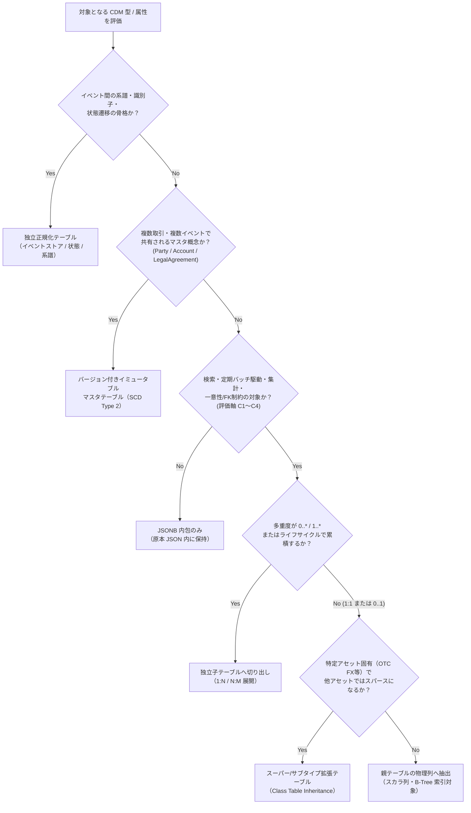
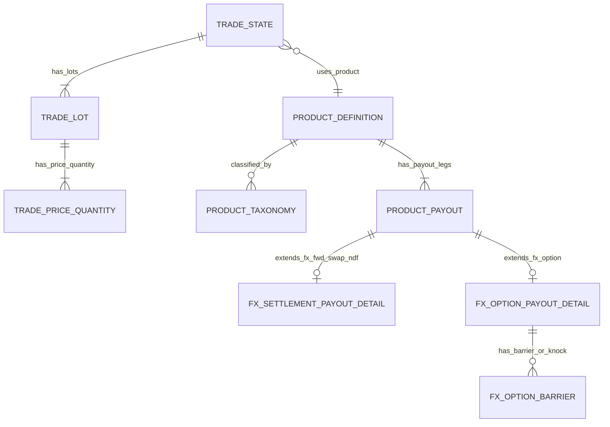

# CDM v6 `WorkflowStep` RDB 永続化 ER 設計 要求定義書

## 1. 目的・背景および前提条件

### 1.1 背景と目的
FINOS Common Domain Model（以下、CDM）は、金融取引およびそのライフサイクルイベントを機械可読かつ標準化された形式で表現するドメインモデルである。CDM の最上位メッセージ単位である `WorkflowStep` は、約定から契約形成、条件変更、リセット、キャッシュフロー決済、清算、更改、解約、満期に至る取引状態（`TradeState`）の遷移を、イミュータブルなイベント連鎖として表現する設計となっている。

一方で、CDM のデータ構造は多層ネスト、`choice` 型による多態性、商品種別ごとの分岐、配列（`0..*`）の入れ子、およびモデル内クロスリファレンス（`[metadata key]` / `[metadata reference]` / `[metadata address]`）を含み、そのままリレーショナルデータベース（RDB）へ全面的に正規化することはスキーマ肥大化・結合コスト増大・保守性低下の観点から現実的ではない。

本要求定義書は、CDM v6 準拠の `WorkflowStep` JSON データを RDB へ永続化するにあたり、以下を明確に定義することを目的とする。

1. `WorkflowStep` のイベントソーシング指向とイミュータブルな状態遷移特性を維持する永続化アーキテクチャの要件
2. 取引ライフサイクル管理業務および定期イベント処理のデータ操作ユースケースとアクセスパターン要件
3. CDM DSL の多数の型に対し、「テーブルに切り出すもの」と「JSON データ内にのみ保持するもの」を客観的に決定するための判断フレームワークと分類基準
4. 設計上の主要トレードオフ（系譜表現、JSON 原本格納粒度、スキーマ方針、マスタ管理）の比較整理と推奨方針

### 1.2 前提条件
- **対象 CDM バージョン**: CDM バージョン 6 系。すべての型定義・属性・多重度・制約条件は、一次情報ソースであるワークスペース内の Rosetta DSL（`common-domain-model/rosetta-source/src/main/rosetta/` 配下）を正とする。
- **対象 RDB**: PostgreSQL（`JSONB` 型および標準的なインデックス機能の利用を前提とする）。
- **想定規模と設計優先度**: 小〜中規模の業務システム初期導入および PoC を想定する（有効取引数千〜数万件、日次イベント数千件規模）。過度な分散・高度チューニングよりも、**機能要件の充足、データモデルの明快さ、保守性・シンプルさ**を優先する。

### 1.3 対象スコープ

#### 1.3.1 対象とする `WorkflowStep` の範囲
[event-workflow-type.rosetta](file:///e:/dev/java/my_cdm_wiki/common-domain-model/rosetta-source/src/main/rosetta/event-workflow-type.rosetta#L37-L69) に定義される以下の 4 領域をすべて永続化・管理対象とする。

1. **確定済み取引イベント**: `WorkflowStep.businessEvent`（`BusinessEvent`）および遷移後状態 `after`（`TradeState`）
2. **提案・承認・却下ワークフロー**: `proposedEvent`（`EventInstruction`）、`nextEvent`（`EventInstruction`）、`approval`（`WorkflowStepApproval`）、`rejected` フラグ、`workflowState`（`WorkflowState`）
3. **訂正・取消イベントと系譜**: `action`（`ActionEnum`: `New` / `Correct` / `Cancel`）および `previousWorkflowStep` 参照によるイベント連鎖
4. **ポジション系イベント**: `WorkflowStep.counterpartyPositionBusinessEvent`（`CounterpartyPositionBusinessEvent`）および `CounterpartyPositionState`

#### 1.3.2 対象金融商品の範囲
- **主スコープ**: **OTC FX デリバティブ**（FX Spot / FX Forward、FX Swap、NDF、NDS、FX Vanilla Option、NDO、FX Barrier / Digital / Asian Option 等）
- **拡張スコープ**: 共通コア構造を商品非依存とすることで、その他の OTC デリバティブ（金利スワップ、クレジットデリバティブ、エクイティスワップ等）も自然な拡張でカバーできる設計とする。

#### 1.3.3 対象業務スコープ
- **取引ライフサイクル管理**: 約定（Execution）、契約形成（ContractFormation）、増減額（Increase / Decrease）、条件変更（ContractTermsAmendment）、更改（Novation）、割当（Allocation / Reallocation）、清算（Clearing）、圧縮（Compression）、一部/全部解約（Termination）、訂正・取消（Correct / Cancel）
- **定期イベント処理**: NDF / NDO 等のフィキシング・リセット（Reset）、キャッシュフロー生成および決済ステータス管理（Transfer / TransferState）、満期到来・権利行使/失効処理（Maturity / OptionExercise / Expiry）、バリア・トリガ観測（ObservationEvent）、評価額履歴管理（Valuation）

---

## 2. CDM v6 `WorkflowStep` のドメイン構造分析（一次ソース準拠）

ER 設計の前提となる CDM v6 の構造的特性を、一次ソース（Rosetta DSL）に基づき整理する。

### 2.1 `WorkflowStep` の状態モデルと制約条件
[event-workflow-type.rosetta](file:///e:/dev/java/my_cdm_wiki/common-domain-model/rosetta-source/src/main/rosetta/event-workflow-type.rosetta#L37-L68) および [event-workflow-func.rosetta](file:///e:/dev/java/my_cdm_wiki/common-domain-model/rosetta-source/src/main/rosetta/event-workflow-func.rosetta#L14-L222) により、`WorkflowStep` は以下の状態遷移構造を持つ。

| ステップ種別 | 主要属性の充足条件 | `previousWorkflowStep` | `action` の遷移規則（`event-workflow-func.rosetta` 準拠） |
|---|---|---|---|
| **確定済み（取引）** | `businessEvent` が存在、`rejected`・`nextEvent.instruction` 不在 | 任意（`as-key` 参照） | 先行なしは `New` のみ。先行が `New`/`Correct` なら `New`/`Correct`/`Cancel` 可。`Cancel` 後は不可 |
| **確定済み（ポジション）** | `counterpartyPositionBusinessEvent` が存在 | 任意 | `businessEvent` と排他（`CounterpartyPositionBusinessEventOrBusinessEventChoice`） |
| **提案中（Proposed）** | `proposedEvent` が存在、`nextEvent`・`rejected` 不在 | 任意（訂正時は先行提案を参照） | 先行なしまたは先行確定イベント後は `New`。先行提案の訂正時は `Correct` |
| **却下（Rejected）** | `rejected = True`、`businessEvent`・`nextEvent` 不在 | 必須（先行の提案ステップを参照） | `Create_RejectedWorkflowStep` により生成 |
| **取消（Cancelled）** | `action = ActionEnum -> Cancel`、`previousWorkflowStep` が存在 | 必須（取消対象ステップを参照） | `Create_WorkflowStep` の仕様上、取消時は `businessEvent` 不在で先行ステップへ系譜参照を持つ |
| **次イベント予定** | `nextEvent.instruction` が存在、`businessEvent`・`rejected` 不在 | 任意 | 後続イベントの事前指示を保持 |

> [!NOTE]
> `WorkflowStep` の `condition CounterpartyPositionBusinessEventOrBusinessEventChoice` は `required choice counterpartyPositionBusinessEvent, businessEvent` として定義されているが、提案・却下・取消ステップでは双方とも不在となる（`WorkflowStepStatus` 参照）。アプリ層の CDM バリデーション運用および RDB 制約設計では、確定ステップと非確定ステップの差異を前提に扱う必要がある。

### 2.2 単線連鎖と多対多遷移（DAG）の二重構造
CDM v6 には 2 種類の系譜リンクが存在する。

1. **ワークフロー連鎖（単線 / ツリー）**: `WorkflowStep.previousWorkflowStep`（多重度 `0..1`、`[metadata reference]`）。提案 → 承認/却下、または確定イベント → 訂正/取消の系列を表す。
2. **取引状態遷移グラフ（多対多 DAG）**: [event-common-type.rosetta](file:///e:/dev/java/my_cdm_wiki/common-domain-model/rosetta-source/src/main/rosetta/event-common-type.rosetta#L29-L66) において、`BusinessEvent`（`EventInstruction` を継承）は `instruction Instruction (0..*)` と `after TradeState (0..*)` を持つ。各 `Instruction` は `before TradeState (0..1) [metadata reference]` と `primitiveInstruction PrimitiveInstruction (0..1)` を持つ。
   - **0 対 1**: 新規約定（`Execution`：`before` 不在、`after` に 1 件生成）
   - **1 対 1**: 契約形成、増減額、条件変更、リセット、キャッシュフロー転送、全部解約
   - **1 対 N**: `SplitInstruction` を伴う割当（Allocation）、清算（Clearing：元取引 Closed ＋ Alpha/Beta/Gamma 等）、更改（Novation：旧取引 Closed ＋ 新取引生成）
   - **N 対 1 / N 対 M**: 圧縮（Compression：複数 `Instruction.before` → 圧縮後の `after` 群）

### 2.3 OTC FX デリバティブの CDM v6 商品構造
[product-qualification-func.rosetta](file:///e:/dev/java/my_cdm_wiki/common-domain-model/rosetta-source/src/main/rosetta/product-qualification-func.rosetta#L1594-L1785)、[product-template-type.rosetta](file:///e:/dev/java/my_cdm_wiki/common-domain-model/rosetta-source/src/main/rosetta/product-template-type.rosetta#L121-L395)、[product-common-settlement-type.rosetta](file:///e:/dev/java/my_cdm_wiki/common-domain-model/rosetta-source/src/main/rosetta/product-common-settlement-type.rosetta#L104-L385)、および [observable-asset-type.rosetta](file:///e:/dev/java/my_cdm_wiki/common-domain-model/rosetta-source/src/main/rosetta/observable-asset-type.rosetta#L39-L246) に基づく OTC FX 商品の構成対応は以下の通りである。

| FX 商品種別 | CDM 適格性判定関数（`product-qualification-func.rosetta`） | `Payout` 構成 | 主要な商品・スケジュール・決済属性の格納位置 |
|---|---|---|---|
| **FX Spot / FX Forward** | `Qualify_ForeignExchange_Spot_Forward` | `SettlementPayout` × 1（`cashSettlementTerms` 不在） | `TradeLot.priceQuantity`（2 通貨数量 + `ExchangeRate` / `PriceComposite`）、`SettlementPayout.settlementTerms.settlementDate.valueDate` 等 |
| **FX Swap** | `Qualify_ForeignExchange_Swap` | `SettlementPayout` × 2（Near / Far、`cashSettlementTerms` 不在） | 各レグの `SettlementPayout.settlementTerms.settlementDate`、各レグに対応する `PriceQuantity` |
| **NDF** | `Qualify_ForeignExchange_NDF` | `SettlementPayout` × 1（`cashSettlementTerms` 存在） | `settlementTerms.settlementCurrency`、`cashSettlementTerms.valuationDate.fxFixingDate`、`ForeignExchangeRateIndex`（`quotedCurrencyPair` / `primaryFxSpotRateSource`） |
| **NDS** | `Qualify_ForeignExchange_NDS` | `SettlementPayout` × 2（`cashSettlementTerms` 存在） | Near / Far 各レグの `fxFixingDate`・`settlementDate`・`settlementCurrency` |
| **FX Vanilla Option** | `Qualify_ForeignExchange_VanillaOption` | `OptionPayout` × 1（`style <> Bermuda`、`feature` 不在） | `buyerSeller`、`optionType`、`exerciseTerms`（`style` / `expirationDate` / `expirationTime`）、`strike.strikePrice`、`underlier` |
| **NDO** | `Qualify_ForeignExchange_NDO` | `OptionPayout` × 1（`style = European`、`cashSettlementTerms` 存在） | `OptionPayout` 属性 ＋ `settlementTerms.settlementCurrency` / `cashSettlementTerms.valuationDate.fxFixingDate` |
| **FX Barrier / Digital / Asian** | `Qualify_ForeignExchange_SimpleExotic_Barrier` / `_Digital` / `_Asian` | `OptionPayout` × 1（`feature.knock` または `feature.averagingFeature` 存在） | `OptionPayout.feature.knock`（`knockIn` / `knockOut` の `TriggerEvent`・`Trigger.level`）、`feature.barrier`、`feature.averagingFeature`（Digital は `strike` 不在） |
| **FX Variance / Volatility / Correlation** | `Qualify_ForeignExchange_ParameterReturn*` | `PerformancePayout` × 1 | `underlier.Observable.Index.ForeignExchangeRateIndex`（または `Basket`）、`returnTerms` |

### 2.4 CDM 固有のメタデータ参照機構と累積肥大化リスク
1. **`[metadata key]`（`globalKey` / `externalKey`）と `[metadata reference]`**:
   - `WorkflowStep`、`BusinessEvent`、`TradeState`、`Trade`、`NonTransferableProduct`、`Payout`、`Party`、`Account`、`LegalAgreement`、`Reset`、`TransferState`、`PriceQuantity` 等は `[metadata key]` を持ち、コンテンツハッシュである `globalKey` およびドキュメント内ローカルキーである `externalKey` が付与され得る。
   - `WorkflowStep.party` や `Trade.party` で定義された `Party` を、`Counterparty.partyReference`、`PartyRole.partyReference`、`Transfer.payerReceiver`、`WorkflowStepApproval.party`、`Identifier.issuerReference` 等が `[metadata reference]` で参照する。
2. **`[metadata location]` と `[metadata address "pointsTo"=...]`**:
   - `TradeLot.priceQuantity` 側の `price` / `quantity` / `observable` に `[metadata location]` が付与され、`Payout` 配下の `ResolvablePriceQuantity`（`quantitySchedule` / `priceSchedule`）や `Underlier` が `[metadata address]` で指し示す構造となっている。
3. **`TradeState` 配下の履歴リスト累積肥大化**:
   - [event-common-type.rosetta](file:///e:/dev/java/my_cdm_wiki/common-domain-model/rosetta-source/src/main/rosetta/event-common-type.rosetta#L165-L174) において、`TradeState` は `resetHistory Reset (0..*)`、`transferHistory TransferState (0..*)`、`observationHistory ObservationEvent (0..*)`、`valuationHistory Valuation (0..*)` を内包する。
   - ライフサイクルが進むたびに新しい `TradeState` スナップショットが生成されるため、履歴要素を JSON 内にのみ閉じ込めると、決済管理・リセット抽出のたびに巨大化した JSON の走査・パースが発生する。

---

## 3. ライフサイクル管理業務ユースケースとデータ操作要件

ER 設計が効率的に満たすべきデータ操作ユースケースを定義する。

### 3.1 取引ライフサイクル管理ユースケース（UC-LC）

| ID | ユースケース名 | 概要 | 対象となる主要 CDM 型 |
|---|---|---|---|
| **UC-LC-01** | 新規約定登録（Execution） | OTC FX 新規約定の `WorkflowStep`（`action = New`）を永続化し、初期 `TradeState`（`positionState = Executed` 等）を最新状態投影へ登録する。 | `WorkflowStep`, `BusinessEvent`, `TradeState`, `Trade`, `TradeLot`, `PriceQuantity`, `Payout` |
| **UC-LC-02** | 契約形成・法的契約紐付け（ContractFormation） | 約定済み `TradeState` を `before` とし、ISDA Master Agreement 等の `LegalAgreement` を紐付けた `ContractDetails` を含む新 `TradeState`（`Formed`）へ遷移させる。 | `WorkflowStep`, `BusinessEvent`, `ContractDetails`, `LegalAgreement` |
| **UC-LC-03** | イベント提案・承認・却下ワークフロー | `proposedEvent` を持つ提案ステップを登録し、関係者からの `approval`（`WorkflowStepApproval`）や `workflowState` の進行を管理する。承認確定時に `businessEvent` を持つ新ステップ、却下時に `rejected = True` ステップを `previousWorkflowStep` 連鎖で追記する。 | `WorkflowStep`, `EventInstruction`, `WorkflowStepApproval`, `WorkflowState` |
| **UC-LC-04** | 増減額・条件変更（QuantityChange / TermsChange） | 一部解約、想定元本変更、バリューデート変更、FX ロール等の `BusinessEvent` を追記し、最新 `TradeState` および FX 拡張条件（金額・レート・決済日等）を更新投影する。 | `BusinessEvent`, `QuantityChangeInstruction`, `TermsChangeInstruction`, `TradeState`, `PriceQuantity` |
| **UC-LC-05** | 分岐・統合イベント（Allocation / Novation / Clearing / Compression） | 1 取引から複数取引への分割（Split）、当事者交代（PartyChange）、清算、または複数取引の圧縮を多対多遷移として記録し、旧取引を `ClosedState`（`Allocated` / `Novated` / `Terminated` 等）へ更新、新取引群をアクティブ化する。 | `BusinessEvent`, `SplitInstruction`, `PartyChangeInstruction`, `State`, `ClosedState` |
| **UC-LC-06** | 全部解約・取消（Full Termination） | 取引の早期解約を実行し、`TradeState.state.positionState = Closed` および `closedState`（`Terminated`、`activityDate`、`effectiveDate`、`lastPaymentDate`）と解約手数料の `TransferState` を記録する。 | `BusinessEvent`, `State`, `ClosedState`, `TransferState` |
| **UC-LC-07** | イベント訂正・取消（`Correct` / `Cancel`） | 誤登録された過去 `WorkflowStep` に対し、`action = Correct` または `Cancel`、バージョン加算された `eventIdentifier`、および `previousWorkflowStep` を持つ新ステップを追記し、論理的な最新有効状態を再確定する。 | `WorkflowStep`, `ActionEnum`, `Identifier`, `AssignedIdentifier` |
| **UC-LC-08** | ポジション系イベント処理 | `CounterpartyPositionBusinessEvent` によるポジション生成・増減・移管・評価更新を追記し、最新 `CounterpartyPositionState` を投影管理する。 | `WorkflowStep`, `CounterpartyPositionBusinessEvent`, `CounterpartyPositionState`, `CounterpartyPosition` |

### 3.2 定期イベント処理ユースケース（UC-PE）

| ID | ユースケース名 | 概要 | 効率実行の要点 |
|---|---|---|---|
| **UC-PE-01** | フィキシング対象抽出とリセット記録（Reset） | 営業日時点でフィキシング日（NDF / NDO の `fxFixingDate` 等）が到来した有効取引を抽出し、市場観測レート（`Observation`）に基づく `Reset` を伴う `WorkflowStep` を生成・記録する。未フィキシング取引の検知も行う。 | `fx_fixing_date` による高速レンジスキャン、対象取引の `reset` 記録有無との突合 |
| **UC-PE-02** | キャッシュフロー生成・決済ステータス管理（Transfer） | バリューデート・決済日（`settlementDate` / `valueDate`）が到来する取引の決済予定を抽出し、`TransferState`（通貨・金額・支払/受取当事者・口座・`transferStatus`: `Pending` / `Instructed` / `Settled` / `Disputed` / `Netted`）を一覧照会・状態遷移管理する。 | 決済日・通貨・ステータス・当事者別の高速抽出と決済金額集計 |
| **UC-PE-03** | オプション満期到来・権利行使／失効処理 | 満期日（`expirationDate`）およびカットオフ時刻（`expirationTime`）が到来した有効 FX Option を抽出し、権利行使（`OptionExercise`：現物決済による FX Forward 生成または差金決済）あるいは失効（`ClosedState = Expired`）イベントを実行する。 | `expiration_date`・`option_style`・`position_state` による高速抽出 |
| **UC-PE-04** | バリア／ノック監視と観測イベント記録（ObservationEvent） | 有効な FX Barrier / Digital Option のトリガ水準（`knockIn` / `knockOut`、`level`）を一覧取得して市場レートと照合し、条件成就時に `ObservationEvent`（または条件変更・解約イベント）を記録する。 | アクティブなバリア/ノック条件の通貨ペア別高速抽出 |
| **UC-PE-05** | 満期到来取引クローズ・評価履歴照会（Maturity / Valuation） | 最終決済日・満期日（`terminationDate` / `valueDate`）を過ぎ決済完了した取引を `ClosedState = Matured` へ遷移させる。また、取引ごとの `Valuation` 履歴（評価日時・金額・手法）を時系列照会する。 | 満期日レンジ検索および取引単位の評価時系列ソート |

### 3.3 照会・系譜追跡ユースケース（UC-QR）

| ID | ユースケース名 | 概要 |
|---|---|---|
| **UC-QR-01** | 最新有効取引・ポジション一覧照会 | 取引ステータス（`Executed` / `Formed` / `Settled` / `Closed`）、資産クラス、FX 商品種別、通貨ペア、当事者、口座、約定日・満期日等で現在の有効取引を絞り込み照会する。 |
| **UC-QR-02** | 業務日軸の時系列イベント検索 | 業務日（`eventDate` / `effectiveDate`）の範囲指定により、特定期間に発生・発効した確定イベントおよび取引状態遷移を一覧取得する（取消・訂正された旧ステップの除外／包含切替が可能）。 |
| **UC-QR-03** | 多対多遷移系譜（DAG）追跡 | 任意の取引または `WorkflowStep` を起点に、割当・更改・清算・圧縮・訂正/取消を含む上流（親取引・元イベント）および下流（派生取引・後続イベント）を再帰クエリ（PostgreSQL `WITH RECURSIVE`）で追跡する。 |
| **UC-QR-04** | 外部識別子横断検索 | UTI / USI / 社内取引ID（`TradeIdentifier`）、イベントID（`eventIdentifier`）、メッセージID（`MessageInformation.messageId`）、パッケージID（`packageReference`）、法人識別子 LEI（`PartyIdentifier`）から対象ステップ・取引を O(1)〜O(log N) で特定する。 |

### 3.4 ユースケース別アクセスパターン一覧

| ユースケース群 | 主な検索条件（WHERE） | 結合・集計（JOIN / AGG） | 書き込み特性 |
|---|---|---|---|
| 定期フィキシング抽出（UC-PE-01） | `position_state != 'Closed'`, `fx_fixing_date = :biz_date`, 未リセット判定 | `current_trade_state` ⋈ `fx_settlement_detail` / `fx_option_detail` ⟕ `trade_reset` | 日次バッチ参照 ＋ 取引単位イベント追記 |
| 決済予定・消込管理（UC-PE-02） | `settlement_date BETWEEN :d1 AND :d2`, `transfer_status IN (...)`, `currency` | `trade_transfer` ⋈ `party_version` ⋈ `account_version`、通貨別・当事者別 `SUM(amount)` | 画面/バッチ高頻度参照 ＋ ステータス遷移イベント追記 |
| オプション満期・バリア監視（UC-PE-03, 04） | `position_state != 'Closed'`, `expiration_date = :biz_date` または `currency_pair = :pair` | `current_trade_state` ⋈ `fx_option_detail` ⋈ `fx_option_barrier` | 日次・日中監視参照 ＋ イベント追記 |
| 提案・承認キュー照会（UC-LC-03） | `step_category = 'Proposed'`, `workflow_status`, 承認待ち当事者 | `workflow_step` ⋈ `workflow_step_approval` ⋈ `party_version` | 画面高頻度参照 ＋ 承認/確定/却下ステップ追記 |
| 識別子検索（UC-QR-04） | `(issuer, identifier_value, identifier_type)` | `trade_identifier` / `event_identifier` → `trade_state` / `workflow_step` | 1 件特定（B-Tree ユニーク/複合インデックス） |
| 業務日時系列・系譜追跡（UC-QR-02, 03） | `event_date` / `effective_date` 範囲、`is_active_chain = TRUE`、`trade_state_id` | `trade_state_transition` の再帰探索、`workflow_step` 自己結合 | 読み取り専用（履歴追記のみ） |

---

## 4. アーキテクチャ設計方針および方式比較

### 4.1 CQRS / Projection 併用アーキテクチャ
`WorkflowStep` のイベントソーシング指向と、ライフサイクル管理・定期イベント処理における高速クエリ要件を両立するため、**CQRS（コマンド／クエリ責務分離）および Projection 併用パターン**を採用する。

- **Write Model（イミュータブル・イベントストア層）**:
  - `WorkflowStep`、確定済み `BusinessEvent` / `CounterpartyPositionBusinessEvent`、遷移後の `TradeState` / `CounterpartyPositionState`、および遷移エッジは **原則 Append-Only（追記専用）** とし、過去事実の物理上書き（`UPDATE`）や物理削除（`DELETE`）を行わない。
  - 訂正・取消も `action = Correct / Cancel` を持つ新規 `WorkflowStep` として追記する。
- **Read Model（最新状態 Projection 層）**:
  - 現在有効な取引・ポジションの最新状態（`current_trade_state`、`current_position_state`）および定期イベント抽出用の商品・FX 拡張射影テーブルを維持する。
  - イベント追記と同一の RDB トランザクション内で最新投影テーブルを更新し、強い一貫性を保つ（第 8 章参照）。

### 4.2 方式比較①：多対多遷移系譜（DAG）の表現方式

`BusinessEvent` が複数の `before TradeState` から複数の `after TradeState` へ遷移し得る構造（Allocation / Clearing / Novation / Compression）に対する RDB 表現方式を比較する。

| 評価観点 | 案1：明示的遷移エッジテーブル（推奨） | 案2：論理取引 ID ＋ 親取引参照 | 案3：JSON 参照依存（専用テーブルなし） |
|---|---|---|---|
| **構造概要** | `WorkflowStep` の `previousWorkflowStep` 連鎖とは別に、`before_trade_state_id` → `workflow_step_id` → `after_trade_state_id` の多対多エッジテーブルを持つ。 | 取引ごとに論理 ID を採番し、通常の状態遷移は同一論理 ID の連番、分岐・統合時のみ親取引 ID リンクを張る。 | `WorkflowStep.previousWorkflowStep` と JSON 内の `instruction[].before`（`globalKey`）のみに委ねる。 |
| **多対多（Compression 等）の表現力** | 1 対 N、N 対 1、N 対 M のいずれの遷移も同一構造で正確に表現可能。 | 1 対 N（分割）は表現しやすいが、N 対 1（Compression）では結局多対多中間テーブルが必要になる。 | JSON 構造上は表現されるが、RDB 上の参照整合性や関係性が可視化されない。 |
| **系譜クエリ性能（UC-QR-03）** | PostgreSQL の `WITH RECURSIVE` と B-Tree インデックスで上流・下流とも高速に走査可能。 | 単一取引内の履歴取得は速いが、分岐・統合を跨ぐ横断系譜クエリが複雑化する。 | JSONB 内の参照探索が必要となり、逆方向（子から親・親から子）の探索性能が著しく低い。 |
| **CDM モデルとの親和性** | CDM の `before TradeState` → `BusinessEvent` → `after TradeState` の意味論とそのまま一致する。 | CDM に存在しない「論理取引 ID」の同一性判定ルール（例：PartyChange 時に別取引とする等）を独自維持する必要がある。 | スキーマは最小だが、業務上の系譜追跡要件を満たしにくい。 |
| **実装・保守複雑度** | 中（テーブル 1〜2 個の追加で済み、クエリ構造も定型化しやすい）。 | 中〜高（分岐・統合種別ごとの例外処理が増えやすい）。 | 低（書き込み時のみ）。読み取りアプリ側の負担が高い。 |

> [!IMPORTANT]
> **推奨方針**: **案1（明示的遷移エッジテーブル）** を推奨する。`WorkflowStep` 間の単線連鎖（提案→承認/却下、確定→訂正/取消）は `workflow_step.previous_workflow_step_id` で管理し、取引状態の多対多遷移（約定→契約形成→割当→圧縮→解約）は遷移エッジテーブル（`trade_state_transition`）で明示的に管理することで、CDM の二層の系譜を無理なく分離・追跡できる。

### 4.3 方式比較②：JSONB 原本の格納粒度（全体格納 vs 分割格納）

CDM の JSONB 原本をどの粒度で格納するかについて、**方式2（`WorkflowStep` 全体 1 カラム格納）** と **方式3（構成要素別の分割格納＋読み出し時再構成）** を比較検討する。

| 評価観点 | 方式2：`WorkflowStep` 全体 JSONB 格納 | 方式3：構成要素別（Step ヘッダ / Event / `TradeState` 等）分割格納 |
|---|---|---|
| **ストレージ効率・重複排除** | Multi-trade イベント（Allocation / Compression 等）では 1 行の JSONB が肥大化する。また、単一取引でもイベントごとに `Trade` 全体と累積履歴を含むため冗長になりやすい（ただし PostgreSQL の TOAST 圧縮である程度は軽減される）。 | `TradeState` 単位・商品定義単位・累積履歴差分単位で JSONB を分割できるため、重複格納を抑えやすく、**データ効率に優れる**。 |
| **単一取引 `TradeState` の読込性能** | 50 取引を含む Allocation イベントから 1 取引の `TradeState` を読み出す場合でも、巨大な `WorkflowStep` 全体の TOAST JSONB を展開する必要がある。 | 対象 `TradeState` の小規模 JSONB 行のみを直接取得できるため、後続ライフサイクル実行時の読み出しコストが小さい。 |
| **CDM 参照整合性（`externalKey` / `address`）** | 1 ドキュメント内に `WorkflowStep.party` や `PriceQuantity` の参照先がすべて完結しているため、参照切れが起きない。 | `WorkflowStep.party` の `externalKey` を `Trade` や `Transfer` が参照する構造や、`Payout` → `PriceQuantity` の `[metadata address]` を跨いで分割する場合、**参照スコープの補完・解決ルール**を厳密に設計する必要がある。 |
| **CDM JSON 完全復元（Round-trip）と `globalKey` 再現性** | 格納した JSONB をそのまま返却できるため、原本の完全復元と `globalKey` ハッシュ一致が容易。 | 複数テーブルの JSON 片＋バージョン付きマスタから `WorkflowStep` を再組立（Assembler）する処理が必要となり、シリアライズ順序や参照形式の差異で `globalKey` がずれないよう結合テストによる厳密な検証が必須となる。 |
| **実装・保守コスト（小〜中規模導入時）** | 低。取り込み（Ingest）と原本取得が単純で、CDM マイナーバージョン更新時も原本列はそのまま維持できる。 | 中〜高。分割・再構成の変換レイヤー（Decomposition / Reassembly）の実装と、CDM スキーマ変更時の追従テストが必要。 |

> [!TIP]
> **検討指針と折衷の視点**:
> - データ効率および単一取引アクセス性能を重視する場合は **方式3（分割格納）** が有力である。特に、`WorkflowStep` 本体から `TradeState` 単位（および `resetHistory` / `transferHistory` 等の履歴要素）を分離して保持すると、多取引イベントや長期取引での I/O 効率が大きく改善する。
> - 一方、本システムは小〜中規模・保守性とシンプルさ優先という前提があるため、方式3を採る場合でも **細分化しすぎず「`WorkflowStep` エンベロープ JSONB ＋ `TradeState` 単位 JSONB（または `Product` 定義 JSONB）」の 2 階層程度の粗粒度分割** に留めるか、あるいは初期フェーズでは方式2で原本保持しつつ最新 `TradeState` 投影テーブルに単一 `TradeState` JSONB を持つ構成とすることで、再構成リスクとデータ効率のバランスを取る選択が実務的である。次工程（論理・物理設計）で PoC 検証の上、最終決定する。

### 4.4 方式比較③：スキーマ設計アプローチ（明示的スキーマ重視 vs JSONB 活用重視）

切り出し戦略の基本スタンスについて、**明示的スキーマ重視方針** と **JSONB 活用重視方針** を比較する。

| 評価観点 | 明示的スキーマ重視方針（本要件の推奨） | JSONB 活用重視方針 |
|---|---|---|
| **基本コンセプト** | 業務ロジック・検索・定期バッチ・集計で参照する項目はすべて明示的な物理テーブル／物理列として切り出し、JSONB 式インデックスや JSONPath クエリには原則依存しない。 | テーブル切り出しは `WorkflowStep` / `TradeState` / 識別子等の最小骨格に留め、商品条件・履歴検索・詳細フィルタは PostgreSQL の JSONB 演算子（`@>` / `->` / JSONPath）および GIN・式インデックスを活用する。 |
| **型安全性・データ品質** | `DATE` / `NUMERIC` / `VARCHAR` / `NOT NULL` / `CHECK` / `FOREIGN KEY` により DB レベルで型と参照整合性を強制できる。 | JSONB 内部の型不整合やキー欠損を DB 制約で防ぎにくく、アプリ側の規約依存度が高まる。 |
| **クエリ可読性・保守性** | 標準的な SQL（JOIN・WHERE・GROUP BY）で記述でき、RDB 開発者にとって理解・レビュー・チューニングが容易。 | 深いネストの JSONPath や配列展開（`jsonb_array_elements`）が頻発し、実行計画の読解や保守の難易度が上がる。 |
| **定期イベント処理・集計性能** | B-Tree 複合インデックスによる高速レンジスキャン（フィキシング日、決済日、満期日）や `SUM` 集計が安定して高速。 | GIN インデックスは等価・包含検索には強いが、日付範囲検索・ソート・数値集計・配列内要素の複合条件には弱く、式インデックスの乱立を招きやすい。 |
| **スキーマ変更コスト（CDM 改訂・新商品追加）** | 新アセット追加や切り出し対象追加時に DDL マイグレーションが必要（ただしスーパー/サブタイプ設計により既存テーブルへの破壊的変更は抑えられる）。 | 新属性を DDL 変更なしで即座に格納・検索可能であり、スキーマ柔軟性が高い。 |
| **本要件（FX 拡張・履歴4種・完全マスタ正規化）との整合性** | 履歴 4 種（`Reset` / `TransferState` / `ObservationEvent` / `Valuation`）の独立テーブル化、FX 特化サブテーブル併設、および完全マスタ正規化の要件と整合し、設計原則に一貫性がある。 | 最小骨格に留める前提と、履歴・FX サブテーブル・マスタ正規化の要件とが相反しやすい。 |

> [!IMPORTANT]
> **推奨方針**: 本要件では保守性・シンプルさ・定期イベント処理の安定性能を重視し、**明示的スキーマ重視方針** を採用する。JSONB 列は「CDM 原本の保持および商品固有の非定型・低頻度詳細属性（端数丸め規則、複雑な営業日調整詳細、法的選択条項など）の格納」に役割を限定し、業務検索・定期バッチ駆動・集計に必要な項目は明示的なテーブル・列へ切り出す。

### 4.5 時間軸および訂正・取消（`Correct` / `Cancel`）の論理有効性管理
- **業務日軸（Business Time）**: `eventDate`（イベント発生日）および `effectiveDate`（契約発効日）を物理 `DATE` 列として切り出し、業務日範囲による時系列検索（UC-QR-02）を効率化する。
- **システム記録時刻（System Time）**: 追記監査用に `recorded_at`（`TIMESTAMPTZ`）および CDM の `EventTimestamp` 群を保持する。
- **現在有効チェーンの高速特定**:
  - `ActionEnum = Correct` または `Cancel` が追記された場合、先行する対象 `WorkflowStep` 自体を物理更新・削除せず、**有効性管理用の投影属性または管理テーブル**（例：`workflow_step_chain_status` あるいは投影テーブル側の `superseded_by_step_id` / `is_effective`）によって「現在有効な最新チェーン」を O(1) で判定可能とする。
  - なお、過去の特定記録時刻における状態再現（Bi-temporal クエリ）はオンライン高速検索の対象外とし、必要に応じて追記イベントログの再生（Replay）で対応する。

### 4.6 完全マスタ正規化とイミュータビリティの両立
`Party`、`Account`、`LegalAgreement` を完全マスタ正規化し、取引テーブルからは外部キー参照のみとする方針において、将来の社名変更・口座情報変更・マスター契約改定時に過去 `WorkflowStep` の不変性（および CDM `globalKey` 再現性）が破壊されるリスクを防ぐため、**バージョン付きイミュータブルマスタ（SCD Type 2 / `globalKey` ベース）** を採用する。

- **論理エンティティとバージョン行の分離**:
  - 論理マスタ（例：`party_master`、`account_master`、`legal_agreement_master`）が業務上の不変 ID（例：社内当事者コード）を管理する。
  - バージョンテーブル（例：`party_version`、`account_version`、`legal_agreement_version`）が各時点の不変属性と CDM `globalKey`（一意キー候補）、有効期間（`effective_from` / `effective_to`）、最新フラグ（`is_current`）を保持する。
- **改定時の挙動**: マスタ属性に変更が生じた場合、既存バージョン行を上書きせず新規バージョン行を `INSERT` する。
- **イベントからの参照**: 過去の `WorkflowStep` / `TradeState` はイベント発生時点の `*_version_id` を FK 参照し続けるため、過去時点の属性不変性と `globalKey` 整合性が維持される。最新状態での横断名寄せは `*_master_id` を介して行う。

---

## 5. テーブル切り出し vs JSON 内包の判断フレームワーク

`WorkflowStep` 配下に連なる多数の CDM 型について、テーブル切り出しの要否を一貫した基準で判定するためのフレームワークを定義する。

### 5.1 切り出し要否を判定する 6 つの評価軸

| # | 評価軸 | テーブル切り出し（または親列抽出）を強く推奨する条件 | JSONB 内包に留めるべき条件 |
|---|---|---|---|
| **C1** | **検索・フィルタ・レンジスキャン頻度** | 業務画面・定期バッチで `WHERE` 条件（特に日付範囲・ステータス・通貨・識別子等）として日常的に使用される。 | 取引詳細画面を開いた際にのみ参照される、または CDM 計算エンジン入力時に丸ごと読み込めば足りる。 |
| **C2** | **JOIN・参照整合性・一意性制約** | 他エンティティとの結合（当事者・口座・法的契約）、一意性保証（UTI/USI、Event ID、Message ID）、または参照整合性（FK）が必要。 | 親オブジェクトに従属する値オブジェクトであり、外部から参照・結合されない。 |
| **C3** | **配列（`0..*`）の展開と累積肥大化** | 多重度が `0..*` / `1..*` であり、要素単位の検索・ステータス更新・集計が必要、またはライフサイクル進行に伴い要素が累積増加する（例：`resetHistory`、`transferHistory`、`approval`、`tradeIdentifier`）。 | 多重度 `0..*` であっても要素数が極めて少なく、個別検索・個別集計を行わない（例：住所の `street` 行、連絡先電話番号等）。 |
| **C4** | **定期イベント・バッチ駆動条件** | フィキシング日、決済日、オプション満期日、バリア水準など、定期イベント処理（UC-PE）の抽出トリガとなる。 | 契約書面上の補足条項や例外的フォールバック規定など、日次バッチの抽出キーにならない。 |
| **C5** | **構造の安定性と多態性（スパース性）** | 対象商品全体で共通の構造を持つ、または主スコープ（OTC FX）で主要業務を構成する定型サブタイプである。 | 商品・取引ごとにネスト構造が大きく異なり、テーブル化すると NULL 列や中間テーブルが爆発する（例：`AdjustableOrRelativeDate` の複雑なオフセット定義、エキゾチック条項の細部、`MarginCall` / `Collateral` 細部等）。 |
| **C6** | **CDM スキーマ進化・保守コスト** | 切り出しによる業務価値（性能・整合性）が、DDL 保守およびマッピング実装コストを明確に上回る。 | 切り出しても利用頻度が低く、CDM v6.x 改訂時の追従コストだけが先行する。 |

### 5.2 テーブル切り出し決定フロー

### 5.3 永続化区分（5 区分）の定義
本設計では、すべての CDM 型・属性を以下の 5 区分に分類する。

1. **コア正規化テーブル（Core Table）**: イベントストア・状態遷移・系譜 DAG・最新投影の中核を担う独立テーブル。
2. **独立子テーブル（Child Table）**: 親に対し `1:N` / `N:M` となる識別子、タイムスタンプ、承認、累積履歴（`Reset` / `TransferState` / `ObservationEvent` / `Valuation`）、`TradeLot` / `PriceQuantity` 等を切り出したテーブル。
3. **スーパー／サブタイプ拡張テーブル（Subtype Table）**: 汎用的な `Payout` テーブルを親とし、OTC FX 特有の定型条件（`fx_settlement_payout_detail`、`fx_option_payout_detail`、`fx_option_barrier` 等）を 1:1 / 1:N で拡張するテーブル。将来 IRS / CDS 等を追加する際も同パターンで拡張可能。
4. **親テーブル物理列（Parent Column）**: 親と 1:1 かつ検索・ソート頻度が高いスカラ属性（`action`、`eventDate`、`effectiveDate`、`positionState`、`closedState.state`、`workflowStatus` 等）を親テーブルの物理列として抽出する。
5. **JSONB 内包のみ（JSONB Only）**: テーブル・物理列への切り出しを行わず、JSONB 原本内にのみ値を保持する型・属性。

---

## 6. CDM v6 主要型の永続化分類マトリクス

第 5 章の判断フレームワークに基づき、`WorkflowStep` に連なる CDM v6 主要型の永続化区分を定義する。すべての型名・属性名は一次ソース（`common-domain-model/rosetta-source/src/main/rosetta/`）に準拠する。

### 6.1 グループ A：ワークフロー・イベント制御系（`event-workflow-type.rosetta` / `event-common-type.rosetta`）

| CDM 型名 | 一次ソース上の役割・多重度 | 永続化区分 | 主な切り出し対象属性 | 判断根拠（評価軸） |
|---|---|---|---|---|
| `WorkflowStep` | 最上位ルート型（`[metadata key]`） | **コア正規化テーブル** (`workflow_step`) | `workflow_step_id`, `global_key`, `previous_workflow_step_id`, `step_category` (Accepted/Position/Proposed/Rejected/Cancelled/NextEvent), `action`, `rejected`, `recorded_at`, `payload_jsonb` | 全ライフサイクルの起点・追記専用イベントストアの主表（C1, C2） |
| `Identifier` (`WorkflowStep.eventIdentifier`) | イベント識別子（`1..*`） | **独立子テーブル** (`workflow_step_identifier`) | `issuer_type`, `issuer_party_version_id` / `issuer_string`, `identifier_value`, `identifier_scheme`, `version` | 多重度 `1..*`、バージョン番号による訂正/取消追跡・横断検索に必須（C1, C2, C3） |
| `EventTimestamp` (`WorkflowStep.timestamp`) | イベント日時群（`1..*`） | **独立子テーブル** (`workflow_step_timestamp`) | `qualification` (`EventTimestampQualificationEnum`), `event_datetime` (`TIMESTAMPTZ`) | 多重度 `1..*`、`executionDateTime` や `eventCreationDateTime` 等の種別検索（C1, C3） |
| `WorkflowState` | ステータス・コメント・カスタム情報（`0..1`） | **親テーブル物理列** ＋ **JSONB 内包** | `workflow_status` (`WorkflowStatusEnum`), `warehouse_identity` を親列抽出。`comment`・`partyCustomisedWorkflow` は JSONB 内包 | ステータスによるワークフローキュー検索は高頻度（C1）。`partyCustomisedWorkflow` は非定型 K-V のため JSONB 向き（C5） |
| `WorkflowStepApproval` | 当事者別承認記録（`0..*`） | **独立子テーブル** (`workflow_step_approval`) | `party_version_id`, `approved`, `rejected_reason`, `approval_timestamp`, `timestamp_qualification` | 提案・承認ワークフロー（UC-LC-03）で未承認者抽出に必須（C1, C2, C3） |
| `MessageInformation` | メッセージヘッダ（`0..1`） | **親テーブル物理列** ＋ **JSONB 内包** | `message_id`（＋`sent_by`）を親列抽出し重複受信防止（冪等性チェック）に利用。`sentTo` / `copyTo` 等は JSONB 内包 | `messageId` の一意性・冪等性検証に必須（C2） |
| `BusinessEvent` | 確定済み取引イベント（`0..1`、`EventInstruction` 継承） | **コア正規化テーブル** (`business_event`) | `global_key`, `event_qualifier`, `intent` (`EventIntentEnum`), `corporate_action_intent`, `event_date`, `effective_date`, `package_id` | 業務日軸検索（UC-QR-02）、イベント種別集計、取引状態遷移のハブ（C1, C2） |
| `CounterpartyPositionBusinessEvent` | 確定済みポジションイベント（`0..1`） | **コア正規化テーブル** (`position_business_event`) | `intent` (`PositionEventIntentEnum`), `corporate_action_intent`, `event_date`, `effective_date`, `package_id` | `BusinessEvent` と排他・属性体系が異なるため独立テーブル化（C1, C5） |
| `EventInstruction` (`proposedEvent` / `nextEvent`) | 提案・予定イベント指示（`0..1`） | **親テーブル物理列** ＋ **JSONB 内包** | 提案の `intent` / `event_date` / `effective_date` を要約列抽出し、`instruction` 詳細（`PrimitiveInstruction` 群）は JSONB 内包 | 承認待ち一覧のフィルタは要約列で十分。指示詳細は確定実行時に CDM エンジンへ渡す（C1, C5） |
| `Instruction` / `PrimitiveInstruction` | プリミティブ命令（`0..*`） | **独立子テーブル（遷移エッジ部のみ）** ＋ **JSONB 内包** | `before TradeState` 参照および適用プリミティブ種別（`execution` / `quantityChange` / `split` 等）を遷移テーブルへ記録。各命令の細部は JSONB 内包 | `before` 参照は多対多 DAG 構築に必須（C2）。13 種の `PrimitiveInstruction` 詳細の全面正規化は過剰（C5, C6） |
| `CreditLimitInformation` / `LimitApplicableExtended` | 清算与信枠情報（`0..1`） | **JSONB 内包のみ** | なし | 本要件のライフサイクル・定期イベント処理の主検索対象外であり、構造が清算機関依存でスパース（C5, C6） |
| `Lineage` (`WorkflowStep.lineage`) | 非推奨の旧系譜属性（`[deprecated]`） | **JSONB 内包のみ** | なし | CDM v6 で `[deprecated]` であり、`previousWorkflowStep` と遷移エッジテーブルで代替する |

### 6.2 グループ B：取引・ポジション状態系（`event-common-type.rosetta` / `event-position-type.rosetta`）

| CDM 型名 | 一次ソース上の役割・多重度 | 永続化区分 | 主な切り出し対象属性 | 判断根拠（評価軸） |
|---|---|---|---|---|
| `TradeState`（履歴） | イベント後の不変取引状態（`BusinessEvent.after` `0..*`、`[metadata key]`） | **コア正規化テーブル** (`trade_state`) | `trade_state_id`, `global_key`, `business_event_id`, `trade_date`, `position_state`, `closed_state`, `closed_activity_date`, `closed_effective_date`, `closed_last_payment_date`, `product_id`, `trade_state_jsonb`（方式選択に依存） | 状態遷移スナップショットの単位。DAG ノードおよび履歴参照の基盤（C1, C2） |
| `TradeState`（最新投影） | 現在有効な最新取引状態（Projection） | **コア正規化テーブル** (`current_trade_state`) | `logical_trade_id`, `latest_trade_state_id`, `latest_workflow_step_id`, `position_state`, `closed_state`, `asset_class`, `product_qualifier`, `trade_date`, `effective_date`, `termination_date`, `updated_at` | CQRS Read Model。画面照会・定期バッチの高速起点（C1, C4） |
| `State` / `ClosedState` | 取引状態・クローズ事由（`0..1`） | **親テーブル物理列**（`trade_state` / `current_trade_state` 内） | `position_state` (`PositionStatusEnum`), `closed_state` (`ClosedStateEnum`), `closed_activity_date`, `closed_effective_date`, `closed_last_payment_date` | `TradeState` と 1:1 であり、アクティブ取引抽出の主要なフィルタ条件（C1, C4） |
| `TradeIdentifier` | 取引識別子（UTI / USI / 社内ID、`1..*`） | **独立子テーブル** (`trade_identifier`) | `trade_state_id` / `logical_trade_id`, `identifier_type` (`TradeIdentifierTypeEnum`), `issuer_party_version_id` / `issuer_string`, `identifier_value`, `identifier_scheme`, `version` | 多重度 `1..*`、外部照合・検索の主要なキー（C1, C2, C3） |
| `Counterparty` / `PartyRole` / `AncillaryParty` | 取引当事者・役割マッピング（`2..2` / `0..*`） | **独立子テーブル** (`trade_party_role`) | `trade_state_id`, `party_version_id`, `party_master_id`, `counterparty_role` (`Party1`/`Party2`), `party_role` (`PartyRoleEnum`), `ancillary_role` (`AncillaryRoleEnum`), `ownership_party_version_id` | 当事者別取引検索・名寄せおよび完全マスタ正規化の結合テーブル（C1, C2, C3） |
| `ExecutionDetails` | 約定形態・執行場・パッケージ参照（`0..1`） | **親テーブル物理列** ＋ **JSONB 内包** | `execution_type` (`ExecutionTypeEnum`), `execution_venue_id`, `package_list_id` を親列抽出。`IdentifiedList.componentId` 詳細は必要に応じ子テーブルまたは JSONB | パッケージ取引のグルーピング・執行形態フィルタに有用（C1, C2） |
| `ContractDetails` | 法的契約紐付け・準拠法（`0..1`） | **独立子テーブル** (`trade_legal_agreement`) ＋ 親列 | `governing_law`（親列）、`legal_agreement_version_id`（`documentation` 0..* の結合テーブル） | 完全マスタ正規化方針に従い `LegalAgreement` マスタへ FK 参照（C2, C3） |
| `CounterpartyPositionState` / `CounterpartyPosition` / `PositionIdentifier` | ポジション状態・識別子（`0..*`） | **コア正規化テーブル** (`position_state`, `current_position_state`) ＋ **独立子テーブル** (`position_identifier`, `position_trade_link`) | `position_state_id`, `global_key`, `position_business_event_id`, `open_datetime`, `position_state`, `closed_state`, `position_identifier`, 構成取引参照 (`tradeReference`) | スコープに含まれるポジション系イベントの状態管理・検索に必須（C1, C2, C3） |

### 6.3 グループ C：累積履歴リスト系（`TradeState` 配下の肥大化対策・定期イベント中核）

| CDM 型名 | 一次ソース上の役割・多重度 | 永続化区分 | 主な切り出し対象属性 | 判断根拠（評価軸） |
|---|---|---|---|---|
| `Reset` (`TradeState.resetHistory`) | フィキシング・リセット履歴（`0..*`、`[metadata key]`） | **独立子テーブル** (`trade_reset`) | `reset_id`, `global_key`, `logical_trade_id`, `created_by_workflow_step_id`, `payout_global_key`, `reset_date`, `rate_record_date`, `reset_value`, `reset_price_type`, `unit_currency`, `per_unit_currency` | NDF / NDO フィキシング実績管理・未フィキシング検出（UC-PE-01）に必須（C1, C3, C4） |
| `Observation` (`Reset.observations`) | 市場観測レート実績（`1..*`、`[rootType]`・`[metadata key]`） | **独立子テーブル** (`market_observation`) ＋ 結合表 | `observation_id`, `global_key`, `observation_date`, `observation_time`, `observable_code`（通貨ペア等）, `information_source`, `observed_value` | 複数取引の `Reset` から再利用される `[rootType]` のため独立テーブル化が自然（C2, C3） |
| `TransferState` / `Transfer` (`TradeState.transferHistory`) | キャッシュフロー・資産移転と決済状態（`0..*`、`[rootType]`・`[metadata key]`） | **独立子テーブル** (`trade_transfer`) | `transfer_state_id`, `global_key`, `logical_trade_id`, `created_by_workflow_step_id`, `transfer_status` (`TransferStatusEnum`), `settlement_date`, `quantity_amount`, `asset_currency`, `payer_party_version_id`, `payer_account_version_id`, `receiver_party_version_id`, `receiver_account_version_id`, `transfer_expression_type`（`FeeTypeEnum` / `ScheduledTransferEnum`）, `settlement_origin_payout_key`, `reset_origin_id` | 決済日到来抽出・決済ステータス管理・当事者/通貨別ネッティング集計（UC-PE-02）の中核（C1, C2, C3, C4） |
| `ObservationEvent` (`TradeState.observationHistory`) | クレジットイベント・コーポレートアクション等の観測履歴（`0..*`） | **独立子テーブル** (`trade_observation_event`) | `observation_event_id`, `logical_trade_id`, `created_by_workflow_step_id`, `event_category` (CreditEvent / CorporateAction), `event_type`, `event_date` (`eventDeterminationDate` / `exDate`), `pay_date` / `auction_date`, `detail_jsonb` | 履歴 4 種の独立テーブル化方針および将来のマルチアセット観測管理に対応（C1, C3, C5） |
| `Valuation` (`TradeState.valuationHistory`) | 時価評価履歴（`0..*`） | **独立子テーブル** (`trade_valuation`) | `valuation_id`, `logical_trade_id`, `created_by_workflow_step_id`, `valuation_timestamp`, `amount_value`, `amount_currency`, `method` (`ValuationTypeEnum`), `source` (`ValuationSourceEnum`), `delta`, `valuation_timing` | 日次等で高頻度に累積するため独立テーブル化が必須（C1, C3） |

> [!NOTE]
> グループ C の独立子テーブル（`trade_reset`、`trade_transfer`、`trade_observation_event`、`trade_valuation`）では、各イベントで新たに追加・状態遷移した要素を「イベント単位の差分レコード」として追記しつつ、`logical_trade_id` で最新取引へ紐付ける設計とすることで、`TradeState` 更新ごとの重複行発生を防ぎ、累積肥大化を回避する。

### 6.4 グループ D：商品・経済条件・OTC FX 拡張系（`product-template-type.rosetta` / `product-common-settlement-type.rosetta` / `observable-asset-type.rosetta`）

| CDM 型名 | 一次ソース上の役割・多重度 | 永続化区分 | 主な切り出し対象属性 | 判断根拠（評価軸） |
|---|---|---|---|---|
| `NonTransferableProduct` / `ProductTaxonomy` | 商品定義・分類（`1..1` / `0..*`、`[metadata key]`） | **コア正規化テーブル** (`product_definition`) ＋ 子テーブル (`product_taxonomy`) | `product_id`, `global_key`, `primary_asset_class` (`AssetClassEnum`), `product_qualifier` (`Qualify_ForeignExchange_*` 等), `taxonomy_source`, `taxonomy_value`, `non_standardised_terms`, `product_jsonb` | 資産クラス・商品種別フィルタおよび商品定義の再利用・識別（C1, C2） |
| `EconomicTerms` | 契約経済条件（`1..1`） | **親テーブル物理列**（`product_definition` 内） ＋ **JSONB 内包** | `effective_date`（調整後/未調整の代表日付）、`termination_date`、`non_standardised_terms` を列抽出。`dateAdjustments` / `terminationProvision` / `calculationAgent` 詳細は JSONB 内包 | 契約開始日・満期日は全アセット共通の検索キー（C1, C4）。詳細な営業日調整規則等は JSONB 向き（C5） |
| `TradeLot` / `PriceQuantity` | 取引ロット・価格・数量・観測対象（`1..*` / `1..*`） | **独立子テーブル** (`trade_lot`, `trade_price_quantity`) | `lot_identifier`, `pq_global_key`, `location_key`, `quantity_value`, `quantity_unit_currency`, `price_value`, `price_type` (`ExchangeRate` / `CashPrice` / `InterestRate` 等), `price_unit_currency`, `price_per_unit_currency`, `spot_rate_base`, `forward_points`（`PriceComposite`）, `effective_date` | FX の 2 通貨想定元本・約定為替レート・スワップポイント・オプションプレミアム等の検索・集計に必須（C1, C3, C4） |
| `Payout`（基底） | 各種ペイアウトの選択基底（`1..*`、`[metadata key]`） | **コア正規化テーブル** (`product_payout`) | `payout_id`, `product_id`, `global_key`, `leg_index`, `payout_type` (`SettlementPayout` / `OptionPayout` / `InterestRatePayout` / `PerformancePayout` 等), `payer_role`, `receiver_role`, `settlement_type`, `settlement_currency` | スーパークラス表として全アセット OTC デリバティブへ統一対応（C1, C5） |
| `SettlementPayout` ＋ `CashSettlementTerms` / `FxFixingDate`（FX Forward / Swap / NDF / NDS） | FX 決済レグ・NDF フィキシング条件 | **サブタイプ拡張テーブル** (`fx_settlement_payout_detail`) | `payout_id` (PK/FK), `leg_role` (Single/Near/Far), `currency1`, `currency2`, `quote_basis`, `value_date` / `settlement_date`, `is_non_deliverable`, `settlement_currency`, `fx_fixing_date`, `fx_rate_source_provider`, `fx_rate_source_page` | FX Forward / Swap のバリューデート抽出、NDF / NDS のフィキシング日抽出（UC-PE-01, 02）を高速実行（C1, C4, C5） |
| `OptionPayout` ＋ `ExerciseTerms` / `OptionStrike`（FX Vanilla / NDO / Barrier / Digital / Asian） | FX オプション条件・行使・ストライク | **サブタイプ拡張テーブル** (`fx_option_payout_detail`) | `payout_id` (PK/FK), `buyer_role`, `seller_role`, `option_type` (`Put`/`Call`/`Straddle` 等), `exercise_style` (`European`/`American`/`Bermuda`), `expiration_date`, `expiration_time`, `expiration_business_center`, `commencement_date`, `strike_rate`, `strike_currency1`, `strike_currency2`, `is_non_deliverable`, `fx_fixing_date`, `settlement_date`, `has_barrier`, `has_averaging` | FX オプション満期到来抽出（UC-PE-03）、ストライク・スタイル別管理、NDO フィキシング抽出に必須（C1, C4, C5） |
| `OptionFeature` (`Knock` / `Barrier` / `TriggerEvent` / `Trigger`) | FX バリア・ノックイン/アウト・デジタル条件（`0..*`） | **サブタイプ子テーブル** (`fx_option_barrier`) | `barrier_id`, `payout_id` (FK), `feature_kind` (`KnockIn` / `KnockOut` / `BarrierCap` / `BarrierFloor`), `trigger_type` (`EqualOrLess` / `EqualOrGreater` 等), `trigger_time_type`, `trigger_level_1`, `trigger_level_2`, `observation_start_date`, `observation_end_date`, `rebate_amount`, `rebate_currency` | バリア監視バッチ（UC-PE-04）で通貨ペア・水準別にアクティブなバリアを高速抽出するため（C1, C3, C4） |
| その他アセットの `Payout` 固有詳細（`InterestRatePayout`, `CreditDefaultPayout`, `PerformancePayout`, `CommodityPayout`, `AssetPayout`） | 他アセット OTC デリバティブの細部 | **JSONB 内包のみ**（将来拡張時は同サブタイプ表を追加） | 基底 `product_payout` と `trade_price_quantity` のみ切り出し、各ペイアウト固有詳細（計算期間スケジュール、クレジットイベント条項等）は JSONB 内包 | 主スコープ外アセットの過剰正規化を防ぎつつ、`product_payout` 配下へのサブタイプ表追加で自然拡張可能（C5, C6） |
| 複雑な補助スケジュール・条項（`AdjustableOrRelativeDate` の元オフセット、`CalculationSchedule`、`Asian`、`FxFeature`、`PhysicalSettlementTerms`、`Collateral` 等） | 深いネストを持つ非定型・低頻度属性 | **JSONB 内包のみ** | なし（確定済み・代表日付のみ親/サブタイプ列へ抽出） | 構造分岐が深く正規化コストが高い。詳細計算・検証時は原本 JSONB を利用する（C5, C6） |

### 6.5 グループ E：バージョン付きイミュータブルマスタ系（`base-staticdata-party-type.rosetta` / `legaldocumentation-common-type.rosetta`）

| CDM 型名 | 一次ソース上の役割・多重度 | 永続化区分 | 主な切り出し対象属性 | 判断根拠（評価軸） |
|---|---|---|---|---|
| `Party` / `PartyIdentifier` | 当事者・LEI 等の識別子（`[metadata key]`） | **バージョン付きマスタ** (`party_master`, `party_version`, `party_identifier`) | `party_master_id`, `party_version_id`, `global_key`, `party_name`, `effective_from`, `effective_to`, `is_current`；子表に `identifier_value` (LEI 等), `identifier_type`, `scheme`。`businessUnit` / `person` / `contactInformation` 詳細は JSONB 内包 | 完全マスタ正規化＋過去イベント不変性（SCD Type 2）の両立（C1, C2, C3） |
| `Account` | 口座情報（`[metadata key]`） | **バージョン付きマスタ** (`account_master`, `account_version`) | `account_master_id`, `account_version_id`, `global_key`, `party_version_id`, `account_number`, `account_name`, `account_type`, `beneficiary_party_version_id`, `servicing_party_version_id`, `effective_from`, `effective_to`, `is_current` | 決済口座（`Transfer.payerReceiver`）や取引口座の正規化参照と改定履歴保持（C1, C2） |
| `LegalAgreement` / `LegalAgreementIdentification` | ISDA Master Agreement / CSA 等の法的契約（`[rootType]`・`[metadata key]`） | **バージョン付きマスタ** (`legal_agreement_master`, `legal_agreement_version`) | `legal_agreement_master_id`, `legal_agreement_version_id`, `global_key`, `agreement_type`, `csa_type`, `publisher`, `vintage`, `governing_law`, `agreement_date`, `effective_date`, `party1_version_id`, `party2_version_id`, `agreement_terms_jsonb` | `ContractDetails.documentation` からの正規化 FK 参照。詳細な `AgreementTerms` / Elections は構造が極めて複雑なため JSONB 内包（C2, C5） |
| `LegalEntity` | 執行場（`ExecutionDetails.executionVenue`）やインデックス提供者等の法人 | **バージョン付きマスタ**（`party_master` / `legal_entity_version` に統合または独立） | `legal_entity_version_id`, `global_key`, `name`, `entity_identifier` (LEI / MIC 等) | 執行場・発行体等の法人参照の正規化（C2） |

---

## 7. 概念 ER モデル設計（要件レベル）

### 7.1 ドメイン領域分割
概念 ER モデルは以下の 5 領域で構成する。
1. **イベントストア＆系譜 DAG 領域**: `workflow_step`、`business_event`、`position_business_event`、`trade_state`、`trade_state_transition`、`workflow_step_identifier`、`workflow_step_timestamp`、`workflow_step_approval`
2. **最新状態 Projection 領域**: `current_trade_state`、`current_position_state`、`trade_identifier`、`trade_party_role`、`trade_legal_agreement`
3. **履歴イベント明細領域**: `trade_reset`、`market_observation`、`trade_transfer`、`trade_observation_event`、`trade_valuation`
4. **商品・OTC FX 拡張領域**: `product_definition`、`product_taxonomy`、`product_payout`、`fx_settlement_payout_detail`、`fx_option_payout_detail`、`fx_option_barrier`、`trade_lot`、`trade_price_quantity`
5. **バージョン付きイミュータブルマスタ領域**: `party_master` / `party_version` / `party_identifier`、`account_master` / `account_version`、`legal_agreement_master` / `legal_agreement_version`

### 7.2 概念 ER 図

#### 図 7-1：イベントストア・状態遷移 DAG・最新投影・履歴・マスタ関連図

```mermaid
erDiagram
    WORKFLOW_STEP ||--o| WORKFLOW_STEP : "previous_workflow_step"
    WORKFLOW_STEP ||--|{ WORKFLOW_STEP_IDENTIFIER : "has"
    WORKFLOW_STEP ||--|{ WORKFLOW_STEP_TIMESTAMP : "has"
    WORKFLOW_STEP ||--o{ WORKFLOW_STEP_APPROVAL : "has"
    WORKFLOW_STEP ||--o| BUSINESS_EVENT : "contains"
    WORKFLOW_STEP ||--o| POSITION_BUSINESS_EVENT : "contains"

    BUSINESS_EVENT ||--o{ TRADE_STATE : "produces_after"
    BUSINESS_EVENT ||--o{ TRADE_STATE_TRANSITION : "records_dag_edge"
    TRADE_STATE ||--o{ TRADE_STATE_TRANSITION : "before_state"
    TRADE_STATE ||--o{ TRADE_STATE_TRANSITION : "after_state"

    CURRENT_TRADE_STATE ||--|| TRADE_STATE : "points_to_latest"
    CURRENT_TRADE_STATE ||--|{ TRADE_IDENTIFIER : "identified_by"
    TRADE_STATE ||--o{ TRADE_PARTY_ROLE : "involves"
    TRADE_STATE ||--o{ TRADE_LEGAL_AGREEMENT : "governed_by"
    TRADE_STATE }o--|| PRODUCT_DEFINITION : "references"

    CURRENT_TRADE_STATE ||--o{ TRADE_RESET : "accumulates"
    TRADE_RESET }o--o{ MARKET_OBSERVATION : "uses"
    CURRENT_TRADE_STATE ||--o{ TRADE_TRANSFER : "accumulates"
    TRADE_RESET ||--o{ TRADE_TRANSFER : "reset_origin"
    CURRENT_TRADE_STATE ||--o{ TRADE_OBSERVATION_EVENT : "accumulates"
    CURRENT_TRADE_STATE ||--o{ TRADE_VALUATION : "accumulates"

    POSITION_BUSINESS_EVENT ||--o{ POSITION_STATE : "produces_after"
    CURRENT_POSITION_STATE ||--|| POSITION_STATE : "points_to_latest"

    PARTY_MASTER ||--|{ PARTY_VERSION : "versions"
    PARTY_VERSION ||--|{ PARTY_IDENTIFIER : "has"
    PARTY_VERSION ||--o{ TRADE_PARTY_ROLE : "referenced_by"
    PARTY_VERSION ||--o{ WORKFLOW_STEP_APPROVAL : "approves"
    PARTY_VERSION ||--o{ TRADE_TRANSFER : "payer_or_receiver"

    ACCOUNT_MASTER ||--|{ ACCOUNT_VERSION : "versions"
    ACCOUNT_VERSION }o--o| PARTY_VERSION : "belongs_to"
    ACCOUNT_VERSION ||--o{ TRADE_TRANSFER : "settlement_account"

    LEGAL_AGREEMENT_MASTER ||--|{ LEGAL_AGREEMENT_VERSION : "versions"
    LEGAL_AGREEMENT_VERSION ||--o{ TRADE_LEGAL_AGREEMENT : "referenced_by"
```

#### 図 7-2：商品定義・ロット・OTC FX サブタイプ拡張関連図

### 7.3 代表的ライフサイクルシナリオにおけるレコード遷移例（USD/KRW NDF の例）

1. **Step 1：新規約定（`Execution`、`action = New`）**
   - `workflow_step`、`business_event`、`trade_state`（TS1）、`trade_state_transition`（`before = NULL` → `after = TS1`）を追記。
   - `product_definition`、`product_payout`、`fx_settlement_payout_detail`（`currency1 = USD`, `currency2 = KRW`, `is_non_deliverable = TRUE`, `settlement_currency = USD`, `fx_fixing_date = 2026-12-15`, `value_date = 2026-12-17`）、`trade_lot`、`trade_price_quantity` を登録。
   - `current_trade_state` に論理取引行（`latest_trade_state_id = TS1`, `position_state = Executed`）を投影。
2. **Step 2：契約形成の提案と承認確定（`Proposed` → `Accepted`）**
   - 提案：`workflow_step`（WS2, `step_category = Proposed`, `previous_workflow_step_id = WS1`）および `workflow_step_approval` を追記。この時点では `current_trade_state` は変更しない。
   - 承認確定：`workflow_step`（WS3, `step_category = Accepted`, `previous_workflow_step_id = WS2`）、`business_event`、`trade_state`（TS2, `position_state = Formed`）、`trade_state_transition`（`TS1` → `TS2`）、`trade_legal_agreement`（ISDA Master の `legal_agreement_version_id` 参照）を追記し、`current_trade_state` を TS2 へ更新。
3. **Step 3：フィキシング到来とリセット記録（`Reset`）**
   - 日次バッチが `current_trade_state` ⋈ `fx_settlement_payout_detail` から `fx_fixing_date = 2026-12-15` かつ未リセットの取引を抽出。
   - 市場レート確定後、`workflow_step`（WS4）、`trade_state`（TS3）、`trade_state_transition`（`TS2` → `TS3`）、`market_observation`、`trade_reset` を追記し、`current_trade_state` を TS3 へ更新。
4. **Step 4：差金決済キャッシュフロー生成・決済完了（`Transfer`）**
   - `workflow_step`（WS5）、`trade_state`（TS4）、`trade_transfer`（`transfer_status = Pending`, `settlement_date = 2026-12-17`, `reset_origin_id` 参照）を追記。決済完了イベント（WS6）で `Settled` 状態の遷移を記録し、満期クローズイベントで `position_state = Closed` / `closed_state = Matured` とする。
5. **Step 5：フィキシングレートの訂正（`action = Correct`）**
   - WS4 を `previous_workflow_step_id` に指す新規ステップ WS7（`action = Correct`, `eventIdentifier.version = 2`）を追記。WS4 の物理レコードは不変のまま保持しつつ、有効チェーン管理により WS4 を論理無効化（`superseded`）し、訂正後の `trade_reset`・最新投影へ反映する。

---

## 8. データ整合性・バリデーション責務境界および非機能要件

### 8.1 トランザクション整合性要件
- **単一 RDB トランザクションによる ACID 強整合**:
  - 1 件の `WorkflowStep` 永続化処理において、①イベントストア層（`workflow_step` / `business_event` / `trade_state` / `trade_state_transition`）、②切り出し子テーブル（識別子・履歴・商品/FX 拡張）、③最新状態投影層（`current_trade_state` / `current_position_state`）の書き込みを **同一の PostgreSQL トランザクション内で原子的に実行** する。
  - これにより、書き込み直後の画面照会や定期バッチ実行において結果整合性による参照遅延・不整合を発生させない。
- **冪等性・楽観排他制御**:
  - 同一 `WorkflowStep` の二重取り込みを防止するため、`workflow_step.global_key` および `MessageInformation.messageId`（指定時）にユニーク制約を設ける。
  - 同一取引に対する同時並行のライフサイクル遷移競合を防ぐため、`current_trade_state` に対して `latest_trade_state_id`（または楽観ロック用バージョン番号）を用いた排他検証を行う。

### 8.2 バリデーション責務境界（アプリ層 vs RDB 層）

| 検証カテゴリ | アプリ層（CDM エンジン等）の責務 | RDB 層（PostgreSQL 制約）の責務 |
|---|---|---|
| **CDM 構文・データルール（`condition`）** | Rosetta DSL の全 `condition`（例：`WorkflowStepStatus`、`PriceQuantityTriangulation`、`NewTrade`、`ExclusiveSplitPrimitive` 等）の検証、および商品・イベント適格性判定（`Qualify_*`）の実行。 | 実施しない（複雑な条件分岐の二重実装による乖離を防ぐ）。 |
| **`globalKey` 算出・参照整合性（`externalKey` / `address`）** | CDM 標準の `GlobalKeyHashCalculator` によるハッシュ計算およびドキュメント内参照解決。 | 算出済み `global_key` の格納・一意制約（`UNIQUE`）およびテーブル間外部キー制約（`FOREIGN KEY`）を担保。 |
| **型・ドメイン・必須制約** | 業務入力時の事前チェック。 | `NOT NULL`、基本データ型（`DATE` / `NUMERIC` / `TIMESTAMPTZ`）、列挙値チェック（`CHECK` またはコード参照）、複合ユニーク制約（識別子・マスタ版など）を強制。 |
| **イミュータビリティ保護** | 追記専用 API の提供（過去ステップ更新 API を公開しない）。 | 運用上、イベントストア層・バージョン付きマスタ層に対する `UPDATE` / `DELETE` を DB 権限またはルール設計で禁止する。 |

### 8.3 非機能要件

| カテゴリ | 要件内容 |
|---|---|
| **規模前提・性能** | 小〜中規模（有効取引数千〜数万件、日次イベント数千件）を前提とする。識別子検索（UC-QR-04）および単一取引の最新状態取得は数十ミリ秒以内、日次定期イベント抽出バッチ（UC-PE-01〜04）は数秒以内で完了するインデックス設計（B-Tree 複合インデックス中心）とする。 |
| **保守性・シンプルさ** | 複雑なトリガ・ストアドプロシージャや多重の JSONB 式インデックスは避け、標準的な SQL と明示的な物理テーブル構造で運用・デバッグできることを優先する。 |
| **監査・証跡・長期保持** | イミュータブルなイベントストアとバージョン付きマスタにより、すべての取引状態遷移と訂正・取消の経緯を改ざんなく追跡可能とする。将来的なデータ増大時は `workflow_step` の `recorded_at` / `event_date` 単位でのアーカイブ・パーティショニング拡張が可能なキー設計とする。 |
| **CDM v6.x スキーマ進化・再射影** | CDM v6 系のマイナー/パッチ改訂に備え、`workflow_step` に CDM バージョン識別子（例：`cdm_version`）を保持する。切り出しテーブルや最新状態投影の仕様変更時は、イミュータブルなイベントストア（JSONB 原本）を起点として再射影（Replay / Re-projection）できる構成を維持する。 |

---

## 9. 次工程（論理・物理 DB 設計）に向けた検討事項

本要求定義書をベースとして次工程の論理・物理 DB 設計へ進むにあたり、以下の詳細論点を検証・確定する。

1. **JSONB 原本格納粒度（方式2 vs 方式3）の最終決定と PoC 検証**:
   - 実際の OTC FX `WorkflowStep` JSON サンプル（単一 FX Forward、FX Swap、NDF リセット/決済、多数取引の Allocation 等）を用いて、方式2（全体格納）と方式3（分割格納＋再構成）のストレージ容量・読込レイテンシ・CDM Java SDK による `globalKey` Round-trip 一致性を検証し、最終方式を確定する。
2. **主キー設計（サロゲートキー UUID/BIGINT vs CDM `globalKey`）**:
   - `globalKey` はコンテンツハッシュであり長大かつ外部データ不備時に欠損・再計算リスクがあるため、RDB の主キーおよび外部キーには内部サロゲートキー（`BIGINT` / `UUIDv7`）を用い、`global_key` は `UNIQUE` 索引付きの業務キー列として併設する方針の詳細化。
3. **FX Swap（2 レグ）および部分ロール・一部解約のモデリング細部**:
   - `SettlementPayout` が 2 レグ（Near / Far）存在する FX Swap / NDS において、Near レグ決済完了後も Far レグが有効である状態（`TradeLot` / `Payout` 単位の残存状態管理）を `fx_settlement_payout_detail` および `trade_transfer` でどう追跡するかの詳細設計。
4. **訂正・取消（`Correct` / `Cancel`）のカスケード影響範囲ルール**:
   - 後続イベント（例：Reset 後の Transfer）が既に存在する状態で過去イベントが `Cancel` / `Correct` された場合の、有効チェーン再計算および業務エラー判定ルールの定義。
5. **バージョン付きマスタの自動取り込み（Upsert / Diff 判定）仕様**:
   - 受信した `WorkflowStep` 内の `Party` / `Account` / `LegalAgreement` と既存マスタの `globalKey`（または主要属性）を比較し、未変更なら既存 `*_version_id` を再利用、変更ありなら新規バージョン行を自動発行する取り込みロジックの詳細設計。

---

## 付録：要件検討ヒアリング（`/grill-me`）決定ログ一覧

本要求定義書の前提・比較方針・設計判断の根拠として、全 4 フェーズ・全 16 問のヒアリングにおける質問内容、提示した全対応案（推奨案を含む）、および最終選択内容を以下に記録する。

| No. | フェーズ | 質問内容 | 提示したすべての対応案 | 最終選択 |
|---|---|---|---|---|
| **1-1** | フェーズ1： 前提・スコープ・業務ユースケース | 想定している RDB 製品・JSON サポートの前提はどれですか？ | 1. **[推奨]** PostgreSQL（`JSONB` + GINインデックス / 生成列・部分インデックス活用を前提） 2. Oracle Database（JSON型 / JSON Search Index / Relational Duality 活用を前提） 3. 特定製品に依存しない汎用 RDB（標準 SQL + JSON文字列格納を前提、JSON検索機能には依存しない） 4. MySQL / SQL Server 等その他の RDB（JSON型＋生成列による部分インデックスを前提） | **案1（推奨案）** PostgreSQL（`JSONB` + GINインデックス / 生成列・部分インデックス活用を前提） |
| **1-2** | フェーズ1 | 永続化・管理対象とする `WorkflowStep` の範囲はどこまでですか？（複数選択） | 1. **[推奨]** 確定済み取引イベント（`WorkflowStep.businessEvent` + `TradeState`） 2. 提案・承認ワークフロー中のイベント（`proposedEvent` / `nextEvent` / `approval` / `rejected` / `workflowState`） 3. イベントの訂正・取消（`action = Correct / Cancel` および `previousWorkflowStep` による系譜管理） 4. ポジション系イベント（`CounterpartyPositionBusinessEvent` + `CounterpartyPositionState`） | **案1・2・3・4 すべて選択** |
| **1-3** | フェーズ1 | 対象とする金融商品（Asset Class / Payout）の範囲はどれですか？（複数選択） | 1. **[推奨]** 金利デリバティブ中心（IRS / FRA / Swaption 等：`InterestRatePayout` / `OptionPayout`） 2. マルチアセット OTC デリバティブ全般（金利・FX・クレジット・エクイティ・コモディティ） 3. 証券金融取引（Repo / 証券貸借：`AssetPayout` / `Billing` 等） 4. 現物・キャッシュ商品（`SettlementPayout` 中心） | **自由記述（その他）** 「OTCのFXデリバティブをスコープとする。その前提で自然に対応可能な範囲でその他のアセットOTCデリバティブについてもカバーできるとよい。」 |
| **1-4** | フェーズ1 | この RDB で効率的に実行したいライフサイクル管理業務・データ操作の主たるユースケースはどれですか？（複数選択） | 1. **[推奨]** 取引ライフサイクル管理（約定・契約形成・更改・増減額・一部/全部解約・清算・アロケーション等） 2. 定期イベント処理（金利リセット・キャッシュフロー生成/決済状況管理・満期到来処理） 3. ポートフォリオ照会・ポジション集計・リスク/バリュエーション連携（`Valuation`履歴・エクスポージャー把握） 4. 規制報告・監査・証跡照会（UTI/USI検索、過去時点の状態再現、イベント系譜の追跡） | **案1（推奨案）・案2** 取引ライフサイクル管理、定期イベント処理 |
| **2-1** | フェーズ2： イベントソーシング・系譜・時間軸・正本粒度 | イベントソーシング指向（Append-Only）を維持しつつ、「現在有効な取引・ポジション状態」をどう管理・検索しますか？ | 1. **[推奨]** CQRS / Projection 併用（Append-Only のイベントストア ＋ 検索・定期バッチ用の最新 `TradeState` / `PositionState` 投影テーブルを維持） 2. イミュータブル履歴テーブル中心＋最新フラグ/部分インデックス（`is_current` 等で最新行を特定し、別テーブルへの投影は最小限に抑える） 3. 純粋なイベントストアのみ（最新状態は PostgreSQL の Materialized View やクエリ時集約で導出） | **案1（推奨案）** CQRS / Projection 併用 |
| **2-2** | フェーズ2 | 分岐・統合（Allocation / Clearing / Novation / Compression 等）を含む `TradeState` の多対多遷移（DAG）を RDB 上でどう追跡しますか？ | 1. **[推奨]** 遷移グラフを明示テーブル化（`WorkflowStep` の前ステップ連鎖とは別に、`before TradeState` → `BusinessEvent` → `after TradeState` の多対多エッジテーブルを持つ） 2. `WorkflowStep` 連鎖＋論理取引ID（`TradeIdentifier` / 内部 `trade_id`）による系列管理とし、分岐・統合のみ親取引参照で繋ぐ 3. 系譜は `WorkflowStep.previousWorkflowStep` と JSON 内の `before` 参照（`globalKey`）に委ね、RDB 上の専用グラフテーブルは持たない | **自由記述（その他）** 「要求定義書にはこの３つの対応案を比較提示しつつ、１を推奨案と記載する。」 |
| **2-3** | フェーズ2 | `ActionEnum` (`New` / `Correct` / `Cancel`) による訂正・取消と、時間軸（As-Of / 過去時点再現）はどこまで要件に含めますか？ | 1. **[推奨]** 業務日（`eventDate` / `effectiveDate`）とシステム記録日時（`recorded_at`）の二軸（Bi-temporal）を保持し、任意過去時点の状態再現・訂正履歴追跡を可能にする 2. 業務日（`eventDate` / `effectiveDate`）軸の時系列検索は必須だが、訂正・取消は「現在有効な最新チェーン」のみ効率よく引ければよい（過去認識時点の再現はイベントログ再生で対応） 3. 最新状態と全イベントの追記ログ保持のみでよく、過去時点（As-Of）での状態再現クエリは要件外とする | **案2** 業務日軸の時系列検索は必須だが、訂正・取消は「現在有効な最新チェーン」のみ効率よく引ければよい（過去認識時点の再現はイベントログ再生で対応） |
| **2-4** | フェーズ2 | JSONB 原本の格納粒度と CDM JSON の完全復元（Round-trip：`globalKey` / `externalKey` 参照の保持）に対する方針はどれですか？ | 1. **[推奨]** `WorkflowStep` JSON 全体を原本（Single Source of Truth）として丸ごと保持しつつ、各 `TradeState` JSON も独立して取得・参照できるよう正規化テーブル側にも部分保持または抽出可能にする 2. `WorkflowStep` 全体の JSONB を唯一の原本として保持し、`TradeState` や `Party` 等の下位 JSON は重複保存せず必要属性のみテーブル列へ抽出する 3. `WorkflowStep` をそのまま保存せず、Header JSON / `BusinessEvent` JSON / `TradeState` JSON 等に分割格納し、読み出し時に CDM オブジェクトへ再構成する | **自由記述（その他）** 「要求定義書には2と3についてメリットデメリットを比較検討するかたちで記載する。データ効率からいくと3がよさそうだが？」 |
| **3-1** | フェーズ3： 切り出し基準・CDM 主要型の扱い | テーブル切り出し vs JSONB 内包の基本アーキテクチャ方針はどれを採りますか？ | 1. **[推奨]** 3層ハイブリッド方針（①正規化テーブル：配列展開・JOIN・一意性/FK・定期バッチ抽出対象、②物理列/生成列＋B-Tree：1対1の主要フィルタ項目、③JSONB内包＋必要時GIN/式Index：商品固有の深い条件） 2. 明示的スキーマ重視方針（検索・業務ロジックで参照する項目はすべて物理テーブル/物理列へ切り出し、JSONBへの式インデックスやJSONPath検索には原則依存しない） 3. JSONB活用重視方針（テーブル切り出しは `WorkflowStep` / `TradeState` / `Identifier` / `Party` 等の最小骨格に留め、商品条件や詳細検索は PostgreSQL の JSONB 生成列・GIN・JSONPath を積極活用する） | **自由記述（その他）** 「1は技術的に複雑な印象で私の手には負えない印象。2と3を比較検討する記載にしたい。」 |
| **3-2** | フェーズ3 | `TradeState` 配下の累積肥大化する履歴リスト（`resetHistory` / `transferHistory` / `observationHistory` / `valuationHistory`）をどう扱いますか？ | 1. **[推奨]** 履歴要素（`Reset` / `TransferState` / `ObservationEvent` / `Valuation`）はすべて独立子テーブルに切り出し、定期イベント処理（決済ステータス更新・未フィキシング検出・履歴照会）をリレーショナルに高速実行する 2. `TransferState`（キャッシュフロー・決済管理）と `Reset`（フィキシング）のみ独立テーブル化し、`ObservationEvent` や `Valuation` は JSONB 内包（または将来拡張）に留める 3. 累積履歴はすべて `TradeState` JSONB 内にのみ保持し、必要な最新値・ステータスのみ親テーブルのサマリ列に持つ | **案1（推奨案）** 履歴要素（`Reset` / `TransferState` / `ObservationEvent` / `Valuation`）はすべて独立子テーブルに切り出す |
| **3-3** | フェーズ3 | OTC FX デリバティブ中心の商品条件・スケジュール（`EconomicTerms` / `Payout` / `TradeLot` / `PriceQuantity`）をどの深さまでテーブルに切り出しますか？ | 1. **[推奨]** 共通抽象レイヤー＋イベント予定日テーブル（`ProductTaxonomy`・契約期間・`TradeLot`/`PriceQuantity`の通貨/金額/レートを汎用抽出し、FXのフィキシング日・バリューデート・オプション満期日等は共通の「イベント予定（Schedule/Obligation）」テーブルへ射影する） 2. FX特化サブテーブル併設（共通レイヤーに加え、FX Forward/Swap用の通貨ペア・バリューデート、NDF用のフィキシング日・決済通貨、FX Option用のストライク・満期日・バリア条件等を FX 専用テーブルに切り出す） 3. 最小限の共通ヘッダのみ切り出し（資産クラス・通貨ペア・想定元本・満期日程度に留め、NDFフィキシング日やオプション行使条件・バリア判定は JSONB 読み込み後にアプリ層で評価する） | **案2** FX特化サブテーブル併設 |
| **3-4** | フェーズ3 | 当事者（`Party` / `PartyIdentifier` / `Account`）や法的契約（`LegalAgreement`）の参照・マスタ管理方針はどれですか？ | 1. **[推奨]** マスタ併用＋イベント時点スナップショット（`Party` / `Account` の論理マスタ参照テーブルを持ち検索・名寄せを高速化しつつ、各 `WorkflowStep` / `Trade` 時点の属性はイミュータブルなスナップショットとして JSON 原本に保持する） 2. 完全マスタ正規化（`Party` / `Account` / `LegalAgreement` はマスタテーブルのみに持ち、取引テーブルからは FK 参照のみとする） 3. マスタを持たずイベント完結（`Party` / `Account` は取引・イベントごとの子テーブルに都度展開し、LEI 等の識別子文字列で横断検索する） | **案2** 完全マスタ正規化 |
| **4-1** | フェーズ4： マスタ版管理・整合性・非機能・出力仕様 | 完全マスタ正規化（`Party` / `Account` / `LegalAgreement`）において、マスタ改定時と過去イベントの不変性（イミュータビリティ）をどう両立させますか？ | 1. **[推奨]** バージョン付きイミュータブルマスタ（SCD Type 2 / `globalKey` 単位で改定のたび新バージョン行を追加し、過去 `WorkflowStep` からの不変参照を維持） 2. 現行マスタ1行を直接上書き更新（常に最新の当事者・契約情報を参照できればよく、過去時点の旧属性や `globalKey` の完全再計算一致は不要） 3. 現行マスタは直接更新しつつ、`WorkflowStep` 側の JSON 原本にはイベント発生時点のスナップショットを残す（論理参照は最新マスタ、監査証跡は JSON 原本） | **案1（推奨案）** バージョン付きイミュータブルマスタ（SCD Type 2 / `globalKey` 単位） |
| **4-2** | フェーズ4 | JSON 原本・切り出しテーブル・最新状態 Projection 間のトランザクション整合性と、CDM バリデーション（`condition` 評価）の責務境界はどれですか？ | 1. **[推奨]** 同一 RDB トランザクション内で強整合（ACID）に同時書き込み（イベントストア＋切り出し子テーブル＋最新状態 Projection を原子的に更新）。CDM の `condition` 検証・`globalKey` 算出はアプリ層（CDM エンジン）の責務とする 2. イベントストアへ先行コミット＋非同期 Projection（Outbox パターン等で結果整合）。書き込みスループットを優先し、検索用テーブルの反映遅延を許容する 3. 同一 RDB トランザクション内で強整合とし、CDM の主要業務ルール（`WorkflowStepStatus` や状態遷移制約等）も可能な限り RDB の `CHECK` / `UNIQUE` / トリガ制約で二重担保する | **案1（推奨案）** 同一 RDB トランザクション内で強整合（ACID）に同時書き込み＋CDM 検証・`globalKey` 算出はアプリ層責務 |
| **4-3** | フェーズ4 | 要求定義書の前提とする非機能要件（データ規模感・保持期間・スキーマ進化）のレンジはどれですか？ | 1. **[推奨]** 中〜大規模 OTC FX 運用を想定（有効取引数万〜数十万件、日次イベント数万件、法令監査保持 7〜10 年、CDM v6.x マイナー改訂時の後方互換・再射影運用を要件に含める） 2. 小〜中規模・PoC/業務システム初期導入を想定（有効取引数千〜数万件、日次イベント数千件、まずは機能要件と保守性・シンプルさを最優先） 3. 高頻度・大規模グローバル運用を想定（有効取引数百万件、日次イベント数十万〜数百万件、パーティショニング・アーカイブ・読み取りレプリカ前提の性能設計を重視） | **案2** 小〜中規模・PoC/業務システム初期導入を想定（機能要件と保守性・シンプルさ優先） |
| **4-4** | フェーズ4 | 要求定義書の出力先と含める設計コンテンツの範囲はどれにしますか？ | 1. **[推奨]** 会話のアーティファクト（Markdown）として要求定義書を出力（判断フレームワーク・CDM v6 型分類マトリクス・概念 ER 図 Mermaid・ユースケース別アクセスパターンを含む） 2. 会話のアーティファクトに加え、ワークスペース内の `cdm_wiki/` 配下にもドキュメントとして保存・インデックス登録する 3. まずは要求定義書の章立て案（骨子）だけを提示してもらい、確認後に本文を執筆する | **案1（推奨案）** 会話のアーティファクト（Markdown）として要求定義書を出力 |
